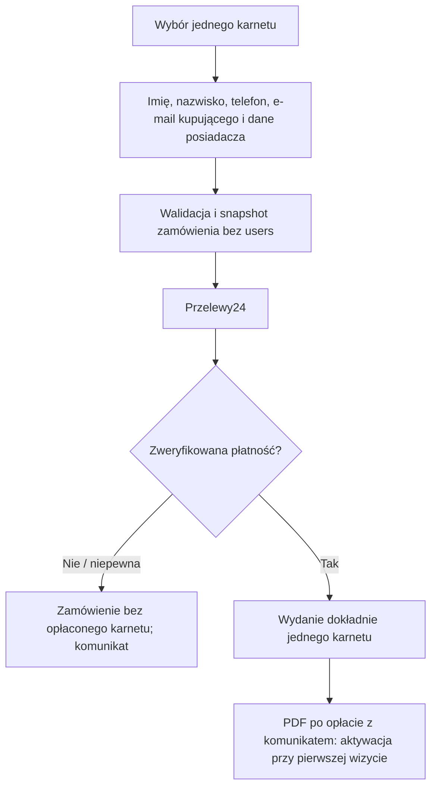
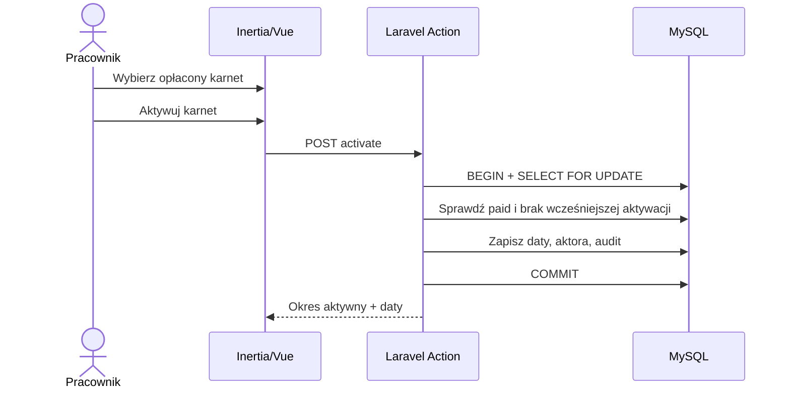
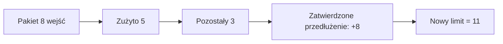
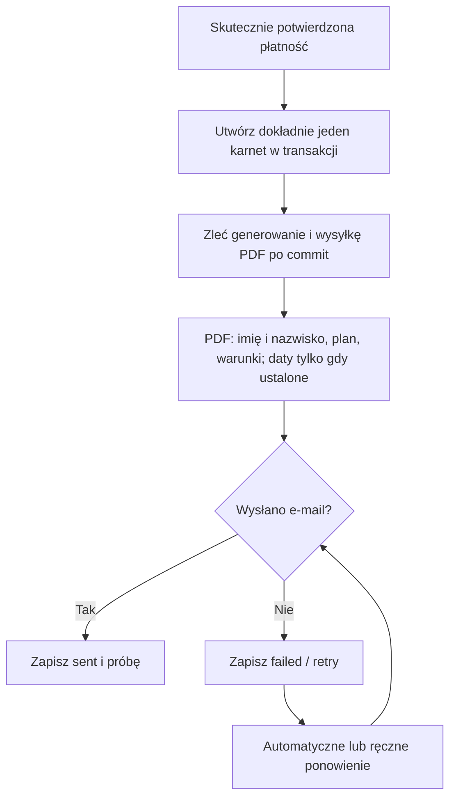

# ActiveFit — Business Flows

> **Wersja:** 1.0 · **Data:** 2026-11-04 · **Status:** DRAFT (projekt przepływów, nie kod)
>
> **Stack:** Laravel + Inertia.js + Vue 3 + TypeScript + MySQL · **Płatności:** Przelewy24 (online), gotówka/karta (recepcja) · **Strefa biznesowa:** `Europe/Warsaw`

## 1. Cel, zakres i źródła prawdy

Dokument opisuje przebieg procesów biznesowych ActiveFit: aktorów, warunki wejściowe, zapis danych, transakcje, reakcje na błędy i testy. Ma umożliwić implementację modułów bez podejmowania przez agenta AI niezatwierdzonych decyzji biznesowych.

**Powiązane dokumenty:**
- `docs/product/requirements.md` — nadrzędne wymagania i statusy `CONFIRMED` / `OPEN`;
- `docs/architecture/overview.md` — granice modułów, bezpieczeństwo, architektura;
- `docs/architecture/database.md` — encje, relacje, indeksy i model transakcyjny;
- `docs/architecture/cms.md` — treści, widoczność, publikacja, media;
- `AGENTS.md` — standardy implementacji i testów.

**Zasada pierwszeństwa:** zatwierdzone wymagania biznesowe mają pierwszeństwo przed proponowaną implementacją. Poniższe nazwy Actions, zdarzeń i statusów to **propozycje techniczne**, chyba że wynikają z `CONFIRMED`. Zmiany schematu bazy wymagają synchronizacji z `database.md`.

### 1.1. Reguły przekrojowe — `CONFIRMED`

1. Jedno zamówienie = **jeden** karnet dla **jednego** posiadacza; kupujący i posiadacz mogą być różnymi osobami.
2. Zakup może być gościnny. Nie zakładamy konta tymczasowego i **nie łączymy** zakupu gościnnego z późniejszym kontem (OD-05).
3. Unikalne e-mail i znormalizowany telefon obowiązują wyłącznie dla kont `users`; osoby z tym samym telefonem mogą mieć różne karnety.
4. Ceny przechowujemy jako integer w groszach; plan i jego warunki są utrwalone w niezmiennym snapshotcie zamówienia/karnetu (`PLN-005`).
5. Karnet kupiony online wydajemy **wyłącznie po skutecznym zweryfikowaniu płatności**. Powtórzony callback nie powoduje ponownego wydania karnetu.
6. Punktem odniesienia dla nowego karnetu jest **data skutecznego potwierdzenia płatności w `Europe/Warsaw`**; na recepcji — data zatwierdzenia odbioru gotówki lub udanej transakcji kartą przez pracownika.
7. `starts_on` i `expires_on` są datami **włącznie**. Reguła miesiąca (OD-01): jeżeli numer dnia rozpoczęcia istnieje w kolejnym miesiącu, `expires_on = odpowiadający dzień - 1 dzień`; gdy nie istnieje, `expires_on = ostatni dzień następnego miesiąca`. Przykłady: 28.09→27.10; 30.04→29.05; 31.01.2027→28.02.2027; 31.01.2028→29.02.2028; 28.02.2027→27.03.2027.
8. Przedłużenie **tego samego obsługiwanego rodzaju** aktywnego karnetu czasowego rozpoczyna się **dzień po końcu bieżącego okresu**, nie w dacie wcześniejszego zakupu.
9. Przy zatwierdzonym przedłużeniu pakietu wejściowego niewykorzystane wejścia są doliczane do nowego pakietu **dokładnie raz**. Przejście po wygaśnięciu i mieszanie typów pozostaje `OPEN`.
10. PDF z karnetem należy się również kupującym z kontem. Dane osobowe na PDF to **wyłącznie imię i nazwisko posiadacza**; dodatkowo nazwa klubu, rodzaj i warunki karnetu, daty, liczba wejść (jeśli dotyczy).
11. Dla każdego opłaconego karnetu PDF wysyłamy po skutecznym potwierdzeniu płatności, także jeśli ważność rozpoczyna się później. Niepowodzenie wysyłki **nie cofa płatności i nie tworzy nowego karnetu**.
12. Każde wejście ma `used_at`, pracownika rejestrującego i nie może przekroczyć dostępnego salda. Historia karnetów, wejść i operacji pozostaje także po wygaśnięciu.
13. Pracownik nie zarządza pracownikami, globalną konfiguracją, cennikiem ani treściami CMS. Zmiany krytyczne wymagają audytu.

### 1.2. Kontrakty danych używane w przepływach

| Encja | Rola |
|---|---|
| `users` | Konta klientów, pracowników i administratorów; brak kont gościnnych |
| `membership_plans` | Jeden katalog i cennik, edytowany w CMS |
| `orders` | Snapshot kupującego/posiadacza, planu, kwoty, kanału, metody i statusu |
| `payments` | Próby opłacenia, potwierdzenie, przyczyny błędów |
| `memberships` | Wydany karnet, daty ważności, właściciel/snapshot, opcjonalny limit |
| `membership_entries` | Rejestr pojedynczych wejść: `used_at`, pracownik, deduplikacja |
| `membership_adjustments` | Przeniesienie salda wejść i przyszłe zatwierdzone korekty |
| `document_deliveries`, `document_delivery_attempts` | Plan PDF, historia prób i ponawianie |
| `audit_logs` | Kto, kiedy i co zmienił w karnetach i konfiguracji sprzedaży |
| `news_posts`, `media_assets`, `gallery_categories`, `gallery_category_media`, `offer_tiles`, `hero_slides`, `regulation_versions`, `club_settings`, `opening_hours`, `class_types`, `class_schedule_slots` | CMS — zgodnie z `cms.md` |

Nie rekonstruujemy posiadacza przez złączenie po telefonie/e-mailu. Snapshoty historyczne nie są aktualizowane przy edycji profilu ani cennika. Płatność, zamówienie, karnet i dostarczenie PDF mają **odrębne stany**.

## 2. Mapa procesów

| ID | Proces | Aktorzy | Wymagania |
|---|---|---|---|
| FLOW-01 | Zakup online z kontem | customer, Przelewy24, system | ORD-001–006, PAY-001–004, MEM-001, PDF/NTF |
| FLOW-02 | Zakup online bez konta | guest, Przelewy24, system | ACC-007–010, ORD-001–006, PAY-001–004 |
| FLOW-03 | Zakup dla innej osoby | purchaser, holder, system | ORD-002–005, PDF-002, OD-07 `OPEN` |
| FLOW-04 | Potwierdzenie płatności i wydanie karnetu | Przelewy24, system | PAY-003–004, PLN-005, MEM-001–003 |
| FLOW-05 | Przedłużenie miesięcznego karnetu | customer/staff, system | MEM-002–003, OD-01, OD-02 |
| FLOW-06 | Przedłużenie pakietu wejściowego | customer/staff, system | MEM-008, OD-02a `OPEN` |
| FLOW-07 | Odnotowanie wejścia | employee/admin, system | E2E-04, MEM-004–006, STF-005 |
| FLOW-08 | Sprzedaż na recepcji | employee/admin, holder | PAY-005–006, STF-004 |
| FLOW-09 | PDF i powiadomienia | queue/scheduler/admin | PDF-001–003, NTF-002–003 |
| FLOW-10 | Wyszukiwanie i historia | employee/admin/customer | STF-001–003, MEM-006, ADM-002 |
| FLOW-11 | Edycja i publikacja aktualności | admin | CMS-003 |
| FLOW-12 | Galeria oraz media | admin | CMS-002 |
| FLOW-13 | Kafelki i karuzela | admin | CMS-006–007 |
| FLOW-14 | Cennik i wyróżnienia | admin | CMS-004, CMS-010, PLN-001, PLN-005 |
| FLOW-15 | Regulamin i wersje | admin | CMS-001, CMS-011 |
| FLOW-16 | Kontakt i grafik zajęć | admin | CMS-005, CMS-008 |
| FLOW-17 | Konta pracowników | admin, employee | ADM-005–008, NTF-001 |
| FLOW-18 | Audit i dashboard | admin, system | ADM-001, ADM-010 |

## 3. Karnety, zamówienia i płatności

### FLOW-01 — Zakup online przez zalogowanego klienta

**Warunki:** konto aktywne, dostępny plan `is_active && is_public`, dane kupującego i posiadacza podane, reguła wydania danego typu karnetu zatwierdzona.

1. Klient wybiera plan i wskazuje „dla siebie” lub „dla innej osoby”.
2. Formularz zbiera dane kupującego, posiadacza i adres wysyłki PDF; backend waliduje je i uprawnienia.
3. Serwer pobiera aktualną cenę/warunki **z bazy** (nie ufa kwocie z przeglądarki) i zapisuje **jedno** `orders` z niezmiennym snapshotem; opcjonalny `purchaser_user_id` wskazuje uwierzytelnionego kupującego.
4. Po zapisie serwer inicjuje próbę `payments` w Przelewy24 i kieruje klienta do operatora.
5. UI pokazuje stan „Oczekiwanie na płatność”; powrót z bramki **nie** aktywuje karnetu.
6. FLOW-04 potwierdza opłacenie i wydaje jeden karnet; FLOW-09 planuje PDF.
7. Panel konta pokazuje powiązane z uprawnionym użytkownikiem karnety, z rozróżnieniem `scheduled`/`active`/`expired`. Zakup dla innego posiadacza nie daje kupującemu automatycznie prawa do jego historii.

**Transakcja:** zapis zamówienia/snapshotu atomowo; potwierdzenie płatności i wydanie osobno, w transakcji FLOW-04. Wywołanie zewnętrznej bramki **poza** transakcją DB.

**Błędy/UI:** walidacja pól; plan ukryty/nieaktywny → brak możliwości zakupu; nieudana inicjacja bramki → zachowany `pending`/stan próby oraz przyjazny komunikat; niepewny wynik → „Sprawdzamy płatność”, bez deklarowania porażki.

**Testy:** poprawny snapshot, brak możliwości podmiany ceny, jeden plan/jeden karnet, autoryzacja historii, brak karnetu przed weryfikacją płatności.

### FLOW-02 — Zakup online bez rejestracji



**Różnica względem FLOW-01:** `purchaser_user_id = NULL`, brak tworzenia konta, brak późniejszego podpinania zakupów do konta nawet przy zbieżnym e-mailu lub numerze telefonu. Dane kontaktowe w zamówieniu nie są unikalne; telefon normalizujemy do E.164.

**Weryfikacja dostępu:** zewnętrzne odnośniki do potwierdzeń muszą być nieodgadywalne, wygasające lub dodatkowo uwierzytelnione; nie udostępniać historii gości wyłącznie po znajomości telefonu. Konkretna metoda dostępu: **PROPOSED**, do `security.md`.

**Testy:** ponowne zakupy z tym samym telefonem/e-mailem, rejestracja późniejszego konta, brak migracji zakupów do konta, dostęp do potwierdzenia tylko przez uprawniony kanał.

### FLOW-03 — Zakup dla innej osoby

1. Kupujący zaznacza „Dla innej osoby”.
2. Formularz pokazuje odrębne dane posiadacza (imię, nazwisko, telefon, e-mail jeżeli potrzebny w danym scenariuszu).
3. System zapisuje **oddzielnie** dane kupującego i posiadacza oraz jeden wskazany `recipient_email`.
4. Płatność należy do kupującego; karnet identyfikuje posiadacza i **nie przechodzi automatycznie na kupującego**.
5. PDF zawiera imię i nazwisko **posiadacza**, nigdy dane kontaktowe. Jeśli okres jeszcze nie został ustalony, zawiera informację o aktywacji podczas pierwszej wizyty zamiast fikcyjnych dat.
6. Kolejny karnet dla innej osoby wymaga **osobnego zamówienia** (D-14).

**Bloker `OD-07`:** reguła wskazania i weryfikacji adresu odbiorcy PDF przy prezencie, identyfikacja posiadacza oraz zakup dla osób niepełnoletnich. Nie kodować nieweryfikowanych automatycznych przypisań do `holder_user_id` ani dowolnej podmiany odbiorcy. Wdrożyć zatwierdzone ścieżki po decyzji.

**Testy:** kupujący ≠ posiadacz, prawidłowy PDF, brak ujawnienia kupującemu prywatnej historii innej osoby, osobne zamówienia.

### FLOW-04 — Zweryfikowana płatność Przelewy24 i wydanie karnetu

```mermaid
sequenceDiagram
  participant P as Przelewy24
  participant W as Laravel callback
  participant V as Payment verification
  participant DB as MySQL
  participant Q as Queue / outbox
  P->>W: Powiadomienie o transakcji
  W->>V: Weryfikacja podpisu i danych
  V->>P: Weryfikacja u operatora zgodnie z API
  P-->>V: Wynik
  alt Niezweryfikowane / kwota niezgodna
    V-->>W: Odrzuć, bez aktywacji
  else Potwierdzone
    V->>DB: BEGIN; lock order
    DB-->>V: Aktualny stan zamówienia
    alt Karnet już wydany
      V->>DB: Bez powtórnego wydania; COMMIT
    else Nie wydano
      V->>DB: Potwierdź payment/order i paid_at
      V->>DB: Utwórz membership (UNIQUE order_id)
      V->>DB: Utwórz zadanie dostarczenia PDF
      V->>DB: Audit / outbox; COMMIT
    end
    DB-->>Q: Zdarzenie po commit / outbox do przetworzenia
  end
```

**Bezpieczeństwo:** weryfikować źródło i podpis wg kontraktu operatora, identyfikatory, kwotę w groszach, walutę `PLN`, zamówienie oraz wynik potwierdzenia po stronie Przelewy24. Nigdy nie ufać parametrom URL powrotnego ani jedynie treści callbacka. Nie przechowywać danych kart. Szczegóły podpisu i API ustala implementacja według aktualnej dokumentacji operatora.

**Atomowość i idempotencja:**
- blokada `SELECT ... FOR UPDATE` na `orders` w transakcji;
- `UNIQUE(memberships.order_id)` w DB;
- stałe `paid_at` = **pierwszy skutecznie zweryfikowany czas potwierdzenia**, a nie czas kolejnych callbacków;
- deduplikacja identyfikatorów transakcji dostawcy zgodnie z jego kontraktem;
- rekord zamówienia, płatności, karnetu, zaplanowanej wysyłki i audytu utrwalany spójnie; kolejka uruchamiana **po commit**, opcjonalnie przez wzorzec outbox;
- nie trzymać transakcji MySQL otwartej podczas żądania do Przelewy24.

**Data aktywacji (ACT-01 CONFIRMED):** potwierdzenie płatności wystawia `pending_activation` z nieustalonymi datami. Dopiero uprawniony pracownik/admin podczas pierwszej wizyty ustawia `starts_on` na bieżący lokalny dzień wizyty (`Europe/Warsaw`), `expires_on` według zatwierdzonej reguły planu, `activated_at` UTC i aktora. Dla przedłużenia aktywnego karnetu ustalamy daty z wyprzedzeniem po zakończeniu poprzedniego okresu.

**Błędy/UI:** fałszywe powiadomienie → brak karnetu, bezpieczny log; powtórny callback → ten sam karnet; awaria DB → bez częściowo wydanego karnetu, bez przedwczesnego sukcesu; niepewny status → ponowna weryfikacja, bez automatycznego „failed”.

**Testy:** poprawny callback, zły podpis/kwota/waluta, replay, dwie równoległe notyfikacje, data przy zmianie dnia i DST w Warszawie, niezależność PDF od płatności.

### FLOW-04A — Aktywacja przy pierwszej wizycie (ACT-01 CONFIRMED)

**Warunki:** zamówienie jest opłacone i zweryfikowane; rekord karnetu istnieje jako `pending_activation`; uprawniony pracownik lub administrator odnalazł właściwego posiadacza. Telefon jest wyłącznie kryterium wyszukiwania, nie dowodem tożsamości.

1. Recepcja wyszukuje numer i wybiera konkretną osobę oraz konkretny nieaktywny karnet.
2. UI pokazuje: „Opłacony · Oczekuje na pierwszą aktywację”, plan, osobę, datę opłacenia oraz przycisk **„Aktywuj karnet”**.
3. Serwer wymaga uprawnień, sprawdza `paid`, blokuje rekord karnetu w transakcji (`FOR UPDATE`) i odrzuca powtórną aktywację.
4. Wylicza dzień startu w `Europe/Warsaw`, następnie koniec zgodnie z planem, zapisuje `starts_on`, `expires_on`, `activated_at` (UTC) i `activated_by_user_id`.
5. W tej samej transakcji zapisuje audit (aktor, czas, stare/nowe wartości). UI prezentuje potwierdzony okres i status aktywny.
6. Jeśli to wejściówka, oznaczenie wykorzystania wejścia to osobna autoryzowana akcja zapisująca `used_at` i pracownika. Aktywacja sama nie zużywa wejścia.
7. Wcześniej wysłany PDF pozostaje ważnym potwierdzeniem zakupu i może wskazywać „Oczekuje na aktywację”; system **nie wysyła automatycznie drugiego PDF**.



**Testy:** brak płatności → 422/409; rola customer → 403; dwukrotne kliknięcie → jeden niezmienny okres; konkurencyjne aktywacje → jedna operacja; przełom dnia i DST; przypisanie właściwego posiadacza; brak automatycznego zużycia wejścia.


### FLOW-05 — Przedłużenie miesięcznego karnetu

**Warunek:** ten sam posiadacz i typ karnetu, dla którego reguła przedłużania jest zatwierdzona. **Nie** utożsamiać posiadaczy wyłącznie przez wspólny numer telefonu; używać zweryfikowanego odniesienia do karnetu/posiadacza.

1. System odnajduje aktualny karnet i sprawdza zakres ważności oraz prawo do przedłużenia.
2. Klient opłaca **nowe**, osobne zamówienie i karnet; stary rekord pozostaje w historii.
3. Nowy `starts_on = previous.expires_on + 1 day` (nawet jeśli płatność była wcześniej).
4. `expires_on` obliczamy na podstawie **nowego** `starts_on` zgodnie z OD-01; oba końce przedziału są włącznie.
5. Zapisujemy relację `renewed_from_id` oraz snapshot nowej oferty; nie zmieniamy historycznych warunków.
6. W UI: „Karnet przedłużony. Nowy okres rozpocznie się [data]. PDF z datami ważności wyślemy po potwierdzeniu płatności”.
7. FLOW-09 zleca PDF po potwierdzeniu płatności. Karnet z przyszłą datą może mieć status `scheduled`, ale PDF jest już wysyłany.

**Przykład:** już aktywny karnet do 14.11, płatność przedłużenia 05.11 → nowy start 15.11 → według OD-01 koniec 14.12. Nie wymaga drugiej aktywacji recepcyjnej.

**Testy:** wcześniejszy zakup nie skraca okresu; dwa szybkie przedłużenia nie nakładają się (blokady/serializacja łańcucha); granice 28/29/30/31; PDF wychodzi po płatności, także przed przyszłą datą startu.

### FLOW-06 — Przedłużenie pakietu z limitem wejść

**Potwierdzone:** wejścia niewykorzystane w zatwierdzonym przedłużeniu doliczamy do nowego limitu, bez podwójnego przeniesienia.



**Proponowany bezpieczny kontrakt:** w jednej transakcji z blokadą źródła i celu: odczytaj dostępne saldo; utwórz/uzupełnij nowy karnet; zapisz `membership_adjustments(kind=rollover, source_membership_id, delta_entries, idempotency_key)`; oznacz przeniesioną część jako niedostępną w źródle, aby nie dało się jej zużyć w obu pakietach. Unikalny klucz zapobiega podwójnemu rollover; operacja ma audit. Nie dopuszczać ujemnych sald.

**`OPEN` — nie wolno zgadywać:** czy wejścia przechodzą po wygaśnięciu, co dzieje się przy zmianie pakietu na karnet czasowy, jak traktować dwie równoległe pule jednej osoby oraz dokładne zasady rozpoczęcia pakietu wejściowego po wyczerpaniu starego. Dla tych ścieżek zwracać stan wymagający decyzji biznesowej, a nie automatycznie sumować wszystko po telefonie.

**Testy:** 3+8=11, dwa callbacki => tylko jeden rollover, wejście równoległe do przeniesienia => brak podwójnego użycia, brak przeniesienia nieuprawnionego pakietu.

### FLOW-07 — Odnotowanie wejścia przez pracownika

1. Pracownik wyszukuje numer (po normalizacji). Wyniki prezentują **odrębnych posiadaczy i konkretne karnety**, aby uniknąć pomyłek rodzinnych.
2. Wybiera właściwy aktywny pakiet wejściowy; widzi `entries_remaining` oraz datę ważności.
3. Klika „Odnotuj wejście”. Frontend wysyła unikalne `request_id` dla operacji (zabezpieczenie retry/dwukliku).
4. Backend ponownie sprawdza rolę, status, zakres dat i saldo. W transakcji blokuje wiersz karnetu.
5. Gdy `entries_remaining > 0`, atomowo zmniejsza saldo, zapisuje `membership_entries` (`recorded_by_user_id`, `used_at` w UTC, `request_id`) i wpis do audytu.
6. UI pokazuje nowy stan oraz datę/godzinę wejścia w `Europe/Warsaw`. Po wyczerpaniu limitu akcja jest nieaktywna i backend odrzuca kolejne próby.

**Niezmienniki:** nie zapisujemy wejścia dla karnetu nieaktywnego/wygasłego/anulowanego; saldo nigdy <0; jeden `request_id` = co najwyżej jedno użycie; dwie równoległe próby o **różnych** identyfikatorach przy ostatnim wejściu → dokładnie jedna może się powieść. Nie edytować/usunąć zdarzenia bez osobno zatwierdzonej korekty.

**Testy:** E2E-04, concurrency, retry, końcowy limit, uprawnienia, strefa czasu, historia po wygaśnięciu.

### FLOW-08 — Sprzedaż karnetu na recepcji

1. Pracownik wybiera posiadacza lub wprowadza dane gościa bez zakładania konta; rozróżnia posiadacza od kupującego.
2. Wybiera aktywny plan; serwer pobiera cenę i utrwala snapshot.
3. Wybiera `cash` albo `card` — żadnych innych metod w MVP dla recepcji.
4. **Po faktycznym** przyjęciu gotówki albo informacji o udanej płatności kartą pracownik potwierdza transakcję.
5. Jedna operacja serwerowa zapisuje `orders` (`sales_channel=reception`), potwierdzoną `payments`, `paid_at`, wydany `memberships` i audit z `created_by_user_id` / `confirmed_by_user_id`.
6. Datą referencyjną jest **dzień potwierdzenia** w `Europe/Warsaw`, z wyjątkiem odroczonego przedłużenia.
7. PDF jest obowiązkowy także dla sprzedaży na recepcji; FLOW-09 wysyła go po potwierdzeniu płatności, nawet gdy okres ważności jeszcze się nie rozpoczął.

**Ważne:** personel nie powinien „potwierdzać” karty przed sukcesem terminala; system nie jest integracją terminala. Należy oddzielić przygotowanie sprzedaży od potwierdzenia zapłaty. Deduplikacja operacji przez idempotency key; przy błędzie zapisu nie ukrywać faktu zewnętrznej wpłaty — obsługa operacyjna/reconciliation zamiast ponownego pobrania pieniędzy.

**Testy:** cash/card, pracownik bez prawa edycji planu, płatność niepotwierdzona nie wydaje karnetu, identyfikacja operatora, ponowione żądanie nie dubluje sprzedaży.

## 4. PDF i powiadomienia

### FLOW-09 — Generowanie, planowanie i wysyłka PDF

**CONFIRMED 2026-11-04:** PDF jest obowiązkowy dla klienta z kontem i bez konta, zakupów dla innych osób, przedłużeń oraz sprzedaży na recepcji. Wysyłka następuje po skutecznym potwierdzeniu płatności — **nie czeka na początek okresu ważności**.



- PDF nie zawiera telefonu ani e-maila. Podany odbiorca e-maila jest osobnym polem zamówienia.
- W przypadku przedłużenia PDF pokazuje przyszłą datę początku ważności i jest wysyłany natychmiast po opłacie.
- Idempotentny rekord `document_deliveries` jest tworzony po wydaniu karnetu; wysyłka przebiega z kolejki po commit.
- Nieudane próby są rejestrowane. Ponowienie nie zmienia płatności, nie tworzy drugiego karnetu.
- Plik jest przechowywany prywatnie; zasady retencji pozostają do ustalenia.
- Exactly-once delivery przez SMTP nie może być zagwarantowane, dlatego deduplikujemy zadania i rejestrujemy próby.

**Testy:** zakup z kontem i bez, przyszłe przedłużenie, niepowodzenie SMTP, retry, deduplikacja i brak telefonu/e-maila w PDF.

## 5. Wyszukiwanie, historia i tożsamość

### FLOW-10 — Wyszukiwanie posiadacza i historia

- Pracownik podaje telefon → backend normalizuje go i znajduje **pasujące rekordy posiadaczy**, nie scala osoby przez telefon.
- Wyniki pokazują imię, nazwisko, konkretny typ karnetu, daty i status, aby rozróżnić kilku członków rodziny o jednym numerze.
- Po wybraniu karnetu pracownik widzi historię zakupów, wejść i istotnych operacji, także wygasłych; administrator zgodnie z rozszerzonymi uprawnieniami.
- Zarejestrowany klient widzi wyłącznie karnety, do których ma udowodnione uprawnienie; **nie** widzi gościnnych zamówień z podobnym telefonem czy e-mailem.
- Nie autoryzować dostępu do historii tylko poprzez `holder_phone` / `purchaser_email` lub publiczny ULID. Ograniczyć eksporty i logowanie danych osobowych.

**Testy:** wspólny numer, osoba bez konta, wygasłe karnety, brak account merging, izolacja dostępu klienta, brak możliwości wyszukiwania przez niezalogowanego.

## 6. Przepływy CMS

### Wspólne zasady publikacji

- Wyłącznie `admin` może tworzyć, zmieniać, ukrywać lub publikować treści i ceny. `employee` otrzymuje HTTP 403 nawet przy ręcznie wysłanym żądaniu.
- Formularze Inertia/Vue pokazują błędy walidacji i stan zapisu; właściwa walidacja odbywa się w Laravel Form Requests / Policies.
- Zmiany zapisujemy transakcyjnie tam, gdzie obejmują kilka rekordów lub wymagają audytu. Przydatne indeksy i definicje tabel opisuje `cms.md` / `database.md`.
- Strona publiczna pokazuje wyłącznie treści opublikowane i niewygasłe (jeżeli obowiązuje `published_at`). Nie wystarczy ukryć wpisu z listy — publiczny szczegół też musi respektować stan publikacji.
- Media walidujemy po zawartości/typie/rozmiarze; dostęp i usuwanie wymagają sprawdzenia referencji. Nie renderujemy nieoczyszczonego HTML administratora bez strategii sanitizacji.

### FLOW-11 — Aktualności: szkic → publikacja → ukrycie

1. Administrator tworzy wpis (`title`, `body`, opcjonalny `excerpt`, zdjęcie i data publikacji).
2. Walidacja + zapis szkicu do `news_posts` (`is_published=false`) bez widoczności publicznej.
3. Administrator publikuje; serwer waliduje unikalny `slug`, kompletność treści i stan mediów, zapisuje `published_at`/status.
4. Publiczny listing i szczegół pokazują wpis dopiero gdy jest opublikowany oraz nadeszła data publikacji.
5. Ukrycie wyłącza publiczny widok, bez usuwania artykułu i jego historii operacyjnej.

**Błędy/testy:** konflikt slug, edycja w dwóch kartach (PROPOSED: optimistic locking lub sygnalizacja konfliktu), niepoprawne zdjęcie, niewidoczny szkic pod bezpośrednim URL, zabezpieczenie XSS.

### FLOW-12 — Galeria i pojedyncze przypisanie mediów

1. Admin tworzy kategorię z **nazwą i krótkim opisem**, publikuje ją lub ukrywa.
2. Upload zdjęć tworzy `media_assets`; przypisanie do kategorii i `sort_order` zapisuje `gallery_category_media`.
3. Zdjęcia galerii **nie mają** własnego opisu redakcyjnego; opcjonalny `alt_text` jest technicznym tekstem alternatywnym do dostępności.
4. Admin zmienia kolejność, odpina zdjęcia, ukrywa kategorię. Usunięcie pliku z dysku nie może zniszczyć obrazu używanego w karuzeli, newsach, regulaminie itp.

**CONFIRMED (CMS-OD-01 i 05):** zdjęcie należy do jednej kategorii i nie jest współdzielone między modułami; usuwamy rekord oraz po commit plik (z retry błędu storage).

### FLOW-13 — Kafelki ofertowe i karuzela

1. Admin tworzy kafelek: nazwa/tytuł, krótki opis, zdjęcie, widoczność, kolejność (`offer_tiles`).
2. Admin tworzy slajd: zdjęcie i opis, widoczność, kolejność (`hero_slides`).
3. Serwer waliduje relacje z `media_assets` i kolejność sortowania; publiczny frontend pokazuje tylko opublikowane elementy we wskazanej kolejności.
4. Przycisk/CTA o stałej treści pozostaje po stronie widoku — nie dokładamy edycji niezatwierdzonych pól.

**Testy:** kolejność po ponownym zapisie, brak ujawniania ukrytych kafelków, poprawność zdjęć, mobile, odporność na brak zdjęcia/elementów.

### FLOW-14 — Cennik CMS ↔ sprzedaż karnetów

```mermaid
sequenceDiagram
  participant A as Administrator
  participant C as CMS / Laravel
  participant DB as membership_plans
  participant S as Checkout
  A->>C: Zmień cenę, opis, widoczność, wyróżnienie
  C->>DB: Walidacja; zapis i audit w transakcji
  DB-->>C: Aktualny plan
  S->>DB: Pobierz aktualną ofertę
  DB-->>S: Cena i warunki planu
  S->>S: Snapshot do nowego zamówienia
  Note over S,DB: Historyczne zamówienia i karnety pozostają bez zmian
```

1. Admin edytuje `membership_plans`: nazwę, cenę (`price_grosz`), opis, warunki, `is_public`/`is_active`, flagę wyróżnienia.
2. Backend sprawdza spójność planu oraz **maksymalnie 3 wyróżnione pozycje** (transakcja + serializacja zmian, aby dwie równoległe edycje nie utworzyły czwartej).
3. Zapis nowej ceny/warunków wraz z `audit_logs` (`actor`, `old_values`, `new_values`, czas) w jednej transakcji.
4. Nowy checkout pobiera ofertę serwerowo i tworzy snapshot. Już utworzone zamówienie i wydany karnet zachowują wcześniejszą cenę/warunki.
5. Ukrycie planu uniemożliwia nowy **publiczny** zakup; nie unieważnia już opłaconych karnetów.

**Do synchronizacji w schemacie:** jeśli `membership_plans` z `database.md` nie ma pola wyróżnienia, dodać je **do istniejącej tabeli**, bez tworzenia osobnego cennika. Wybrać transakcyjny mechanizm egzekwowania limitu.

**Testy:** PLN-005, 4. wyróżnienie odrzucone także przy współbieżności, ukryty plan niedostępny w checkout, historia niezmieniona, audyt zmiany ceny.

### FLOW-15 — Regulamin: edycja, publikacja, historia wersji

1. Admin edytuje **jeden logiczny regulamin**, tekst i opcjonalne zdjęcie.
2. Zapis jako szkic / publikacja według zatwierdzonego mechanizmu statusów; **publikacja** tworzy nowy `regulation_versions` z kolejnym `version_number`, zamiast nadpisać starą treść.
3. Publiczna strona pokazuje najnowszą opublikowaną wersję; wcześniejsze wersje są dostępne w historii administratora.
4. Numeracja wersji i zapis publikacji pod transakcyjną blokadą / odpowiednim ograniczeniem unikalnym.
5. Powiązanie zamówienia z zaakceptowaną wersją (`orders.accepted_regulation_version_id`) jest **PROPOSED** — nie oznaczać akceptacji bez faktycznie zatwierdzonej interakcji klienta.

**CONFIRMED (OD-10, CMS-OD-03):** zakup online wymaga checkboxa akceptacji konkretnej opublikowanej wersji regulaminu. Zamówienie zapisuje FK wersji i czas akceptacji; marketing oddzielnie.

**Testy:** nowa publikacja nie zmienia starej, jedyna bieżąca wersja, bezpieczeństwo zdjęć/HTML, pracownik HTTP 403.

### FLOW-16 — Kontakt i grafik zajęć

- **Kontakt:** admin edytuje dane klubu, adres/lokalizację, telefon, e-mail oraz godziny otwarcia (`club_settings` + proponowane `opening_hours`); serwer waliduje formaty i bezpieczne linki; strona publiczna pokazuje ostatnią opublikowaną konfigurację.
- **Grafik:** admin edytuje `class_types` i `class_schedule_slots`; walidacja `ends_at > starts_at`, dnia tygodnia, powiązania typu zajęć i widoczności; publiczna tabela pobiera tylko pozycje widoczne.
- **CONFIRMED (CMS-OD-02):** jeden przedział godzin w dniu, bez wyjątków świątecznych w MVP.
- **Testy:** poprawność godzin i kolejności, brak nieopublikowanych zajęć, bezpieczeństwo danych kontaktowych, 403 pracownika.

## 7. Operacje administracyjne i audyt

### FLOW-17 — Tworzenie / edycja / zawieszanie pracownika

1. Admin wprowadza imię, nazwisko, unikalny e-mail, unikalny telefon i rolę.
2. Backend sprawdza `admin` + walidację i unikalność na poziomie bazy; tworzy konto w stanie zaproszonym/bez aktywnego hasła zgodnie z bezpiecznym flow uwierzytelniania.
3. Po zatwierdzeniu zapisu wysyłamy e-mail z **bezpiecznym, jednorazowym i wygasającym linkiem ustawienia hasła**, bez hasła jawnym tekstem.
4. Administrator może edytować dane/rolę i zawiesić konto (`suspended_at`).
5. Zawieszenie blokuje **każde następne chronione żądanie**, również z istniejącej sesji. Operacje administracyjne trafiają do audytu.

**Testy:** kolizje e-mail/telefon, nieważny token zaproszenia, ponowna wysyłka zaproszenia, blokada starej sesji, brak dostępu employee do tego modułu (403).

### FLOW-18 — Audit i dashboard administratora

**Audit (`MUST`):** każda krytyczna operacja na karnetach i konfiguracji sprzedaży zapisuje `actor` (lub `system`), czas UTC, obiekt, akcję, bezpieczne `old_values` i `new_values`. Zmiana i audit w tej samej transakcji. Nie zapisujemy haseł, tokenów ani danych kart. Nie pozwalamy pracownikowi usuwać/edytować audytu. Należy wyraźnie odróżniać **historię wejść** od technicznego **audytu zmian**.

**Dashboard (`SHOULD`, zatwierdzony zakres):** liczba aktywnych karnetów, wygasające w 7 dni, liczba klientów, sprzedaż w wybranym okresie, najnowsze zamówienia. Dane wyłącznie dla administratora; wyliczenia powinny opierać się o daty/statusy, a przychodów nie liczyć z `pending` ani podwójnych prób płatności.

**Testy:** kompletność wpisów audytu, brak sekretów w logach, wygaśnięcie nie usuwa historii, izolacja ról, poprawność agregatów i brak podwójnego liczenia prób płatności.

## 8. Stany i reguły przejść

| Obiekt | Stany / interpretacja | Reguła |
|---|---|---|
| Zamówienie | `pending`, `paid`, `failed`, `cancelled` (proponowane) | Płatność nie jest tożsama z aktywnością karnetu; zwroty i anulowania `OPEN` |
| Próba płatności | `initiated`, `pending`, `confirmed`, `failed`, `cancelled`, `unknown` (proponowane) | `unknown` ≠ `failed`; nowe próby nie tworzą nowych zamówień, jeśli można bezpiecznie kontynuować oryginalne |
| Karnet | `scheduled`, `active`, `expired`, `exhausted` (wyliczane) | `scheduled` może być już opłacony; stan zależy od dat i salda; anulowanie `OPEN` |
| Dostarczenie PDF | `pending`, `processing`, `sent`, `failed` (proponowane) | `failed` nie zmienia stanu karnetu/płatności |
| Wpis CMS | szkic, widoczny / ukryty, zaplanowana publikacja gdy obsługiwana | Publiczna widoczność walidowana w zapytaniach backendu |

**Niedozwolone skróty:** `payment=paid ⇒ membership=active` (przedłużenie może być zaplanowane); `return_url=success ⇒ paid`; `email=failed ⇒ new membership`; `phone match ⇒ same person`.

## 9. Transakcje, spójność, błędy i observability

| Operacja | Granica transakcji / blokada | Idempotencja / reakcja na błąd |
|---|---|---|
| Nowe zamówienie | Atomowy insert + snapshot | Klucz operacji checkout dla retry (PROPOSED) |
| Potwierdzenie online | Blokada `orders` + spójny payment/membership/delivery/audit | `UNIQUE(memberships.order_id)` + identyfikatory operatora |
| Przedłużenie | Serializacja łańcucha karnetów danego zweryfikowanego posiadacza | Brak nakładających się okresów w obsługiwanym wariancie |
| Przeniesienie wejść | Blokada źródła/celu + adjustment | Unikalny `idempotency_key`, saldo źródła po przeniesieniu niedostępne |
| Odnotowanie wejścia | Blokada rekordu `memberships` + wpis `membership_entries` | `UNIQUE(request_id)`, saldo >=0 |
| Wysłanie PDF | Claim zadania / status dostarczenia; mail poza transakcją | Retriable, log prób, manual resend, bez nowych płatności |
| Zmiana cennika | Blokada operacji wyróżnień + zapis + audit | Limit 3 także dla równoczesnych zmian |
| Publikacja regulaminu | Transakcja + unikalny numer wersji | Nie modyfikować poprzednich wersji |
| Konto pracownika | Konto + audit atomowo; zaproszenie po commit | Bezpieczne ponowienie maila, bez resetu stanu konta |

**Zasady operacyjne:** loguj `correlation_id`, ID zamówienia/płatności/karnetu (bez pełnych danych osobowych i sekretów), wyniki weryfikacji, próbę zadania. Ustaw retry/backoff dla jobów i alert dla nieprzetworzonych potwierdzeń/nieudanych dostarczeń. Scheduler/queue i weryfikacja statusów wymagają monitoringu. Nie wywołuj zewnętrznych API, SMTP ani generatora PDF wewnątrz długiej transakcji DB.

## 10. Macierz testów i śledzenie

| Test ID | Przepływy | Co weryfikuje | Typ |
|---|---|---|---|
| BF-T01 | FLOW-01/02 | Konto/gość, snapshot, kwota z backendu, osobne zamówienie | Pest Feature |
| BF-T02 | FLOW-03 | Kupujący ≠ posiadacz; brak nieuprawnionego dostępu; odbiorca wg zatwierdzonych reguł | Feature + E2E po OD-07 |
| BF-T03 | FLOW-04 | Zły podpis/kwota, poprawny callback, replay, concurrency | Integration + Feature |
| BF-T04 | FLOW-05 | Granice 28/29/30/31, przedłużenie od następnego dnia | Unit + Feature |
| BF-T05 | FLOW-06 | 3+8=11, dokładnie jeden rollover, konflikt ze zużyciem | Unit + Integration po zamknięciu OPEN |
| BF-T06 | FLOW-07 | E2E-04, `used_at`, pracownik, ostatnie wejście, retry i race | Feature + E2E |
| BF-T07 | FLOW-08 | Cash/card, data potwierdzenia, operacja personelu | Feature |
| BF-T08 | FLOW-09 | PDF konto/gość, wysyłka po opłacie także przed startem ważności, retry, brak danych kontaktowych w PDF | Feature + Queue tests |
| BF-T09 | FLOW-10 | Wspólny telefon, osobne osoby, wygasłe karnety, brak łączenia | Feature |
| BF-T10 | FLOW-11–13 | Draft, publikacja, kolejność, zdjęcia i brak opisów galerii | Feature + Vue/E2E |
| BF-T11 | FLOW-14 | Limit 3, niezmienny snapshot, równoległe edycje, audit | Feature + Integration |
| BF-T12 | FLOW-15 | Wersjonowanie, 1 bieżący regulamin, brak fikcyjnej zgody | Feature |
| BF-T13 | FLOW-16 | Walidacja danych i dostępność publiczna | Feature |
| BF-T14 | FLOW-17 | Unikalność użytkownika, zaproszenie, zawieszenie, 403 | Feature |
| BF-T15 | FLOW-18 | Audit old/new bez sekretów, KPI bez dubli | Feature + Integration |

Testy współbieżności wymagają prawdziwego MySQL/InnoDB i transakcji, nie wyłącznie in-memory SQLite. Testowanie Przelewy24 powinno korzystać z testowego środowiska operatora i lokalnych fixture'ów callbacków. Nie wykonywać rzeczywistych płatności w automatycznych testach.

## 11. Decyzje otwarte — blokery konkretnych ścieżek

| ID | Temat | Skutek dla przepływów |
|---|---|---|
| OD-02a | Przedłużenie różnych planów i kilka niezależnych pakietów jednego posiadacza | FLOW-05/06: tylko zatwierdzone warianty, bez automatycznego łączenia |
| OD-02 | Przenoszenie wejść **po zakończeniu** ważności starego pakietu | FLOW-06: nie implementować bez zgody |
| OD-04 | Zwroty, anulowanie, korekta ręczna, cofnięcie wejścia | FLOW-04/07/08: struktura gotowa, działania wyłączone do czasu decyzji |
| OD-07 | Zakupy dla niepełnoletnich, weryfikacja tożsamości posiadacza, uprawniony odbiorca PDF | FLOW-03/09: zablokować nieustalone warianty |
| OD-10 / CMS-OD-03 | CONFIRMED: akceptacja wersji i czas zapisane przy zamówieniu online | FLOW-15 / checkout: testować brak akceptacji i historyczną wersję |
| OD-11 | Retencja PDF, dostęp do dokumentów i kasowanie danych | FLOW-09: dopracować przed produkcją |
| CMS-OD-01/02/04/05 | CONFIRMED: pojedynczy właściciel pliku, jeden zakres godzin, oczyszczony HTML, usunięcie pliku po commit | FLOW-11/12/16: testować ograniczenia |
| OD-09 | Zakres eksportów i raportowania | FLOW-18: poza podstawowym dashboardem |

**Reguła dla agenta:** nie zamieniać `OPEN` w ukryte założenie. Jeżeli zadanie wymaga decyzji, implementować tylko niezależną, bezpieczną część i odnotować bloker w PR.

## 12. Definition of Done i kolejny krok AI SDLC

Przepływ jest gotowy do implementacji, gdy: (1) ma mapowanie do wymagań; (2) decyzje dotyczące danej ścieżki są zamknięte; (3) schemat i indeksy obsługują wymagane niezmienniki; (4) autoryzacja jest po stronie backendu; (5) operacje wieloetapowe są atomowe lub mają strategię retry/kompensacji; (6) testuje się przypadki błędne i współbieżność; (7) frontend ma czytelne stany; (8) audit i prywatność zostały zweryfikowane; (9) kod przeszedł review; (10) dokumentacja `requirements.md` / `database.md` / `cms.md` jest spójna.

**Następne dokumenty:** `docs/architecture/security.md`, `docs/architecture/frontend.md`, następnie `docs/development/testing-strategy.md` i `implementation-plan.md`.

## 13. Confirmed flow amendments (2026-11-04)

### FLOW-19 — Własny profil (customer / employee / admin)

Zalogowany użytkownik edytuje tylko własne imię/nazwisko/telefon/e-mail; nowe dane muszą przejść walidację, normalizację i unikalność w `users`. Nowy e-mail przechodzi weryfikację. Zmiana hasła wymaga obecnego hasła lub bezpiecznego resetu. Nie można zmienić roli ani zawieszenia konta przez profil. Snapshoty historycznych zamówień pozostają nietknięte. Testy: 403 lub odmowa modyfikacji cudzego profilu, konflikt telefonu, email verification, brak zmian historii.

### FLOW-20 — Seeder pierwszego administratora

Idempotentny `AdminUserSeeder` tworzy początkowego administratora wyłącznie z konfiguracji środowiska; kolizja adresu z istniejącym kontem nie podnosi jego roli. Powtórne uruchomienie nie nadpisuje hasła. Nigdy nie commitować sekretów. Testy: pierwszy start, ponowienie, kolizja.

### FLOW-21 — Akceptacja regulaminu podczas zakupu online

Przed wysłaniem zamówienia klient zaznacza obowiązkową akceptację opublikowanej wersji regulaminu. Backend weryfikuje flagę i zapisuje `accepted_regulation_version_id`, `regulation_accepted_at` z zamówieniem. Nowa publikacja nie modyfikuje historycznego FK. Marketingowa zgoda jest osobna.

### FLOW-22 — Usuwanie mediów

Jedno zdjęcie ma jednego właściciela w CMS. Usunięcie wpisu/kategorii/slajdu/obrazu usuwa przypisanie/rekord; plik dyskowy usuwamy po commit (kolejka / bezpieczny retry). Błąd storage jest rejestrowany, nie usuwa przypadkowo innego zdjęcia. Bez współdzielenia assetów.

### ACT-01 — Aktywacja przy pierwszej wizycie (CONFIRMED 2026-11-05)

Pełny opis znajduje się w FLOW-04A i zaakceptowanym ADR-001. Dotyczy pierwszego uruchomienia okresu opłaconego nowego karnetu (online i recepcja). Przedłużenie aktywnego okresu pozostaje datowane automatycznie od dnia po wygaśnięciu poprzedniego. Zakup kolejnego pakietu przed pierwszą aktywacją obecnego pozostaje OPEN.
