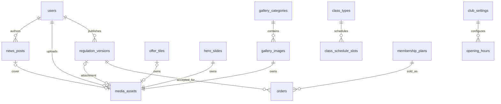

# ActiveFit — CMS Architecture

**Wersja:** 1.1 (DRAFT do przeglądu)  
**Data:** 2026-11-04  
**Ścieżka:** `docs/architecture/cms.md`  
**Stack:** Laravel + Inertia.js + Vue 3 + TypeScript + Tailwind CSS + MySQL

## 1. Cel, zakres i źródła prawdy

CMS obsługuje treści strony publicznej, bez uniwersalnego page buildera. Istniejące widoki HTML są referencją UX/UI; implementacja następuje w Vue przez Inertia. Dokument uszczegóławia moduł CMS z `docs/product/requirements.md`, `docs/architecture/overview.md` oraz rozdział 6 `docs/architecture/database.md`. W przypadku rozbieżności decyzje biznesowe zatwierdzone później mają pierwszeństwo, a sprzeczność należy rozwiązać w dokumentacji przed kodowaniem.

**Zatwierdzone:** CMS-001–009, CMS-011 (potwierdzony w rozmowie), PLN-005 (snapshot warunków karnetu), limit maksymalnie 3 wyróżnionych pozycji cennika, jeden regulamin z historią wersji, galeria kategorii (nazwa + krótki opis), bez opisów pojedynczych zdjęć. **Założenia projektowe poniżej oznaczone `PROPOSED`** wymagają przeglądu podczas przygotowania migracji.

## 2. Mapa funkcjonalna

| Moduł | Panel administratora | Publiczna prezentacja | Reguła |
|---|---|---|---|
| Kafelki ofertowe | CRUD, zdjęcie, opis, kolejność, widoczność | Sekcje oferty | Tytuł i krótki opis; brak edycji dowolnego layoutu |
| Karuzela | CRUD slajdów, zdjęcie, opis, kolejność, widoczność | Strona główna | Obraz + opis; kolejność jawna |
| Aktualności | CRUD, obraz, publikacja/ukrycie, data | Lista i szczegóły | Niepublikowane niedostępne publicznie |
| Galeria | Kategorie, zdjęcia, kolejność, widoczność | Galerie wg kategorii | Kategoria ma nazwę i krótki opis; zdjęcie bez tytułu/opisu redakcyjnego |
| Cennik | Edycja planów i flag wyróżnienia | Cennik i max 3 wyróżnione plany | Jedno źródło: `membership_plans` |
| Regulamin | Edycja jednego dokumentu, publikacja, historia wersji, obraz | Aktualna opublikowana wersja | Opublikowane wersje niezmienne |
| Kontakt i klub | Kontakty, lokalizacja, godziny | Kontakt/stopka | Jeden zestaw danych klubu (MVP) |
| Grafik | Rodzaje zajęć i tygodniowe terminy | Harmonogram | Bez rezerwacji miejsc |
| Treści stałe | Brak formularza dla treści nieedytowalnych | Gotowe komponenty | Nie dodawać pól bez wymagania |

## 3. Granice odpowiedzialności

- `Cms`: aktualności, kafelki, karuzela, galeria, regulamin, ustawienia klubu i grafik.
- `Memberships`: plany i definicje ofert sprzedażowych (`membership_plans`); CMS jedynie udostępnia administratorowi interfejs edycji tych danych.
- `Orders` / `Payments`: historia zamówień, płatności, snapshoty warunków; **nie należą do CMS**.
- `Media`: wspólna, bezpieczna obsługa obrazów i referencji do plików; brak duplikowania uploadów między modułami.
- `Audit`: rejestr krytycznych zmian cen, konfiguracji sprzedaży i operacji na karnetach; wersje regulaminu są dodatkową, osobną historią treści.

Proponowana organizacja kodu (bez dodatkowego frameworka modułowego): `app/Http/Controllers/Admin/Cms`, `app/Http/Requests/Admin/Cms`, `app/Actions/Cms`, `app/Models`; Vue: `resources/js/pages/admin/Cms` oraz `resources/js/components/cms`. Nazwy i ścieżki można dostosować do startera, zachowując odpowiedzialności.

## 4. Model danych — definicje projektowe

**Stan implementacji — TASK-011 (2026-11-16):** dodano migrację i modele podstawy odczytu opisanych poniżej tabel. Publiczne DTO kontrolują publikację i nie ujawniają pól edytorskich, storage path/disk ani identyfikatorów autorów. Panel zapisu, bezpieczny rich text i jego publikacja są kolejnymi zadaniami. Na razie body aktualności/regulaminu jest prezentowane jako escapowany zwykły tekst; nie używamy `v-html` dla niesanitowanych danych. Publiczny odczyt zdjęć wymaga opublikowanego powiązania oraz poprawnego lokalnego pliku `cms/…` i MIME JPEG/PNG/WebP/AVIF. Schema ma unikalne referencje mediów w poszczególnych modułach i restrykcyjne FK; globalne egzekwowanie jednej lokalizacji, upload oraz cleanup po commit pozostają TASK-012, przed udostępnieniem interfejsów zapisu. `path` ma faktycznie 500 znaków (zamiast proponowanych 1024), aby wspólny unikalny indeks `(disk,path)` mieścił się w limicie InnoDB/utf8mb4. Nie zainicjalizowano rekordów klubu ani treści poglądowych; podane w makietach kontakty właścicielka oznaczyła jako nieaktualne. `membership_plans` pozostaje osobną domeną do TASK-019/020; nie ma tabeli `prices` ani kopii cen z HTML.

**Konwencje:** PK `BIGINT UNSIGNED`, FK zgodne typem, `created_at`/`updated_at` jako daty techniczne, `sort_order` jako `INT UNSIGNED`, status publikacji jako `BOOLEAN` i ewentualne `published_at` (`DATETIME`), identyfikatory mediów przez FK. Tabele to propozycja techniczna, spójna z `database.md`.

### 4.1 `media_assets`

| Kolumna | Typ / ograniczenie | Znaczenie |
|---|---|---|
| `id` | BIGINT PK | Identyfikator |
| `disk` | VARCHAR(50) NOT NULL | Dysk storage |
| `path` | VARCHAR(500) NOT NULL | Wewnętrzna ścieżka pliku |
| `mime_type` | VARCHAR(100) NOT NULL | Typ po weryfikacji |
| `size_bytes` | BIGINT UNSIGNED NOT NULL | Rozmiar |
| `alt_text` | VARCHAR(255) NULL | Tekst alternatywny, jeśli wymagany dostępnością; nie jest opisem zdjęcia galerii |
| `uploaded_by_user_id` | FK users NULL | Autor uploadu |
| `created_at`, `updated_at` | TIMESTAMP | Metadane |

Unikalność pary `(disk, path)`. Każdy plik ma dokładnie jedno miejsce wykorzystania (`CMS-OD-05`). Usunięcie elementu usuwa rekord powiązania i wymaga usunięcia pliku; fizyczny `Storage::delete` wywołać po commit z retry i logowaniem błędu (bez usuwania pliku przed commit). Rozmiar, formaty, konwersje do WebP/AVIF i limity: `PROPOSED`, ustalić w implementacji.

**Implementacja TASK-012 (2026-11-16):** `media_assets` ma teraz `owner_type` (`offer`, `slide`, `news`, `gallery`, `regulation`) i `owner_id`, z unikalnym indeksem pary. Dotychczasowe FK pozostają na rekordach treści. Trait `HasOwnedMedia` obejmuje zapis/usunięcie (także quiet) transakcją, blokuje właściciela i wiersze mediów w stałej kolejności, sprawdza pojedyncze przypisanie między modułami i atomowo wycofuje stare medium. Builder blokuje typowe masowe mutacje omijające ten cykl. Ograniczenia aplikacji nie obejmują świadomego surowego SQL/`toBase()`; takie zapisy są zabronione dla mediów. Migracja wypełnia właścicieli istniejących referencji i wykrywa współdzielenie przed DDL, bez automatycznego kasowania danych.

`ManageCmsMedia` autoryzuje administratora również przy bezpośrednim wywołaniu. Przyjmuje właściwy `UploadedFile` i callback zapisujący jednego właściciela (również nowego); to zewnętrzna granica transakcji treści, metadanych i audytu. Trasy `admin.cms.media.*` pozwalają zastąpić/usunąć zdjęcie istniejącego właściciela i odczytać podgląd także szkicu; wymagają auth, weryfikacji e-maila, aktywnego admina, CSRF i limitu żądań. Zmiany wymagają `current_media_id`, aby stara karta nie usunęła/nadpisała nowego zdjęcia. Usunięcie zdjęcia slajdu/pozycji galerii usuwa też jego rekord; dla zdjęć opcjonalnych pozostaje treść. Opublikowane zdjęcie regulaminu jest niezmienne. Operacje uploadu/usunięcia zapisują audyt wykonawcy bez ścieżek i nazw plików.

Przyjęte limity techniczne: 5 MB, bok do 6000 px, łącznie do 24 Mpx, JPEG/PNG/WebP/AVIF. Walidacja używa rzeczywistego `finfo` i `getimagesize`; nazwy są losowe, rozszerzenie wynika z rozpoznanego MIME. Brak SVG, GIF, uploadu z URL i automatycznej konwersji. Błąd daje polski komunikat bez wewnętrznej ścieżki. `OwnedImageField.vue` zapewnia wybór pliku/alt text, stan błędów, postęp, blokadę wysyłania, sukces i potwierdzenie usunięcia. Osadzenie w edytorach modułów pozostaje TASK-013–018.

`media_file_deletions` stanowi trwały outbox: `disk`, `path` (unikalna para), `available_at`, `attempts`, timestamps. Usunięcie wpisu medium oraz utworzenie outboxu następuje w transakcji właściciela, dispatch dopiero po commit. Job idempotentnie usuwa wyłącznie bezpieczne lokalne pliki CMS bez istniejącego wpisu medium. Awaria pliku pozostawia wpis z opóźnieniem 5 minut; kolejka ma trzy próby, a scheduler `cms:retry-media-cleanup` co minutę wznawia do 100 zaległych operacji. Awaria samego dispatchu jest logowana bez ścieżki, a wpis pozostaje w DB. Upload najpierw tworzy osobny trwały wpis ochronny na godzinę; udany commit go usuwa, nieudany zapis przyspiesza cleanup. Chroni to także pliki po przerwanym procesie. Worker i scheduler są wymagani operacyjnie; nie uruchomiono produkcyjnego schedulera automatycznie.

### 4.2 `news_posts`

`id` PK, `title` VARCHAR(200) NOT NULL, `slug` VARCHAR(220) UNIQUE NOT NULL, `excerpt` TEXT NULL, `body` LONGTEXT NOT NULL (sanitized HTML), `cover_media_id` FK media_assets NULL, `is_published` BOOLEAN NOT NULL DEFAULT FALSE, `published_at` DATETIME NULL, `created_by_user_id` FK users NULL, `updated_by_user_id` FK users NULL, timestamps. Indeks `(is_published, published_at)`. Publicznie tylko wpisy opublikowane, których data publikacji nie jest przyszła.

**Implementacja TASK-014 — 2026-11-18:** `admin.cms.news.*` pod `/admin/cms/aktualnosci` udostępnia listę (20/stronę), tworzenie/edycję, widoczność i usuwanie. `NewsPostPolicy` pozwala wyłącznie aktywnemu zweryfikowanemu adminowi; akcje biznesowe powtarzają autoryzację. `NewsPostRequest` waliduje pola i upload. `ManageNewsPost` zapisuje autora utworzenia/ostatniej zmiany, stabilny unikalny slug, treść, datę i zdjęcie atomowo z audytem. Nowy slug powstaje z tytułu i ULID, pozostaje niezmieniony po edycji tytułu. Dodano wyłącznie kolumnę `revision` UNSIGNED INT (default 0). Aktualizacja/usunięcie/widoczność blokują wiersz i odrzucają starszą rewizję; upload i usunięcie przez wspólne media API też zwiększają rewizję i zapisują wykonawcę. Używamy istniejących mechanizmów pojedynczej własności i cleanupu po commit, bez drugiej biblioteki plików. Indeks nie pobiera body, a DTO nie ujawniają storage ani identyfikatorów autorów. Audyt zawiera wykonawcę i zakres pól, bez treści i ścieżek. Udany zapis wraca do listy.

`RichTextSanitizer` używa HTML5 `Dom\HTMLDocument` z PHP 8.4. Wynik jest budowany od nowa ze znanych tagów i escapowanych węzłów tekstu; nie kopiujemy atrybutów źródłowych. Allowlist: `p`, `h2`, `h3`, `strong`, `em`, `u`, `ul`, `ol`, `li`, `blockquote`, `br`, `a`; `b/i` normalizujemy. Aktywne/osadzane/obce przestrzenie nazw są usuwane wraz z poddrzewem. Link może mieć wyłącznie zweryfikowany `href` HTTPS bez danych logowania lub lokalny adres od `/` (bez `//`, backslashy i znaków sterujących); dodajemy stałe `rel`. Brak stylów, eventów, klas/ID, iframe, SVG/MathML, zdjęć w body i zdalnych embedów. Formatowanie ma budżet 200 000 bajtów, 10 000 węzłów i 60 poziomów; request przyjmuje do 50 000 znaków. Pusta po oczyszczeniu treść jest odrzucana. Sanityzacja działa przed zapisem i na granicy odczytu publicznego/edytora dla wcześniejszych wpisów; wyświetlamy wyłącznie `bodyHtml` przez `RichTextContent.vue`, bez surowego body. Regulamin używa tego samego sanitizera od TASK-016.

Edytor WYSIWYG używa natywnych poleceń edycji przeglądarki (bez nowego pakietu), zachowuje historię undo, zaznaczenie i obsługuje klawiaturę. Toolbar ma polskie etykiety, rodzaj akapitu, listy i dialog bezpiecznego linku. Wklejanie/drop przyjmują tylko plain text, bez uruchamiania obcego HTML w edytorze. Wysokość długiej treści jest ograniczona do 60vh i przewijana. Chrome jest sprawdzony automatycznie; nie skonfigurowano nowej macierzy Playwright/Vitest ani pełnej certyfikacji innych przeglądarek. Limity pól: tytuł 200, wstęp 1000, alt 255 znaków.

`PublicationTime` interpretuje minutową datę formularza w `Europe/Warsaw`, wyznaczając możliwe instants z offsetów strefy. Musi istnieć dokładnie jeden wynik; luka i podwójna godzina DST zwracają błąd walidacji. Zapisujemy UTC, pokazujemy czas polski. Włączenie publikacji bez daty ustawia teraz; wskazana przyszła data zachowuje przyszłą publikację. Ukrycie nie usuwa daty. Publiczny odczyt nadal wymaga `is_published=true`, daty niepustej i nieprzyszłej, także dla szczegółu i zdjęć. Nie ma browser-preview bypass ani nowego joba publikującego.

### 4.3 `gallery_categories`, `gallery_images`

- `gallery_categories`: `id`, `name` VARCHAR(150) NOT NULL, `short_description` VARCHAR(500) NULL, `sort_order`, `is_published`, timestamps.
- `gallery_images`: `id` PK, `gallery_category_id` FK NOT NULL, `media_asset_id` FK NOT NULL UNIQUE, `sort_order`, `is_published`, timestamps; indeksy `(gallery_category_id, sort_order)` i `(gallery_category_id, is_published, sort_order)`. Brak pivotu wiele-do-wielu.
- **Nie dodawać** `caption`, `description`, `title` dla pojedynczego zdjęcia galerii.
- **CONFIRMED (CMS-OD-01):** jedno zdjęcie należy do dokładnie jednej kategorii.

**Implementacja TASK-015 — 2026-11-18:** `admin.cms.gallery.*` pod `/admin/cms/galeria` udostępnia indeks, formularze kategorii/zdjęć, widoczność, przesuwanie i usuwanie. `GalleryCategoryPolicy` i akcje dopuszczają wyłącznie aktywnego zweryfikowanego administratora. Udany zapis wraca do indeksu; osobne pagery obejmują 12 kategorii i 24 zdjęcia, z filtrem kategorii. DTO nie ujawnia ścieżek storage. Pozycje i granice ruchu zdjęć wyznaczają funkcje okienkowe SQL według kategorii (MySQL 8 / SQLite), także przez granice stron i dla ukrytych rekordów. Nie ma per-image opisu redakcyjnego; alt jest metadanymi dostępności pliku.

`gallery_content_states` zawiera jeden techniczny wiersz `id=1`, `revision` UNSIGNED BIGINT. Każda mutacja blokuje ten wiersz przed kategorią/właścicielem i mediami, sprawdza rewizję i zwiększa ją atomowo z bezpiecznym audytem. Dotyczy to również wspólnych tras zamiany/usuwania mediów. Równoległe tworzenie w pustej galerii i przesuwanie zdjęć objęto testami MySQL: jedna zmiana wygrywa, druga otrzymuje konflikt. Nowe elementy trafiają na koniec odpowiedniej listy. Przeniesienie zdjęcia zachowuje właściciela pliku i dopisuje je do końca kategorii docelowej. Usunięcie niepustej kategorii jest blokowane; zdjęcia trzeba najpierw przenieść/usunąć. Usunięcie zdjęcia zleca istniejący cleanup po commit.

Publiczny odczyt zdjęcia wymaga `gallery_images.is_published` oraz widocznej kategorii, również przy bezpośrednim pobraniu pliku. Kolejność publiczna: kategorie `(sort_order, id)`, wewnątrz nich zdjęcia `(sort_order, id)`. Model i formularze domyślnie ukrywają nowe zdjęcia/kategorie. Addytywna migracja ustawia bazowy default zdjęcia na `true`, aby zachować publikację istniejących rekordów z wcześniejszego modelu widoczności zależnego wyłącznie od kategorii; nie publikuje ukrytych kategorii ani nie dodaje treści.

**Uzupełnienie TASK-015 — wiele zdjęć:** formularz tworzenia utrzymuje lokalną kolejkę plików z podglądami i osobnym alt. Każdy plik korzysta z dotychczasowego autoryzowanego endpointu, walidacji 5 MB i osobnej transakcji/zdjęcia/audytu. `continue_upload=true` kieruje z powrotem na formularz tworzenia ze świeżą rewizją. Inertia zachowuje kolejkę; następny zapis używa rewizji z odpowiedzi. Błąd zatrzymuje wysyłkę, zachowuje wcześniejsze sukcesy i pozwala pominąć je przy ponowieniu. Nie ma atomowości całej kolejki ani trwałego wznowienia po opuszczeniu strony. Po całej serii klient przechodzi do indeksu. Nie zwiększono limitów multipart i nie dodano API ani współdzielenia mediów.

### 4.4 `offer_tiles`

`id`, `title` VARCHAR(150) NOT NULL, `short_description` TEXT NULL, `media_asset_id` FK NULL, `sort_order`, `is_published`, opcjonalny `link_url` VARCHAR(500) NULL (`PROPOSED`: wyłącznie lokalne ścieżki lub zweryfikowane adresy), timestamps. Indeks `(is_published, sort_order)`.

### 4.5 `hero_slides`

`id`, `media_asset_id` FK NOT NULL, `title` VARCHAR(150) NULL, `description` TEXT NULL, `sort_order`, `is_published`, timestamps. Indeks `(is_published, sort_order)`. Zdjęcie i opis są edytowane w CMS; teksty i CTA niewymagające edycji pozostają stałe w Vue.

### 4.6 Regulamin: `regulation_versions`

Jedna logiczna treść regulaminu; każda publikacja tworzy **nową wersję**, zamiast nadpisywać poprzednią.

`id`, `version_number` INT UNSIGNED UNIQUE NOT NULL, `body` LONGTEXT NOT NULL, `media_asset_id` FK NULL, `published_at` DATETIME NULL, `created_by_user_id` FK users NOT NULL, timestamps. Publiczny regulamin to najnowsza opublikowana wersja; poprzednie pozostają w archiwum. Dla projektu zakładamy jedną aktualną wersję przez selekcję opublikowanego rekordu o najwyższym numerze (bez osobnej tabeli `regulations`). Publikowanie z blokadą/unikalną sekwencją numeracji w transakcji.

**CMS-011:** potwierdzono wersjonowanie i możliwość powiązania wersji z zakupem. `orders.accepted_regulation_version_id` jako FK jest **proponowanym sposobem realizacji**; **CONFIRMED (CMS-OD-03):** checkout online wymaga checkboxa akceptacji opublikowanej wersji. Zapisz `orders.accepted_regulation_version_id` i `orders.regulation_accepted_at`; zgody marketingowe są niezależne. Tekst oświadczenia podlega przeglądowi prawnemu.

**Implementacja TASK-016 — 2026-11-18 (CMS):** `admin.cms.regulations.*` pod `/admin/cms/regulamin` obsługuje listę 20 wersji na stronę, nowy szkic, edycję/podgląd, potwierdzenie publikacji i usuwanie szkiców. `RegulationVersionPolicy` i akcje wymagają aktywnego zweryfikowanego administratora. `RegulationRequest` waliduje body do 50 000 znaków, upload, alt do 255, bieżące medium i rewizję. Nie przyjmuje od klienta autora, numeru ani daty publikacji. Zapis szkicu wraca do indeksu; publikacja jest osobną świadomą operacją. Nowy szkic kopiuje oczyszczoną treść aktualnego regulaminu bez współdzielenia zdjęcia. Numer przydziela serwer jako max istniejących + 1; szkic starszy niż opublikowana wersja nie może jej zastąpić. Nie dodano planowania/ukrywania publikacji.

`regulation_content_states` zawiera techniczny wiersz `id=1`, `revision` UNSIGNED BIGINT. Wszystkie mutacje edytora i wspólnych tras mediów blokują go przed właścicielem/mediami i atomowo zwiększają rewizję z audytem. Kontrola starych formularzy obejmuje tworzenie w pustym zbiorze i publikację; MySQL sprawdza dwa równoległe procesy. `HasOwnedMedia` blokuje każdy zapis/usunięcie istniejącej opublikowanej wersji także bez zdjęcia i przy quiet methods, a `CmsContentBuilder` blokuje masowe aktualizacje regulaminu omijające model. Nie używać surowego SQL/`toBase()` do zmiany takich rekordów. Zdjęcia historycznych wersji nie są usuwane ani udostępniane publicznie; podgląd ma tylko admin. Usuwanie szkicu wycofuje jego medium po commit z retry.

Treść oczyszcza istniejący `RichTextSanitizer` przy zapisie, publikacji oraz odczycie starszych rekordów. DTO publiczne przekazuje `bodyHtml`, bez surowego body/autora/ścieżki; Vue renderuje wyłącznie oczyszczony HTML przez `RichTextContent`. Edytor używa `RichTextEditor` bez nowych pakietów. Puste treści po sanityzacji są odrzucane. Opublikowane rekordy pozostają niezmienne w bazie; bezpieczny odczyt starszego HTML nie nadpisuje historii. Lista CMS nie pobiera body ani danych storage.

**Zależność zakupowa:** część CMS gotowa; akceptacja i FK/czas na zamówieniu wymagają TASK-019/022/030, których kod jeszcze nie istnieje. Nie dodano pozornego checkoutu ani nie oznaczono testów powiązania zamówienia jako wykonanych. Pierwotne `CMS-011 OPEN` zostało zastąpione potwierdzonym OD-10/CMS-OD-03; wymagania zaktualizowano zgodnie z tym istniejącym rozstrzygnięciem.

### 4.7 `club_settings` + `opening_hours`

`club_settings`: pojedynczy rekord (np. `id=1`), `club_name`, `contact_email`, `contact_phone`, `street_address`, `postal_code`, `city`, `map_url` (opcjonalnie), `social_links` JSON (opcjonalnie), timestamps. `opening_hours`: `id`, `weekday` TINYINT (1–7), `opens_at` TIME NULL, `closes_at` TIME NULL, `is_closed` BOOLEAN, opcjonalne `sort_order`; UNIQUE `(weekday)` dla jednego przedziału dziennie. **CONFIRMED (CMS-OD-02):** w MVP jeden przedział na dzień, bez wyjątków świątecznych. Publicznie pokazywać tylko zatwierdzone pola. Dane admina przechodzą walidację, a linki są bezpiecznie renderowane.

### 4.8 `class_types`, `class_schedule_slots`

- `class_types`: `id`, `name` VARCHAR(150), `description` TEXT NULL, `is_published`, timestamps.
- `class_schedule_slots`: `id`, `class_type_id` FK, `weekday` TINYINT (1–7), `starts_at` TIME, `ends_at` TIME, `instructor_name` VARCHAR(150) NULL, `is_published`, timestamps; indeks `(weekday, starts_at)`.
- Wymagana walidacja `ends_at > starts_at`; kolizje sal/instruktorów i harmonogram świąteczny są poza ustalonym MVP (`OPEN`, jeśli będą potrzebne).

**Implementacja TASK-017 — 2026-11-18:** `admin.cms.contact.*` pod `/admin/cms/kontakt` daje podgląd i formularz kontaktu z siedmioma dniami otwarcia. `admin.cms.schedule.*` pod `/admin/cms/grafik` obsługuje rodzaje zajęć i tygodniowe terminy, osobne formularze, widoczność i potwierdzenie usunięcia. `ClubSettingPolicy` obejmuje oba moduły, a `ManageClubContent` powtarza autoryzację aktywnego zweryfikowanego administratora. Po udanym dodaniu/edycji następuje przekierowanie do indeksu. Dane DTO są jawnie ograniczone do pól edytora/listy; wybór rodzaju pobiera tylko ID/nazwę/widoczność. Rodzaje mają licznik wszystkich terminów i paginację 12 (`types_page`), terminy paginację 20 (`page`), eager loading rodzaju i kolejność `(weekday, starts_at, id)`.

`ClubContentRequest` waliduje opcjonalne pola kontaktu, normalizuje telefon (prefiks kraju, 7–15 cyfr) i e-mail, dopuszcza HTTPS bez userinfo i bez kodu osadzenia mapy. Siedem różnych dni 1–7 jest wymaganych przy zapisie godzin. Stany: `open` wymaga `H:i` i końca późniejszego od początku; `closed` usuwa godziny i ustawia `is_closed`; `unknown` usuwa godziny i zostawia `is_closed=false`. Po zapisie istnieje siedem wierszy, bez fikcyjnych przedziałów; przed pierwszym zapisem nie seedujemy dni. To jeden przedział w lokalnym dniu, bez nocnych zakresów i wyjątków świątecznych. Wspólny `TimeField.vue` prezentuje osobny wybór godziny 00–23 i minut 00–59, z pustymi wartościami początkowymi i natywną walidacją wymaganych części; emituje dopiero kompletny `HH:mm`. Nie opiera się na zależnym od lokalizacji widżecie `input[type=time]`. Tygodniowe terminy też zapisują lokalne godziny `H:i`, bez przeliczania na instants/DST, z wymaganym FK rodzaju i późniejszym końcem. Nazwy/prowadzący do 150, opis rodzaju do 2000 znaków, zwykły escapowany tekst. Nie wprowadzono rezerwacji, limitów miejsc ani kolizji sal/prowadzących.

`club_content_states` to jeden techniczny wiersz `id=1`, `revision` UNSIGNED BIGINT. Odczyt formularza/listy i wszystkie mutacje blokują ten wiersz przed ustawieniami, godzinami, rodzajem i terminem. Zapis sprawdza rewizję, a audyt i inkrement są w tej samej transakcji. Wspólna rewizja obejmuje też zmiany między kontaktem a grafikiem. Usunięcie rodzaju z jakimikolwiek terminami jest blokowane; termin można przenieść przez edycję rodzaju. Nie ma kaskadowego usuwania ani zmian plików. Audyt zawiera wykonawcę i nazwy pól, bez wartości kontaktu/opisów/prowadzących.

Nowe rodzaje i terminy są ukryte. Istniejący publiczny odczyt wymaga widoczności terminu oraz rodzaju; edycja kontaktu od razu odświeża dane strony i stopki. Poprawiono zawijanie maksymalnie długich danych na telefonie, zachowując dotychczasowe widoki. Migracja dodaje wyłącznie techniczny stan, bez danych demonstracyjnych; nie skopiowano nieaktualnych kontaktów z HTML.

**Potwierdzone uzupełnienie — 2026-11-20:** właścicielka wybrała ukrywanie przycisku i całej publicznej podstrony grafiku. `club_settings.is_schedule_visible` (boolean, default true; fallback true bez ustawień) jest edytowane na indeksie grafiku przez `admin.cms.schedule.visibility`. Mutacja wymaga admina, walidowanej wartości boolean i wspólnej rewizji; zapis i audyt są atomowe. Publiczne props `showSchedule` steruje obiema wersjami menu; `/grafik` zwraca 404 po wyłączeniu, również przy bezpośrednim wejściu. Opcjonalny link oferty do grafiku znika bez zmiany zapisanego linku. Rekordy zajęć, terminy i ich widoczność nie są modyfikowane; admin może nadal zarządzać nimi i przywrócić publiczny grafik. Zapis kontaktu zachowuje flagę. Addytywna migracja została zastosowana lokalnie w poprzedniej części pracy; po wznowieniu nie uruchamiano bazy developerskiej ani nie nadpisywano danych kontaktowych.

### 4.9 Cennik — `membership_plans` (wspólne źródło)

Nie tworzyć osobnej tabeli `prices`. CMS edytuje `membership_plans`, w tym `price_grosz` typu integer, opis, dostępność/publiczną widoczność oraz flagę wyróżnienia. **Maksymalnie 3 wyróżnione plany** na stronie głównej lub w innych sekcjach korzystających z wyróżnień. Zasada wymaga transakcyjnej walidacji przy równoczesnych zmianach. Nazwy dokładnych kolumn planów muszą być takie jak w `database.md`; jeżeli brakuje flag, dopisać je raz w definicji `membership_plans` i migracji (bez osobnego cennika). Zmiany nie aktualizują historycznych zamówień ani snapshotów karnetów (`PLN-005`). Każda krytyczna zmiana ceny/warunków jest audytowana.

### 4.10 Edytory strony głównej — TASK-013 (2026-11-16)

`HomepageContentController`, `HomepageContentRequest`, `HomepageContentPolicy` i `ManageHomepageContent` obsługują dwa jawne typy `HomepageSection`: `kafelki` (`offer_tiles`) i `karuzela` (`hero_slides`). Trasy `admin.cms.homepage.*` pod `/admin/cms/strona-glowna/{section}` wymagają aktywnego, zweryfikowanego administratora. Policy obowiązuje również przy bezpośrednich wywołaniach akcji. Wszystkie odpowiedzi są DTO; listy mają paginację 20, eager loading mediów, podglądy szkiców przez prywatną trasę admina oraz stały porządek `(sort_order,id)`.

`homepage_content_lists` przechowuje dwa techniczne wiersze: `section` VARCHAR(30) PK i `revision` UNSIGNED BIGINT. W transakcji blokujemy najpierw wiersz sekcji, potem element i media. Serializuje to także pierwsze utworzenie elementu w pustej sekcji, między różnymi administratorami. Formularz przekazuje rewizję sekcji i aktualny identyfikator zdjęcia; starszy zapis zostaje odrzucony z polskim komunikatem i możliwością wczytania bieżących danych. Zmiany treści/zdjęć, publikacji, kolejności i usunięcia inkrementują rewizję. Wspólne trasy `ManageCmsMedia::replace/remove` stosują ten sam protokół dla kafelków/slajdów. Wewnętrzne zapisy modeli i surowe SQL nie zastępują akcji biznesowych edytora.

Przesunięcie przyjmuje wyłącznie ID elementu i kierunek `up/down`; backend sam odtwarza kompletną kanoniczną listę bieżącej sekcji (włącznie z ukrytymi), zamienia sąsiednie elementy i zapisuje jednoznaczne pozycje w jednej transakcji. Nie przyjmujemy arbitralnej listy ID ani `sort_order` od klienta. Operacja działa przez granice stron i odrzuca przesunięcie poza listę. Nowe elementy są dopisywane na końcu. Audyt zapisuje rodzaj operacji, bezpieczny zakres pól i wykonawcę bez treści, ścieżek i nazw plików. Usunięcie rekordu i jego mediów korzysta z trwałego cleanupu TASK-012.

Formularz Vue zapisuje treść, publikację i opcjonalny upload jednym żądaniem multipart (method spoofing przy edycji). Slajd musi otrzymać zdjęcie podczas tworzenia; kafelek może pozostać bez zdjęcia. Alt text można zmienić bez wymiany pliku. Zdjęcie kafelka usuwa się jawnie przy zapisie; slajd usuwa się jako cały element. `ImageUploadFields.vue` jest współdzielony z `OwnedImageField.vue`, zapewnia lokalny podgląd, etykiety, błędy i zwalnianie blob URL. Formularze obsługują loading, postęp, walidację i sukces; listy mają dostępne przyciski kolejności i potwierdzenie usunięcia z Escape/powrotem fokusu. Oddzielono koszyki limitów podglądu (120/min), odczytu list (60/min) i zmian (30/min).

Tytuł kafelka jest wymagany, nagłówek slajdu opcjonalny (istniejący publiczny fallback). Techniczne limity: tytuł 150 znaków, opis kafelka 500, opis slajdu 1000, alt 255. Opisy pozostają zwykłym escapowanym tekstem. Opcjonalny link kafelka jest walidowany wspólnym wzorcem lokalnych tras z `PublicSiteContent`; nie pobieramy obrazów z URL. Treści i wszystkie zmiany publikacji od razu odczytują istniejące strony publiczne. Nie ma wymogu zachowania co najmniej jednego slajdu; stan pusty jest obsługiwany. Dodatkowe sekcje, dowolne podstrony usług, pola CTA/eyebrow i zdalne adresy zdjęć z poglądowego HTML nie rozszerzają zatwierdzonego zakresu CMS-006/007.

**Potwierdzone uzupełnienie — 2026-11-18:** właścicielka wybrała pełny opis na osobnej podstronie oferty. Kafelki zawsze prowadzą teraz do `public.offer.show` (`/oferta/{id}`), a dotychczasowy opcjonalny `link_url` staje się dalszym odnośnikiem w szczegółach. Nie dodano page buildera, nowego pola ani osobnej kopii treści: pełny opis odczytujemy z `short_description`; limit edytora pozostaje 500 znaków. Lista otrzymuje skrót do 180 znaków, wizualnie ograniczony do trzech wierszy z wielokropkiem. Szczegóły przekazują pełny escapowany tekst, bezpieczne DTO zdjęcia i metadane SEO; tylko opublikowana oferta jest dostępna, pozostałe identyfikatory zwracają 404. Udany zapis/dodanie elementu w CMS przekierowuje do indeksu właściwej sekcji. Publiczna karuzela ma stałą wysokość 560 px poniżej 640 px szerokości i 540 px od tego progu; treść może być przewijana, a przewinięcie resetuje się po zmianie slajdu. Zmiana slajdu nie przesuwa kolejnych sekcji.

## 5. Diagram relacji (Mermaid)

**Ważne:** strzałki obrazów wyrażają docelowe pojedyncze przypisanie pliku; unikalność należy wyegzekwować w MySQL przez jednoznaczne pole właściciela w `media_assets` (np. `owner_type` + `owner_id` + unikalny indeks na właścicielu dla zdjęcia) lub osobne FK z restrykcjami. Sam diagram nie zastępuje ograniczeń między tabelami. Nie dopuszczać wielokrotnego podpięcia jednego `media_asset_id`.

## 6. API, trasy i formularze (Inertia)

| Panel | Trasy koncepcyjne | Strony Vue |
|---|---|---|
| Aktualności | `admin.cms.news.*` | `admin/Cms/News/{Index,Create,Edit}` |
| Galeria | `admin.cms.gallery.*` | `admin/cms/gallery/{Index,CategoryForm,ImageForm}` |
| Kafelki | `admin.cms.tiles.*` | `admin/Cms/Tiles/Index` |
| Karuzela | `admin.cms.slides.*` | `admin/Cms/Slides/Index` |
| Regulamin | `admin.cms.regulations.*` | `admin/Cms/Regulations/Edit` + wersje |
| Kontakt i grafik | `admin.cms.settings.*`, `admin.cms.schedule.*` | formularze dedykowane |
| Cennik | `admin.membership-plans.*` | `admin/MembershipPlans/Index` |

To **nazewnictwo przykładowe**; nie dodawać osobnego API JSON do publicznych widoków Inertia bez potrzeby. Dla każdej operacji zapisującej: Form Request + policy + walidacja backendowa, odpowiedź Inertia z komunikatem sukcesu/błędu. Publiczne kontrolery przekazują tylko widoczne/publikowane dane.

## 7. Publikowanie, walidacja i uprawnienia

1. Domyślnie nowa treść jest ukryta (`is_published=false`), chyba że formularz jawnie publikuje.
2. Zaplanowana przyszła data publikacji aktualności nie powoduje wcześniejszej ekspozycji.
3. Zmiana kolejności jest atomowa na poziomie logicznej listy, a backend sprawdza kompletność i unikalność kolejności.
4. Regulamin: edycja wersji roboczej nie zmienia wersji publicznej; opublikowane wersje są nieedytowalne. **Sposób składowania draftu (osobny draft lub wersja bez `published_at`) — `PROPOSED`.**
5. Wyłącznie administrator może edytować CMS i cennik. Pracownik nie może zmieniać globalnej konfiguracji ani zarządzać personelem. Autoryzacja zawsze po stronie Laravela (403), nie tylko ukryte akcje Vue.
6. Upload: walidować zawartość i rozmiar, używać losowych nazw plików, przechowywać poza katalogami wykonywalnymi, nie polegać wyłącznie na rozszerzeniu ani nagłówku od klienta; treść rich text musi być sanitizowana przed renderowaniem (XSS).
7. Zapis cen i konfiguracji sprzedaży generuje `audit_logs` z wykonawcą, czasem i zakresem zmiany; nie zapisywać sekretów. Historia regulaminu stanowi archiwum opublikowanych tekstów.

## 8. Mapowanie istniejących HTML na Vue

| Plik referencyjny | Docelowy ekran/moduł |
|---|---|
| `activefit-start.html` | Strona główna + kafelki + karuzela |
| `activefit-aktualnosci.html` | Publiczne aktualności |
| `activefit-galeria.html` | Publiczna galeria |
| `activefit-cennik.html` | Cennik z `membership_plans` |
| `activefit-kontakt-.html` | Kontakt i godziny |
| `activefit-regulamin.html` | Aktualna wersja regulaminu |
| `activefit-admin-aktualnosci.html` | Formularze aktualności |
| `activefit-admin-cennik-responsywny.html` | Zarządzanie cennikiem, także mobile |
| `activefit-admin-galeria-uproszczona.html` | Kategorie i zdjęcia bez opisów zdjęć |
| `activefit-admin-regulamin-wersje.html` | Edycja i wersjonowanie regulaminu |
| `activefit-admin-bez-edycji-tresci-strony.html` | Referencja dla stałych treści strony |

Uwaga: HTML to punkt odniesienia UX/UI, nie backendowa specyfikacja danych. Wspólne części przenieść do komponentów/layoutów Vue, bez kopiowania niezależnych skryptów DOM.

## 9. Testy i kryteria akceptacji

| ID | Scenariusz | Rodzaj testu |
|---|---|---|
| CMS-T01 | Ukryta aktualność nie jest dostępna publicznie również po ręcznym wejściu na URL | Feature |
| CMS-T02 | Kolejność kafelków, slajdów i zdjęć po zapisie jest stabilna | Feature |
| CMS-T03 | Nie można wyróżnić czwartego planu | Feature + test współbieżności |
| CMS-T04 | Zmiana ceny nie aktualizuje historycznych cen zamówień/karnetów | Feature |
| CMS-T05 | Publikacja nowego regulaminu tworzy wersję, poprzednia pozostaje dostępna | Feature |
| CMS-T06 | Pracownik nie może modyfikować CMS/cennika (HTTP 403) | Feature |
| CMS-T07 | Nieprawidłowy upload lub potencjalny XSS nie trafia do treści publicznej | Feature/security |
| CMS-T08 | Galeria pozwala edytować opis kategorii, ale nie opis pojedynczego zdjęcia | Feature/UX |
| CMS-T09 | Równoległe zmiany cen zostawiają prawidłowy audit log | Integration |
| CMS-T10 | Widoki publiczne i panelowe działają na mobile według HTML referencyjnego | E2E |

## 10. Otwarte decyzje i zalecenia implementacyjne

| ID | Decyzja | Status |
|---|---|---|
| CMS-OD-01 | Jedno zdjęcie w jednej kategorii galerii. | CONFIRMED |
| CMS-OD-02 | Jeden przedział godzin dziennie, bez wyjątków świątecznych. | CONFIRMED |
| CMS-OD-03 | Wymagana akceptacja wersjonowanego regulaminu w checkout online. | CONFIRMED |
| CMS-OD-04 | Sformatowana treść jako oczyszczony HTML (WYSIWYG). | CONFIRMED |
| CMS-OD-05 | Jedno miejsce użycia obrazu; usunięcie rekordu i pliku (po commit). | CONFIRMED |

Dla `news_posts.body` oraz `regulation_versions.body` wymagane jest oczyszczanie HTML po stronie serwera (allowlist) i bezpieczne renderowanie. Nie pozwalać na surowe `<script>`, zdarzenia `on*` ani niebezpieczne URI. Wersję regulaminu akceptowaną przy zakupie przechowywać niezmiennie także po opublikowaniu następnej.

## 11. Następne kroki AI SDLC

1. Zweryfikować kolumny CMS w `docs/architecture/database.md` i wyrównać nazewnictwo przed migracjami.
2. Zatwierdzić otwarte warianty mające wpływ na schemat (`CMS-OD-*`).
3. Dodać sekcję CMS do `business-flows.md`: publikacja, archiwizacja regulaminu, media upload, zmiana ceny.
4. Implementować funkcjonalności w pionowych wycinkach z Pest i kontrolą autoryzacji.

## Aktualizacja 2026-11-04 — bezpieczeństwo mediów

Brak współdzielenia plików między wpisami, galerią, karuzelą i regulaminem. Zmiana obrazu w rekordzie musi usuwać poprzedni plik dopiero po skutecznym zapisie DB. Operacje usuwania z retry są niezależne od transakcji i podlegają logowaniu.
