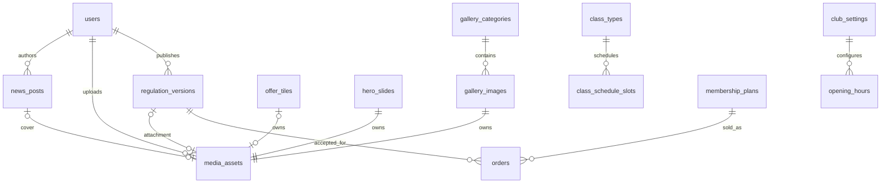

# ActiveFit — CMS Architecture

**Wersja:** 1.1 (DRAFT do przeglądu)  
**Data:** 2026-11-04  
**Ścieżka:** `docs/architecture/cms.md`  
**Stack:** Laravel + Inertia.js + Vue 3 + TypeScript + Tailwind CSS + MySQL

## 1. Cel, zakres i źródła prawdy

CMS obsługuje treści strony publicznej, bez uniwersalnego page buildera. Istniejące widoki HTML są referencją UX/UI; implementacja następuje w Vue przez Inertia. Dokument uszczegóławia moduł CMS z `docs/product/requirements.md`, `docs/architecture/overview.md` oraz rozdział 6 `docs/architecture/database.md`. W przypadku rozbieżności decyzje biznesowe zatwierdzone później mają pierwszeństwo, a sprzeczność należy rozwiązać w dokumentacji przed kodowaniem.

**Zatwierdzone:** CMS-001–009, CMS-011 (potwierdzony w rozmowie), PLN-005 (snapshot warunków karnetu), limit maksymalnie 3 wyróżnionych pozycji cennika, jeden regulamin z historią wersji, galeria kategorii (nazwa + krótki opis), bez opisów pojedynczych zdjęć. **Założenia projektowe poniżej oznaczone `PROPOSED`** wymagają przeglądu podczas przygotowania migracji.

## 2. Mapa funkcjonalna

| Moduł | Panel administratora | Publiczna prezentacja | Reguła |
|---|---|---|---|
| Kafelki ofertowe | CRUD, zdjęcie, opis, kolejność, widoczność | Sekcje oferty | Tytuł i krótki opis; brak edycji dowolnego layoutu |
| Karuzela | CRUD slajdów, zdjęcie, opis, kolejność, widoczność | Strona główna | Obraz + opis; kolejność jawna |
| Aktualności | CRUD, obraz, publikacja/ukrycie, data | Lista i szczegóły | Niepublikowane niedostępne publicznie |
| Galeria | Kategorie, zdjęcia, kolejność, widoczność | Galerie wg kategorii | Kategoria ma nazwę i krótki opis; zdjęcie bez tytułu/opisu redakcyjnego |
| Cennik | Edycja planów i flag wyróżnienia | Cennik i max 3 wyróżnione plany | Jedno źródło: `membership_plans` |
| Regulamin | Edycja jednego dokumentu, publikacja, historia wersji, obraz | Aktualna opublikowana wersja | Opublikowane wersje niezmienne |
| Kontakt i klub | Kontakty, lokalizacja, godziny | Kontakt/stopka | Jeden zestaw danych klubu (MVP) |
| Grafik | Rodzaje zajęć i tygodniowe terminy | Harmonogram | Bez rezerwacji miejsc |
| Treści stałe | Brak formularza dla treści nieedytowalnych | Gotowe komponenty | Nie dodawać pól bez wymagania |

## 3. Granice odpowiedzialności

- `Cms`: aktualności, kafelki, karuzela, galeria, regulamin, ustawienia klubu i grafik.
- `Memberships`: plany i definicje ofert sprzedażowych (`membership_plans`); CMS jedynie udostępnia administratorowi interfejs edycji tych danych.
- `Orders` / `Payments`: historia zamówień, płatności, snapshoty warunków; **nie należą do CMS**.
- `Media`: wspólna, bezpieczna obsługa obrazów i referencji do plików; brak duplikowania uploadów między modułami.
- `Audit`: rejestr krytycznych zmian cen, konfiguracji sprzedaży i operacji na karnetach; wersje regulaminu są dodatkową, osobną historią treści.

Proponowana organizacja kodu (bez dodatkowego frameworka modułowego): `app/Http/Controllers/Admin/Cms`, `app/Http/Requests/Admin/Cms`, `app/Actions/Cms`, `app/Models`; Vue: `resources/js/pages/admin/Cms` oraz `resources/js/components/cms`. Nazwy i ścieżki można dostosować do startera, zachowując odpowiedzialności.

## 4. Model danych — definicje projektowe

**Konwencje:** PK `BIGINT UNSIGNED`, FK zgodne typem, `created_at`/`updated_at` jako daty techniczne, `sort_order` jako `INT UNSIGNED`, status publikacji jako `BOOLEAN` i ewentualne `published_at` (`DATETIME`), identyfikatory mediów przez FK. Tabele to propozycja techniczna, spójna z `database.md`.

### 4.1 `media_assets`

| Kolumna | Typ / ograniczenie | Znaczenie |
|---|---|---|
| `id` | BIGINT PK | Identyfikator |
| `disk` | VARCHAR(50) NOT NULL | Dysk storage |
| `path` | VARCHAR(1024) NOT NULL | Wewnętrzna ścieżka pliku |
| `mime_type` | VARCHAR(100) NOT NULL | Typ po weryfikacji |
| `size_bytes` | BIGINT UNSIGNED NOT NULL | Rozmiar |
| `alt_text` | VARCHAR(255) NULL | Tekst alternatywny, jeśli wymagany dostępnością; nie jest opisem zdjęcia galerii |
| `uploaded_by_user_id` | FK users NULL | Autor uploadu |
| `created_at`, `updated_at` | TIMESTAMP | Metadane |

Unikalność pary `(disk, path)`. Każdy plik ma dokładnie jedno miejsce wykorzystania (`CMS-OD-05`). Usunięcie elementu usuwa rekord powiązania i wymaga usunięcia pliku; fizyczny `Storage::delete` wywołać po commit z retry i logowaniem błędu (bez usuwania pliku przed commit). Rozmiar, formaty, konwersje do WebP/AVIF i limity: `PROPOSED`, ustalić w implementacji.

### 4.2 `news_posts`

`id` PK, `title` VARCHAR(200) NOT NULL, `slug` VARCHAR(220) UNIQUE NOT NULL, `excerpt` TEXT NULL, `body` LONGTEXT NOT NULL (sanitized HTML), `cover_media_id` FK media_assets NULL, `is_published` BOOLEAN NOT NULL DEFAULT FALSE, `published_at` DATETIME NULL, `created_by_user_id` FK users NULL, `updated_by_user_id` FK users NULL, timestamps. Indeks `(is_published, published_at)`. Publicznie tylko wpisy opublikowane, których data publikacji nie jest przyszła.

### 4.3 `gallery_categories`, `gallery_images`

- `gallery_categories`: `id`, `name` VARCHAR(150) NOT NULL, `short_description` VARCHAR(500) NULL, `sort_order`, `is_published`, timestamps.
- `gallery_images`: `id` PK, `gallery_category_id` FK NOT NULL, `media_asset_id` FK NOT NULL UNIQUE, `sort_order`, timestamps; indeks `(gallery_category_id, sort_order)`. Brak pivotu wiele-do-wielu.
- **Nie dodawać** `caption`, `description`, `title` dla pojedynczego zdjęcia galerii.
- **CONFIRMED (CMS-OD-01):** jedno zdjęcie należy do dokładnie jednej kategorii.

### 4.4 `offer_tiles`

`id`, `title` VARCHAR(150) NOT NULL, `short_description` TEXT NULL, `media_asset_id` FK NULL, `sort_order`, `is_published`, opcjonalny `link_url` VARCHAR(500) NULL (`PROPOSED`: wyłącznie lokalne ścieżki lub zweryfikowane adresy), timestamps. Indeks `(is_published, sort_order)`.

### 4.5 `hero_slides`

`id`, `media_asset_id` FK NOT NULL, `title` VARCHAR(150) NULL, `description` TEXT NULL, `sort_order`, `is_published`, timestamps. Indeks `(is_published, sort_order)`. Zdjęcie i opis są edytowane w CMS; teksty i CTA niewymagające edycji pozostają stałe w Vue.

### 4.6 Regulamin: `regulation_versions`

Jedna logiczna treść regulaminu; każda publikacja tworzy **nową wersję**, zamiast nadpisywać poprzednią.

`id`, `version_number` INT UNSIGNED UNIQUE NOT NULL, `body` LONGTEXT NOT NULL, `media_asset_id` FK NULL, `published_at` DATETIME NULL, `created_by_user_id` FK users NOT NULL, timestamps. Publiczny regulamin to najnowsza opublikowana wersja; poprzednie pozostają w archiwum. Dla projektu zakładamy jedną aktualną wersję przez selekcję opublikowanego rekordu o najwyższym numerze (bez osobnej tabeli `regulations`). Publikowanie z blokadą/unikalną sekwencją numeracji w transakcji.

**CMS-011:** potwierdzono wersjonowanie i możliwość powiązania wersji z zakupem. `orders.accepted_regulation_version_id` jako FK jest **proponowanym sposobem realizacji**; **CONFIRMED (CMS-OD-03):** checkout online wymaga checkboxa akceptacji opublikowanej wersji. Zapisz `orders.accepted_regulation_version_id` i `orders.regulation_accepted_at`; zgody marketingowe są niezależne. Tekst oświadczenia podlega przeglądowi prawnemu.

### 4.7 `club_settings` + `opening_hours`

`club_settings`: pojedynczy rekord (np. `id=1`), `club_name`, `contact_email`, `contact_phone`, `street_address`, `postal_code`, `city`, `map_url` (opcjonalnie), `social_links` JSON (opcjonalnie), timestamps. `opening_hours`: `id`, `weekday` TINYINT (1–7), `opens_at` TIME NULL, `closes_at` TIME NULL, `is_closed` BOOLEAN, opcjonalne `sort_order`; UNIQUE `(weekday)` dla jednego przedziału dziennie. **CONFIRMED (CMS-OD-02):** w MVP jeden przedział na dzień, bez wyjątków świątecznych. Publicznie pokazywać tylko zatwierdzone pola. Dane admina przechodzą walidację, a linki są bezpiecznie renderowane.

### 4.8 `class_types`, `class_schedule_slots`

- `class_types`: `id`, `name` VARCHAR(150), `description` TEXT NULL, `is_published`, timestamps.
- `class_schedule_slots`: `id`, `class_type_id` FK, `weekday` TINYINT (1–7), `starts_at` TIME, `ends_at` TIME, `instructor_name` VARCHAR(150) NULL, `is_published`, timestamps; indeks `(weekday, starts_at)`.
- Wymagana walidacja `ends_at > starts_at`; kolizje sal/instruktorów i harmonogram świąteczny są poza ustalonym MVP (`OPEN`, jeśli będą potrzebne).

### 4.9 Cennik — `membership_plans` (wspólne źródło)

Nie tworzyć osobnej tabeli `prices`. CMS edytuje `membership_plans`, w tym `price_grosz` typu integer, opis, dostępność/publiczną widoczność oraz flagę wyróżnienia. **Maksymalnie 3 wyróżnione plany** na stronie głównej lub w innych sekcjach korzystających z wyróżnień. Zasada wymaga transakcyjnej walidacji przy równoczesnych zmianach. Nazwy dokładnych kolumn planów muszą być takie jak w `database.md`; jeżeli brakuje flag, dopisać je raz w definicji `membership_plans` i migracji (bez osobnego cennika). Zmiany nie aktualizują historycznych zamówień ani snapshotów karnetów (`PLN-005`). Każda krytyczna zmiana ceny/warunków jest audytowana.

## 5. Diagram relacji (Mermaid)

**Ważne:** strzałki obrazów wyrażają docelowe pojedyncze przypisanie pliku; unikalność należy wyegzekwować w MySQL przez jednoznaczne pole właściciela w `media_assets` (np. `owner_type` + `owner_id` + unikalny indeks na właścicielu dla zdjęcia) lub osobne FK z restrykcjami. Sam diagram nie zastępuje ograniczeń między tabelami. Nie dopuszczać wielokrotnego podpięcia jednego `media_asset_id`.

## 6. API, trasy i formularze (Inertia)

| Panel | Trasy koncepcyjne | Strony Vue |
|---|---|---|
| Aktualności | `admin.cms.news.*` | `admin/Cms/News/{Index,Create,Edit}` |
| Galeria | `admin.cms.gallery.*` | `admin/Cms/Gallery/{Index,Edit}` |
| Kafelki | `admin.cms.tiles.*` | `admin/Cms/Tiles/Index` |
| Karuzela | `admin.cms.slides.*` | `admin/Cms/Slides/Index` |
| Regulamin | `admin.cms.regulations.*` | `admin/Cms/Regulations/Edit` + wersje |
| Kontakt i grafik | `admin.cms.settings.*`, `admin.cms.schedule.*` | formularze dedykowane |
| Cennik | `admin.membership-plans.*` | `admin/MembershipPlans/Index` |

To **nazewnictwo przykładowe**; nie dodawać osobnego API JSON do publicznych widoków Inertia bez potrzeby. Dla każdej operacji zapisującej: Form Request + policy + walidacja backendowa, odpowiedź Inertia z komunikatem sukcesu/błędu. Publiczne kontrolery przekazują tylko widoczne/publikowane dane.

## 7. Publikowanie, walidacja i uprawnienia

1. Domyślnie nowa treść jest ukryta (`is_published=false`), chyba że formularz jawnie publikuje.
2. Zaplanowana przyszła data publikacji aktualności nie powoduje wcześniejszej ekspozycji.
3. Zmiana kolejności jest atomowa na poziomie logicznej listy, a backend sprawdza kompletność i unikalność kolejności.
4. Regulamin: edycja wersji roboczej nie zmienia wersji publicznej; opublikowane wersje są nieedytowalne. **Sposób składowania draftu (osobny draft lub wersja bez `published_at`) — `PROPOSED`.**
5. Wyłącznie administrator może edytować CMS i cennik. Pracownik nie może zmieniać globalnej konfiguracji ani zarządzać personelem. Autoryzacja zawsze po stronie Laravela (403), nie tylko ukryte akcje Vue.
6. Upload: walidować zawartość i rozmiar, używać losowych nazw plików, przechowywać poza katalogami wykonywalnymi, nie polegać wyłącznie na rozszerzeniu ani nagłówku od klienta; treść rich text musi być sanitizowana przed renderowaniem (XSS).
7. Zapis cen i konfiguracji sprzedaży generuje `audit_logs` z wykonawcą, czasem i zakresem zmiany; nie zapisywać sekretów. Historia regulaminu stanowi archiwum opublikowanych tekstów.

## 8. Mapowanie istniejących HTML na Vue

| Plik referencyjny | Docelowy ekran/moduł |
|---|---|
| `activefit-start.html` | Strona główna + kafelki + karuzela |
| `activefit-aktualnosci.html` | Publiczne aktualności |
| `activefit-galeria.html` | Publiczna galeria |
| `activefit-cennik.html` | Cennik z `membership_plans` |
| `activefit-kontakt-.html` | Kontakt i godziny |
| `activefit-regulamin.html` | Aktualna wersja regulaminu |
| `activefit-admin-aktualnosci.html` | Formularze aktualności |
| `activefit-admin-cennik-responsywny.html` | Zarządzanie cennikiem, także mobile |
| `activefit-admin-galeria-uproszczona.html` | Kategorie i zdjęcia bez opisów zdjęć |
| `activefit-admin-regulamin-wersje.html` | Edycja i wersjonowanie regulaminu |
| `activefit-admin-bez-edycji-tresci-strony.html` | Referencja dla stałych treści strony |

Uwaga: HTML to punkt odniesienia UX/UI, nie backendowa specyfikacja danych. Wspólne części przenieść do komponentów/layoutów Vue, bez kopiowania niezależnych skryptów DOM.

## 9. Testy i kryteria akceptacji

| ID | Scenariusz | Rodzaj testu |
|---|---|---|
| CMS-T01 | Ukryta aktualność nie jest dostępna publicznie również po ręcznym wejściu na URL | Feature |
| CMS-T02 | Kolejność kafelków, slajdów i zdjęć po zapisie jest stabilna | Feature |
| CMS-T03 | Nie można wyróżnić czwartego planu | Feature + test współbieżności |
| CMS-T04 | Zmiana ceny nie aktualizuje historycznych cen zamówień/karnetów | Feature |
| CMS-T05 | Publikacja nowego regulaminu tworzy wersję, poprzednia pozostaje dostępna | Feature |
| CMS-T06 | Pracownik nie może modyfikować CMS/cennika (HTTP 403) | Feature |
| CMS-T07 | Nieprawidłowy upload lub potencjalny XSS nie trafia do treści publicznej | Feature/security |
| CMS-T08 | Galeria pozwala edytować opis kategorii, ale nie opis pojedynczego zdjęcia | Feature/UX |
| CMS-T09 | Równoległe zmiany cen zostawiają prawidłowy audit log | Integration |
| CMS-T10 | Widoki publiczne i panelowe działają na mobile według HTML referencyjnego | E2E |

## 10. Otwarte decyzje i zalecenia implementacyjne

| ID | Decyzja | Status |
|---|---|---|
| CMS-OD-01 | Jedno zdjęcie w jednej kategorii galerii. | CONFIRMED |
| CMS-OD-02 | Jeden przedział godzin dziennie, bez wyjątków świątecznych. | CONFIRMED |
| CMS-OD-03 | Wymagana akceptacja wersjonowanego regulaminu w checkout online. | CONFIRMED |
| CMS-OD-04 | Sformatowana treść jako oczyszczony HTML (WYSIWYG). | CONFIRMED |
| CMS-OD-05 | Jedno miejsce użycia obrazu; usunięcie rekordu i pliku (po commit). | CONFIRMED |

Dla `news_posts.body` oraz `regulation_versions.body` wymagane jest oczyszczanie HTML po stronie serwera (allowlist) i bezpieczne renderowanie. Nie pozwalać na surowe `<script>`, zdarzenia `on*` ani niebezpieczne URI. Wersję regulaminu akceptowaną przy zakupie przechowywać niezmiennie także po opublikowaniu następnej.

## 11. Następne kroki AI SDLC

1. Zweryfikować kolumny CMS w `docs/architecture/database.md` i wyrównać nazewnictwo przed migracjami.
2. Zatwierdzić otwarte warianty mające wpływ na schemat (`CMS-OD-*`).
3. Dodać sekcję CMS do `business-flows.md`: publikacja, archiwizacja regulaminu, media upload, zmiana ceny.
4. Implementować funkcjonalności w pionowych wycinkach z Pest i kontrolą autoryzacji.

## Aktualizacja 2026-11-04 — bezpieczeństwo mediów

Brak współdzielenia plików między wpisami, galerią, karuzelą i regulaminem. Zmiana obrazu w rekordzie musi usuwać poprzedni plik dopiero po skutecznym zapisie DB. Operacje usuwania z retry są niezależne od transakcji i podlegają logowaniu.
