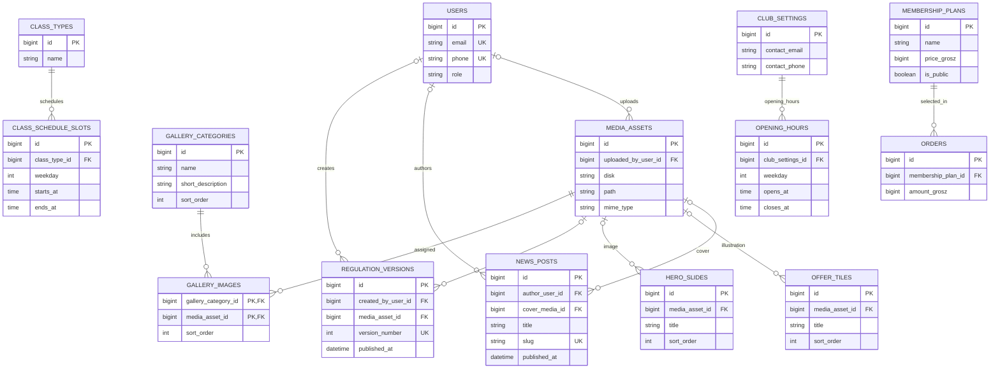
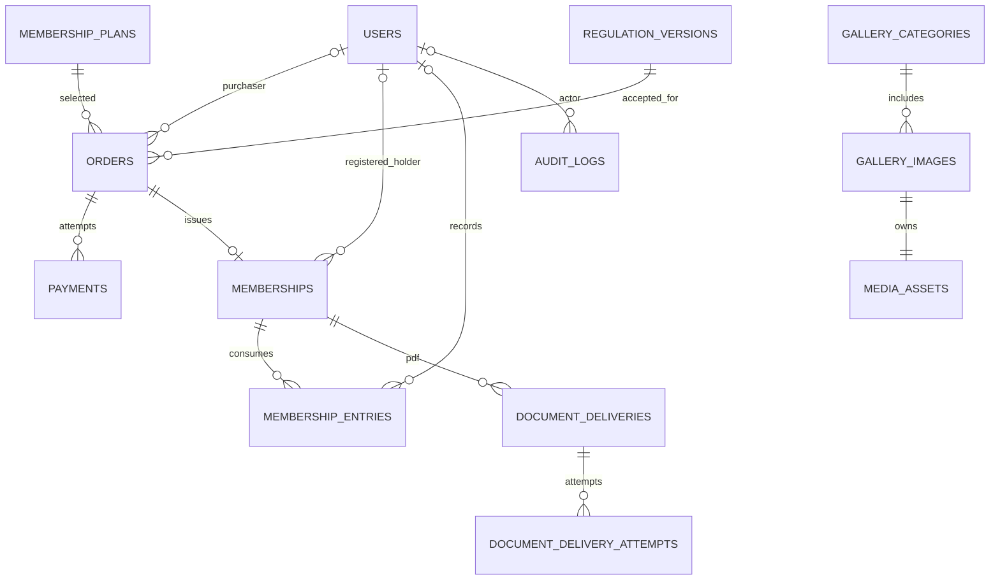

# ActiveFit — Database Design

**Version:** 1.0 (design draft)  
**Date:** 2026-11-04  
**Status:** READY FOR REVIEW — technical proposals are marked `PROPOSED`  
**Target:** MySQL 8+, Laravel, Inertia.js, Vue 3  
**Sources of truth:** `docs/product/requirements.md`, `docs/architecture/overview.md`, `AGENTS.md`.

> This document combines the original logical design with dated implementation notes. For the implemented sales schema, see §14 (TASK-019) and the migrations; unimplemented proposals remain proposals. Where the requirements remain `OPEN`, the schema must not silently decide business behavior.

## 1. Goals and non-negotiable invariants

1. One order purchases **one** pass for **one holder**. Purchaser and holder may differ (`ORD-003`, `ORD-005`).
2. Guest purchase creates **no** `users` row and is never merged into a later account (`OD-05`). `users.email` and normalized `users.phone` are individually unique; guest purchaser/holder contact fields are not unique.
3. A verified payment produces **at most one** membership from an order. Order, payment and membership states are independent.
4. Money is stored as non-negative **integer grosze** (`BIGINT UNSIGNED`); currency is stored explicitly as `PLN`. No `FLOAT`/`DOUBLE` for amounts.
5. Order and membership contain immutable snapshots of the purchased plan terms (`PLN-005`). Price changes do not rewrite historical transactions.
6. `memberships.starts_on` and `memberships.expires_on` are `DATE`; the end date is **inclusive**. Calculate against `Europe/Warsaw`. `paid_at` records payment confirmation, separate from the scheduled start.
7. Limited-entry use is recorded individually with timestamp and the employee who confirmed it (`E2E-04`); concurrent attempts cannot exceed available entries.
8. Memberships and critical activity are preserved after expiry. Audit rows are append-only at the application authorization layer.
9. Every successfully purchased pass must be eligible for PDF delivery, including logged-in purchases. For a future-start renewal, PDF is queued immediately after verified payment; delivery failure does not affect the membership or payment.
10. **OPEN rules remain open**: mixed plan renewals, entry rollover after expiration, cancellations/refunds, minor-holder identity rules, guest document recipient rules and retention periods.

## 2. Conventions

| Aspect | Rule |
|---|---|
| Primary keys | `BIGINT UNSIGNED` auto-increment; foreign keys use `foreignId()` |
| Encoding | `utf8mb4`, InnoDB, consistent collation |
| Audit timestamps | `created_at`, `updated_at` in UTC; business UI timezone `Europe/Warsaw` |
| Effective membership period | `DATE starts_on` nullable until first visit; `DATE expires_on` nullable until first visit (inclusive) |
| External identifiers | Indexed initially; add unique keys only after verifying the provider's uniqueness contract |
| Status fields | String/`VARCHAR` with PHP enums + application checks; migrations shouldn't obscure transitions |
| Snapshot fields | JSON + selected typed columns for queries and amounts |
| Soft delete | **Not** for orders, payments, memberships, entries or audit history |
| Sensitive data | Limit columns and role-based exposure; redact audit payloads and logs |
| Naming | `snake_case` tables/columns, explicit `*_id` foreign keys |

**Technical note:** store timestamps in UTC using a consistent Laravel DB connection convention. MySQL `DATETIME(6)` is suitable when the application writes UTC values explicitly; DB-local timezone settings must be pinned and tested. Date-only periods are intentionally not timestamps.

## 3. Relationship diagram (Mermaid ERD)

```mermaid
erDiagram
    USERS o|--o{ ORDERS : purchaser_account
    USERS o|--o{ ORDERS : holder_account
    USERS o|--o{ MEMBERSHIPS : holder_account
    USERS o|--o{ MEMBERSHIP_ENTRIES : recorded_by
    USERS o|--o{ AUDIT_LOGS : actor
    USERS o|--o{ MEMBERSHIP_ADJUSTMENTS : performed_by
    MEMBERSHIP_PLANS ||--o{ ORDERS : selected_plan
    ORDERS ||--o{ PAYMENTS : attempts
    ORDERS ||--o| MEMBERSHIPS : issues_one
    MEMBERSHIP_PLANS ||--o{ MEMBERSHIPS : original_plan
    MEMBERSHIPS ||--o{ MEMBERSHIP_ENTRIES : usage
    MEMBERSHIPS o|--o{ MEMBERSHIPS : renewed_from
    MEMBERSHIPS ||--o{ MEMBERSHIP_ADJUSTMENTS : balance_changes
    MEMBERSHIPS ||--o{ DOCUMENT_DELIVERIES : pdf_dispatches
    DOCUMENT_DELIVERIES ||--o{ DOCUMENT_DELIVERY_ATTEMPTS : attempts
    MEMBERSHIP_PLANS {
        bigint id PK
        string name
        bigint price_grosz
        string kind
        int duration_months
        int included_entries
    }
    ORDERS {
        bigint id PK
        bigint purchaser_user_id FK
        bigint holder_user_id FK
        bigint membership_plan_id FK
        string purchaser_email
        string purchaser_phone
        string holder_first_name
        string holder_last_name
        string sales_channel
        string payment_method
        bigint amount_grosz
        string status
    }
    PAYMENTS {
        bigint id PK
        bigint order_id FK
        string provider
        string status
        bigint amount_grosz
        datetime confirmed_at
    }
    MEMBERSHIPS {
        bigint id PK
        bigint order_id FK UK
        bigint holder_user_id FK
        bigint renewed_from_id FK
        date starts_on
        date expires_on
        int entries_granted
        int entries_remaining
    }
```

**Interpretation:** optional account FKs do **not** create guest users; purchaser and holder snapshots live on the order. A holder account FK is assigned only when the relationship to the actual holder was established during an authenticated flow — never inferred solely from matching phone/e-mail. The first ERD focuses on transactional tables; the CMS ERD below complements it. Details of CMS entities are in §6 and `cms.md`.


### 3.1. CMS relationship diagram (Mermaid ERD)

The CMS model is separate from sales, except for the shared `membership_plans` catalog. No duplicate price table is introduced.



**Design notes:**
- `gallery_images` links categories and images. Individual gallery photos have no content description; optional `alt_text` in `media_assets` serves accessibility.
- `regulation_versions` retains prior editions; the published version is selected by publication policy, not by overwriting previous text.
- `membership_plans` is the only price source; historical conditions remain snapshotted in orders/memberships.
- `OPENING_HOURS` is a **proposed normalization** of the club schedule. The existing §6 also permits storing validated hours in `club_settings`; select one variant before migrations, do not implement both.
- Relations to media and authors are optional where the content can exist without them; physical nullable FKs must match final validation rules.

## 4. Core identity and sales tables

### 4.1 `users` — registered customers and staff

**Implementation note — TASK-007 (2026-11-13):** additive migration introduces nullable unique `bootstrap_key VARCHAR(32)`. Only the explicit initial-admin seeder writes `initial-admin`; ordinary accounts retain NULL. This durable marker is separate from role/email, is not mass-assignable or serialized, and prevents adopting an unrelated account or creating a second marked account concurrently. Preserve the marker when editing the administrator's profile. No existing account is promoted or backfilled by this migration. The starter's combined `name` and nullable legacy `phone` remain transitional until the profile/schema work in TASK-008; new bootstrap accounts require both name and normalized phone.

**Implementation note — TASK-008 (2026-11-13):** adds `first_name` and `last_name` (120 characters each). These columns and the legacy `phone` remain nullable in the physical schema to preserve incomplete existing/bootstrap/demo accounts without inventing names or contact data; this is a transitional exception to the target NOT NULL table below. Registration and profile-save validation require both names and a normalized unique international phone. Existing accounts supply missing values explicitly on profile save; no automatic name splitting or fake backfill. The starter's `name` remains a display field, synchronized from both supplied names when they change. A later NOT NULL migration requires completion of genuine legacy data first. Profile updates lock the account row and write only `users` in one transaction; email/phone unique constraints remain authoritative, including after stale validation. Changing email clears `email_verified_at`; notification is dispatched after commit. No order, membership, guest association or PDF data is updated.

| Column | Type | Constraints / meaning |
|---|---|---|
| `id` | BIGINT UNSIGNED | PK |
| `first_name`, `last_name` | VARCHAR(120) | NOT NULL |
| `email` | VARCHAR(254) | NOT NULL, UNIQUE; normalized lowercase for comparison |
| `phone` | VARCHAR(20) | NOT NULL, UNIQUE; normalized E.164 |
| `password` | VARCHAR(255) | nullable until invited employee sets password, only if auth flow supports this securely |
| `role` | VARCHAR(20) | `customer`, `employee`, `admin` |
| `suspended_at` | DATETIME(6) | NULL or suspended |
| `staff_invited_at` | TIMESTAMP(6) | nullable; set only for explicitly invited team accounts |
| `staff_invitation_accepted_at` | TIMESTAMP(6) | nullable until initial password setup |
| `email_verified_at` | DATETIME(6) | nullable |
| `created_at`, `updated_at` | DATETIME(6) | standard |

**Rules:** database uniqueness on email and phone, not only Laravel validation. A family may use one phone across *holders* stored in orders, while separate registered accounts cannot duplicate phone. Employee suspension must be enforced on each protected request, including existing sessions. The exact login / invited-password flow will be described in `security.md`.

**Implementation note — TASK-009 (2026-11-13):** the invitation timestamps are guarded from public mass assignment. Existing accounts keep NULL; no invitations are backfilled. A pending invitation has an invited timestamp and no acceptance timestamp; setup uses the existing hashed `password_reset_tokens` table, consuming its token transactionally. Password remains NOT NULL with a cryptographically random hashed placeholder until the email owner sets one; no nullable-password authentication path is introduced.

### 4.2 `membership_plans` — current editable catalog

| Column | Type | Constraints / meaning |
|---|---|---|
| `id` | BIGINT UNSIGNED | PK |
| `name` | VARCHAR(180) | NOT NULL |
| `description` | TEXT | nullable |
| `kind` | VARCHAR(30) | `time`, `entries` (other kinds require requirements change) |
| `price_grosz` | BIGINT UNSIGNED | NOT NULL |
| `currency` | CHAR(3) | `PLN` |
| `duration_months` | SMALLINT UNSIGNED | nullable; e.g. 1 for monthly, exact validity may vary by plan |
| `included_entries` | INT UNSIGNED | nullable for unlimited; NOT NULL for entry-limited plan |
| `terms` | JSON | restrictions (e.g. daytime-only), versioned schema |
| `is_active`, `is_public`, `is_featured` | BOOLEAN | default false; availability, public listing and homepage selection |
| `sort_order` | INT UNSIGNED | default 0 |
| `created_at`, `updated_at` | DATETIME(6) | standard |

**Check in app validation:** a valid plan has a supported, coherent duration/entry configuration. A hidden/inactive plan cannot be purchased from a public form. Do not delete plans referenced by past orders.

### 4.3 `orders` — one purchase = one holder/pass

| Column | Type | Constraints / meaning |
|---|---|---|
| `id` | BIGINT UNSIGNED | PK |
| `public_reference` | CHAR(26) | UNIQUE, opaque ULID for external URLs/support |
| `purchaser_user_id` | BIGINT UNSIGNED | nullable FK `users.id`; NULL for guest |
| `holder_user_id` | BIGINT UNSIGNED | nullable FK `users.id`; explicit verified holder association, independent of purchaser |
| `membership_plan_id` | BIGINT UNSIGNED | FK `membership_plans.id` (historical catalog reference) |
| `purchaser_first_name`, `purchaser_last_name` | VARCHAR(120) | NOT NULL, snapshot |
| `purchaser_email` | VARCHAR(254) | NOT NULL, snapshot; **not unique** |
| `purchaser_phone` | VARCHAR(20) | NOT NULL, normalized snapshot; **not unique** |
| `holder_first_name`, `holder_last_name` | VARCHAR(120) | NOT NULL, snapshot |
| `holder_email` | VARCHAR(254) | nullable, not unique (recipient policy still OPEN for gifts) |
| `holder_phone` | VARCHAR(20) | NOT NULL, normalized snapshot; not unique |
| `recipient_email` | VARCHAR(254) | NOT NULL; explicit email intended for PDF delivery; recipient policy for gift/minors OPEN |
| `plan_snapshot` | JSON | NOT NULL, immutable approved terms from purchase |
| `amount_grosz` | BIGINT UNSIGNED | NOT NULL, locked at checkout |
| `currency` | CHAR(3) | NOT NULL, `PLN` |
| `sales_channel` | VARCHAR(20) | `online`, `reception` |
| `payment_method` | VARCHAR(20) | `przelewy24`, `cash`, `card` |
| `status` | VARCHAR(30) | e.g. `pending`, `paid`, `cancelled`, `failed`; transitions versioned |
| `ordered_at` | DATETIME(6) | UTC order creation timestamp |
| `paid_at` | DATETIME(6) | nullable, immutable first verified confirmation timestamp |
| `created_by_user_id` | BIGINT UNSIGNED | nullable FK `users.id`, reception employee/system context |
| `accepted_regulation_version_id` | BIGINT UNSIGNED | nullable restrictive FK `regulation_versions.id`; required for paid online orders |
| `regulation_accepted_at` | DATETIME(6) | nullable UTC; paired with accepted version and immutable once set |
| `created_at`, `updated_at` | DATETIME(6) | standard |

**Important:** `purchaser_user_id` does not identify the holder. Never attach a guest order to a newly created user automatically. Store a complete `plan_snapshot` such as `{ "name", "kind", "duration_months", "included_entries", "terms", "price_grosz", "currency", "snapshot_version" }`. Persist typed `amount_grosz` as the authoritative order total. Snapshot is immutable after order placement.

**Recipient e-mail:** storing an explicit recipient avoids guessing later from a changing user profile. The rule deciding which email may be entered/used for a gifted pass is still `OPEN` and must be finalized before implementing that checkout branch.

### 4.4 `payments` — online attempts and receipt confirmations

| Column | Type | Constraints / meaning |
|---|---|---|
| `id` | BIGINT UNSIGNED | PK |
| `order_id` | BIGINT UNSIGNED | FK, indexed |
| `provider` | VARCHAR(30) | `przelewy24` or `reception` |
| `method` | VARCHAR(20) | `przelewy24`, `cash`, `card` |
| `status` | VARCHAR(30) | `initiated`, `pending`, `confirmed`, `failed`, `cancelled`, `unknown` |
| `amount_grosz` | BIGINT UNSIGNED | matched against immutable order amount |
| `currency` | CHAR(3) | `PLN` |
| `provider_session_id` | VARCHAR(190) | nullable; unique with provider if guaranteed |
| `provider_transaction_id` | VARCHAR(190) | nullable; unique with provider if guaranteed |
| `confirmed_at` | DATETIME(6) | first successfully verified confirmation UTC |
| `confirmed_by_user_id` | BIGINT UNSIGNED | nullable FK `users.id`, for reception |
| `failure_code` | VARCHAR(100) | nullable; sanitized provider code |
| `created_at`, `updated_at` | DATETIME(6) | standard |

**Payment attempts:** multiple attempts per order are permitted; confirmation and issuance must be serialized by locking the **order**, not only a payment row. Confirm provider-specific uniqueness contracts before adding provider unique keys. Never store PAN/CVV/card secrets in the database. Provider callback payloads should be redacted; store stable identifiers, verification outcome and operational metadata only.

### 4.5 `memberships` — issued individual passes

| Column | Type | Constraints / meaning |
|---|---|---|
| `id` | BIGINT UNSIGNED | PK |
| `order_id` | BIGINT UNSIGNED | NOT NULL FK `orders.id`, **UNIQUE** |
| `membership_plan_id` | BIGINT UNSIGNED | FK for catalog reporting only |
| `holder_user_id` | BIGINT UNSIGNED | nullable FK `users.id`; only if explicitly verified/associated at purchase |
| `renewed_from_id` | BIGINT UNSIGNED | nullable self FK for supported renewal chain |
| `holder_first_name`, `holder_last_name` | VARCHAR(120) | immutable holder snapshot |
| `holder_phone` | VARCHAR(20) | immutable contact snapshot; not unique |
| `holder_email` | VARCHAR(254) | nullable snapshot; not unique |
| `plan_snapshot` | JSON | immutable copy of purchased terms |
| `starts_on`, `expires_on` | DATE NULL | Both NULL until first visit for new passes; both set atomically upon activation; end inclusive, `expires_on >= starts_on` when assigned |
| `activated_at` | DATETIME(6) NULL | UTC instant of first activation; never overwritten |
| `activated_by_user_id` | BIGINT UNSIGNED NULL | FK `users.id` (staff/admin); required when first activated |
| `entries_granted` | INT UNSIGNED | nullable for unlimited; base + rollover on applicable renewals |
| `entries_remaining` | INT UNSIGNED | nullable for unlimited; never negative |
| `created_at`, `updated_at` | DATETIME(6) | standard |

**Derived current status:** paid with `starts_on IS NULL` = `pending_activation`; known future start = `scheduled`; within period and allowed by entry availability = `active`; after period = `expired`; zero entries = `exhausted`. Distinguish `paid` from `active`. `pending_activation` receives the PDF after payment without fabricated dates; `scheduled` advance renewal also receives PDF after payment. Whether an exhausted entry pass renews early is still `OPEN` when not covered by approved rules. No `status_override` column or cancellation/suspension workflow is implemented before approval of OD-04.

**Why both holder snapshots and `holder_user_id`?** History remains truthful even if an account changes contact data, and a guest holder can exist without creating a login. Display grouped search results per holder/pass; matching phone is a search criterion, never an identity merge key.

## Potwierdzona reguła aktywacji — ACT-01 (2026-11-05)

**CONFIRMED:** opłacenie zakupu wydaje karnet o statusie `pending_activation`, ale **nie uruchamia** jego okresu ważności. Przy **pierwszej wizycie posiadacza** pracownik lub administrator weryfikuje właściwy karnet i uruchamia okres ważności; zapisujemy `activated_at` (UTC), `activated_by_user_id`, `starts_on` (lokalny dzień wizyty według `Europe/Warsaw`) i wyliczone `expires_on` (włącznie) według zakupionego snapshotu planu. Nie można aktywować nieopłaconego karnetu. Powtórzenie aktywacji niczego nie przelicza. Zapis aktywacji i audytu jest atomowy.

**Przedłużenia:** opłacone przedłużenie aktywnego karnetu o tym samym obsługiwanym typie ma przyszły okres od `previous.expires_on + 1 day` — **bez ponownej wizyty aktywacyjnej**. Dla karnetu, który sam jeszcze nie został aktywowany, sposób kolejkowania następnych zakupów pozostaje `OPEN`; nie przypisujemy automatycznie dat bez znanej daty startu źródła.

**PDF po opłacie:** generujemy i wysyłamy także dla `pending_activation`. Zawiera imię i nazwisko posiadacza, dane planu i komunikat „Ważność rozpocznie się przy pierwszej wizycie w klubie”; **nie zawiera fikcyjnych dat**. Dla opłaconego przedłużenia ze znanym przyszłym okresem PDF pokazuje rzeczywiste daty. Nie wymagamy automatycznej drugiej wysyłki PDF po aktywacji; ewentualne późniejsze pobranie aktualnego PDF może uwzględniać ustalone daty. Błąd e-maila nie cofa zakupu ani nie tworzy nowego karnetu.

**Granica stanów:** `orders/payments: paid` ≠ `memberships: active`. Statusy UI obejmują `awaiting_payment`, `pending_activation`, `scheduled` (przedłużenie) i `active`, a także `expired`/`exhausted` w odpowiednim kontekście. Faktyczną aktywację i wejście do klubu zapisujemy jako **różne zdarzenia**; odliczenie wejścia z karnetu limitowanego wymaga osobnej świadomej akcji, nawet jeśli odbywa się podczas tej samej wizyty.

### Database constraints for first-visit activation (PROPOSED implementation)

- `memberships.activated_at` and `activated_by_user_id` are NULL for `pending_activation`, both set exactly once for manual first activation. For a scheduled renewal, membership dates are known at issuance and no separate manual check-in activation is required; model its start from the dates and the link to the preceding pass.
- `CHECK ((starts_on IS NULL AND expires_on IS NULL) OR (starts_on IS NOT NULL AND expires_on IS NOT NULL AND expires_on >= starts_on))` where available, plus application validation.
- The activation action uses a transaction with `SELECT ... FOR UPDATE` on membership and an audit insert in that transaction. It rejects unpaid/cancelled/already activated records and avoids two conflicting dates under concurrent requests.
- Add an index supporting the reception queue, e.g. `(holder_phone, starts_on)` together with a payment/state filter on the joined order; do not assume phone identifies one person.
- Existing payment records retain immutable `paid_at`. `activated_at` is distinct from `paid_at` and `membership_entries.used_at`.


## 5. Entry balances, renewals, documents and audit

### 5.1 `membership_entries` — each actual use

| Column | Type | Constraints / meaning |
|---|---|---|
| `id` | BIGINT UNSIGNED | PK |
| `membership_id` | BIGINT UNSIGNED | FK |
| `recorded_by_user_id` | BIGINT UNSIGNED | FK `users.id`, employee/admin |
| `used_at` | DATETIME(6) | UTC instant entry was recorded |
| `request_id` | CHAR(36) | UUID, **UNIQUE**, deduplicate one submission/retry |
| `created_at` | DATETIME(6) | insert time |

An entry is a historical fact. Do not delete it to increase the balance. If corrections are authorized in the future, record a compensating adjustment and audit record. Enforce business date/time validity and nonnegative balance in the same transaction as inserting this row.

### 5.2 `membership_adjustments` — rollover / approved corrections

| Column | Type | Constraints / meaning |
|---|---|---|
| `id` | BIGINT UNSIGNED | PK |
| `membership_id` | BIGINT UNSIGNED | FK target |
| `source_membership_id` | BIGINT UNSIGNED | nullable FK source of rollover |
| `kind` | VARCHAR(30) | `rollover`, future `correction` after policy approval |
| `delta_entries` | INT SIGNED | positive/negative change; no resulting negative balance |
| `performed_by_user_id` | BIGINT UNSIGNED | nullable FK for worker/system-origin |
| `reason` | VARCHAR(250) | nullable controlled reason |
| `idempotency_key` | VARCHAR(190) | UNIQUE |
| `created_at` | DATETIME(6) | standard |

For a supported entry-pass renewal: compute unspent entries **under locks**, create new membership, add rollover exactly once and debit/mark transferred quantity on source using an approved balance operation. `UNIQUE(idempotency_key)` prevents replay, while locking protects simultaneous usage/renewal. **The policy for transfers after source expiration is still OPEN**; do not implicitly allow indefinite banking.

### 5.3 `document_deliveries` and `document_delivery_attempts`

`document_deliveries`:

| Column | Type | Constraints / meaning |
|---|---|---|
| `id` | BIGINT UNSIGNED | PK |
| `membership_id` | BIGINT UNSIGNED | FK |
| `kind` | VARCHAR(30) | `membership_pdf` |
| `recipient_email` | VARCHAR(254) | snapshot of confirmed destination |
| `scheduled_for` | DATETIME(6) | due time (UTC) after verified payment/commit; independent of validity start |
| `status` | VARCHAR(20) | `pending`, `processing`, `sent`, `failed` |
| `sent_at` | DATETIME(6) | nullable |
| `storage_path` | VARCHAR(500) | nullable protected file path; not public URL |
| `idempotency_key` | VARCHAR(190) | UNIQUE for initial automatic delivery |
| `created_at`, `updated_at` | DATETIME(6) | standard |

`document_delivery_attempts`: `id`, `document_delivery_id` FK, `attempt_number`, `status`, `error_code` (redacted), `triggered_by_user_id` nullable, `attempted_at` UTC. Unique `(document_delivery_id, attempt_number)`.

**Rules:** enqueue only **after DB commit**. Scheduler picks due deliveries; queue workers use an atomic claim/lock. Failure retries **only delivery**. Manual resend creates a traceable new attempt (and possibly a new delivery request with its own key), never a new purchase or membership. Keep PDFs outside publicly accessible storage and set a retention policy before production.

### 5.4 `audit_logs` — append-only business event journal

**Implementation — TASK-009 prerequisite for TASK-010 (2026-11-13):** migration adds this table with the columns below, subject/action/time indexes and nullable actor FK (`nullOnDelete`). Employee events write through `RecordEmployeeAudit` in the same transaction as the account change. Metadata contains only allowlisted changed-field names; role/suspension values are safe before/after summaries. The `AuditLog` model rejects instance updates/deletes; no audit mutation endpoint exists. Generic writer/reader, system actors and broader query-level protections are reserved for TASK-010. Preservation is enforced at the application layer, not claimed against raw SQL or privileged DB administrators.

| Column | Type | Constraints / meaning |
|---|---|---|
| `id` | BIGINT UNSIGNED | PK |
| `actor_user_id` | BIGINT UNSIGNED | nullable FK, system actor represented separately |
| `actor_type` | VARCHAR(30) | `admin`, `employee`, `system` |
| `action` | VARCHAR(100) | e.g. `membership.entry_recorded`, `plan.price_updated` |
| `subject_type`, `subject_id` | VARCHAR(100), BIGINT UNSIGNED | polymorphic reference; no FK for polymorphic subject |
| `old_values`, `new_values` | JSON | nullable, **whitelisted** safe fields |
| `metadata` | JSON | nullable, sanitized request/correlation references |
| `occurred_at` | DATETIME(6) | immutable UTC occurrence time |

Critical membership/sales-config changes and their audit rows are saved **in the same transaction**. No update/delete route for audit history. DB permissions and retention/backups should reduce tampering risk. Keep e-mails/phones and provider secrets out of generic before/after captures whenever possible. For account deletion/privacy requests, design a lawful redaction/retention process separately (currently OPEN).

**Implementation — TASK-010 (2026-11-13):** existing schema is retained with no migration. `RecordAudit` supplies validated event/subject, explicit actor/system context, safe summaries and UTC time inside the caller's transaction. The employee adapter uses the shared writer. The allowlist currently stores only valid role values and boolean suspension state; changed contact field names are retained without their values. UUID correlation references are optional. Later business modules must extend the event catalog/subject mapping and typed summary allowlist explicitly (monetary fields must remain integer grosze), with no fabricated events before those modules exist. The admin reader uses ID-descending pagination and one eager actor query per populated page. Historical actor role is stored independently from the current account name. Model/Eloquent protections cover ordinary updates, deletes, counter operations, upserts, truncate and quiet mutations; raw SQL/DB permissions remain an operational boundary. Use least-privilege SELECT/INSERT-only runtime access to this table and separate schema-migration credentials in production; do not combine this with broad database grants that override the intended restriction.

## 6. CMS entities (focused, not a generic page builder)

**Read foundation implemented — TASK-011 (2026-11-16):** migration `2026_11_16_000000_create_public_content_tables` creates `media_assets`, `offer_tiles`, `hero_slides`, `news_posts`, `gallery_categories`, `gallery_images`, `regulation_versions`, `club_settings`, `opening_hours`, `class_types` and `class_schedule_slots`, with publication/order indexes, author FKs and unique per-placement media FKs. No existing business table is rewritten. Media path length is 500 to support the composite unique utf8mb4 index. Public reads explicitly scope publication and select safe DTOs; nullable contact/settings values represent missing real data, not default business claims. Singleton club reads use ID 1; absent weekdays remain unknown instead of closed. Class times are recurring local Warsaw wall times; publication instants remain UTC. Versioned regulations expose only the highest already-published version. This is the read prerequisite for upcoming CMS tasks, not completed ownership/upload/editor behavior. Cross-module media ownership is TASK-012, and plan/order/membership schema remains TASK-019. No public seed data or duplicate pricing table was introduced.

**Media lifecycle implemented — TASK-012 (2026-11-16):** migration `2026_11_16_010000_add_media_ownership_and_cleanup` adds nullable `owner_type`/`owner_id` to `media_assets`, with a unique owner pair and a pre-DDL check/backfill of existing content references. Null ownership is transitional during upload. The existing content FKs remain; model saves/deletes lock owner/assets and keep both directions consistent in one transaction, rejecting cross-module reuse. A custom builder blocks common bulk mutations; raw SQL/base builders are outside those guards and prohibited for media writes. Replacing/removing an image deletes its asset record after detachment and writes a durable deletion intent atomically; an after-commit job removes the file. `media_file_deletions` also stages upload paths before storage writes for crash recovery (one-hour grace period), with due-time/attempt metadata for scheduler retries. No user/order/payment data are modified. Published regulation attachments are immutable. Local migration applied; production worker/scheduler setup remains deployment work.

**Homepage editing implemented — TASK-013 (2026-11-16):** migration `2026_11_16_020000_create_homepage_content_lists` adds only `homepage_content_lists` (`section` VARCHAR(30) PK, `revision` UNSIGNED BIGINT), with two infrastructure rows (`kafelki`, `karuzela`), no editorial/demo data. Homepage actions lock this row before owners/assets to serialize creation (including empty lists), editing, publication, moves and deletion. A submitted revision/current-image ID rejects stale writes. Shared media replace/remove actions use the same list lock/revision for these owners. Ordering is derived from the complete section on the server and normalized atomically after an adjacent move; new elements append after existing order. Frontend lists are paginated; media references, audit and cleanup retain the established transaction boundaries. No extra columns are added to tiles/slides, no catalog/contact values change, and direct/raw model writes are not an alternative to the editor's business actions.

**News editing implemented — TASK-014 (2026-11-18):** migration `2026_11_18_000000_add_revision_to_news_posts` adds `revision` UNSIGNED INT DEFAULT 0 only. No editorial seed/backfill or body rewrite is performed. Row-locked actions compare the submitted revision and cover ID, preserve `created_by_user_id`, set `updated_by_user_id`, keep the initial unique slug stable and atomically commit sanitized HTML, publication instant, photo changes and audit. Shared media mutations also advance news revision and updater. Public reads sanitize legacy HTML and continue scoping nonfuture published rows. Local calendar input uses Warsaw offset candidates, rejects gaps/ambiguities and persists UTC. Existing nullable publication dates/cover references remain supported; no generic CMS builder or scheduling table was added.

**News editing implemented — TASK-014 (2026-11-18):** migration `2026_11_18_000000_add_revision_to_news_posts` adds `revision` UNSIGNED INT DEFAULT 0 without rewriting existing content. News save/publication/delete actions lock the row and compare submitted revision/current-cover ID; updates increment revision and preserve creator while recording updater. Shared media replacement/removal increments news revision in the same transaction. Slugs are generated once from a bounded title slug plus ULID and remain stable across title edits, with existing DB uniqueness. Body is sanitized before save and again at public/editor read boundaries; no unsanitized body is exposed to the client. Publication instants remain UTC; editor local Warsaw times require a unique matching UTC instant, rejecting DST gaps/overlaps. `is_published` plus nonfuture `published_at` defines visibility; a future date on a draft alone never publishes it. No scheduler job or additional publication-state table is needed. The migration was applied locally with zero news records; no demo/real content was seeded.

A compact proposal consistent with approved CMS scope; exact admin form shape follows the HTML reference screens.

| Table | Main columns / responsibility |
|---|---|
| `news_posts` | `id`, `title`, `slug` UNIQUE, `excerpt`, `body`, `cover_media_id`, `published_at`, `is_published`, timestamps |
| `media_assets` | `id`, `disk`, `path`, `mime_type`, `size_bytes`, `alt_text`, `uploaded_by_user_id`, `owner_type`, `owner_id`, timestamps; UNIQUE owner pair and disk/path |
| `media_file_deletions` | `id`, `disk`, `path`, `available_at`, `attempts`, timestamps; UNIQUE disk/path; indexed due time for durable cleanup/recovery |
| `gallery_categories` | `id`, `name`, `short_description`, `sort_order`, `is_published`, timestamps |
| `gallery_images` | `gallery_category_id`, `media_asset_id`, `sort_order`; composite UNIQUE membership; **gallery image has no separate caption/description** |
| `offer_tiles` | `id`, `title`, `short_description`, `media_asset_id`, `sort_order`, `is_published`, optional link target, timestamps |
| `hero_slides` | `id`, `media_asset_id`, `title`, `description`, `sort_order`, `is_published`, timestamps |
| `regulation_versions` | `id`, `version_number` UNIQUE, `body`, nullable `media_asset_id`, `published_at`, `created_by_user_id`, timestamps; preserve prior published versions |
| `club_settings` | preferably one row or validated key-value config for address, contact, opening hours, map coordinates and public metadata |
| `class_types` | `id`, `name`, `description`, `is_published` |
| `class_schedule_slots` | `id`, `class_type_id`, `weekday`, `starts_at`, `ends_at`, optional `instructor_name`, `is_published` |

The public **price list** reads from `membership_plans` (one catalog source), not a second price table. CMS text for fixed homepage sections may be stored in a constrained settings/page-content structure **only where HTML requires editable text**. CMS-OD-03 is **CONFIRMED**: online checkout requires acceptance of the currently published regulation version. Persist `orders.accepted_regulation_version_id` (FK to immutable `regulation_versions`) and `orders.regulation_accepted_at`; wording of the legal declaration must be reviewed before production.

## 7. Indexes, constraints, deletion behavior

| Table | Index/constraint | Purpose |
|---|---|---|
| `users` | UNIQUE(`email`), UNIQUE(`phone`) | Registered account identity only |
| `orders` | UNIQUE(`public_reference`), INDEX(`purchaser_user_id`, `created_at`), INDEX(`holder_phone`, `created_at`), INDEX(`status`, `ordered_at`) | Lookup/history |
| `payments` | INDEX(`order_id`, `status`), INDEX(`provider`, `provider_session_id`), INDEX(`provider`, `provider_transaction_id`) | Attempt lookup; provider uniqueness deferred to verified TASK-028 contract |
| `memberships` | UNIQUE(`order_id`), INDEX(`holder_user_id`, `starts_on`), INDEX(`holder_phone`, `expires_on`), INDEX(`renewed_from_id`) | Issuance, holder search and renewal |
| `membership_entries` | UNIQUE(`request_id`), INDEX(`membership_id`, `used_at`) | Retry protection, history |
| `membership_adjustments` | UNIQUE(`idempotency_key`), INDEX(`membership_id`, `created_at`) | Rollover idempotency |
| `document_deliveries` | UNIQUE(`idempotency_key`), INDEX(`status`, `scheduled_for`) | Scheduler / queue |
| `audit_logs` | INDEX(`subject_type`, `subject_id`, `occurred_at`), INDEX(`actor_user_id`, `occurred_at`) | Administrator audit queries |

**Deletion policy:** use `RESTRICT` for historical money/pass FKs; do not cascade-delete paid orders, payments, memberships, usage or audit logs when deactivating an account or hiding a plan. Holders and snapshots should remain even if the plan is no longer on sale. Define retention/anonymization obligations before production.

**Additional DB guards (PROPOSED):** CHECK constraints where supported (e.g. `(starts_on IS NULL AND expires_on IS NULL) OR (starts_on IS NOT NULL AND expires_on IS NOT NULL AND expires_on >= starts_on)`, nonnegative balances, valid monetary range), with validation in application code as well. Establish exact nullability and FK delete actions in reviewed migrations. MySQL does not offer partial unique indexes as PostgreSQL does; for “only one confirmed payment” semantics prefer transactional state checks and/or a dedicated unique confirmed-reference design, not a naive uniqueness constraint over nullable status.

## 8. Transaction boundaries and race conditions

### 8.1 Successful payment confirmation → one membership

1. Authenticate/verify provider callback according to **Przelewy24's integration contract**; compare provider identity, order reference, amount and currency. Never trust return URL alone.
2. Start transaction; `SELECT ... FOR UPDATE` the `orders` row.
3. Check whether this order is already paid and a membership already exists. On replay, return success **without changing `paid_at`, dates or balance**.
4. Record confirmed payment and **first** `paid_at` (UTC). Issue one `pending_activation` pass without validity dates; do not derive dates from the payment timestamp.
5. For a supported renewal of an already active pass, determine the new scheduled interval after previous expiry; for a new first-use pass keep both dates NULL until staff/admin first-visit activation. Block unsupported renewal paths.
6. Create exactly one `memberships` row (`UNIQUE(order_id)`), snapshot holder/terms; if eligible for rollover, apply it under source locks once.
7. Insert audit log and pending document delivery in the transaction; commit. Queue dispatch happens after commit.
8. Queue PDF delivery immediately after verified payment regardless of the membership start date. Pending-first-visit documents show no unknown dates.

**Callback time:** keep `paid_at` as the **first verified successful confirmation instant** (not order creation), and never rewrite it on retry. If the payment provider exposes a distinct authoritative settlement timestamp, its use must be validated against the provider protocol and the approved confirmation rule.

### 8.2 Record a limited-entry visit

1. Authorize staff; validate active date, status and membership type.
2. Start transaction; lock `memberships` row; verify `entries_remaining > 0`.
3. Deduplicate `request_id`; decrement balance atomically; insert `membership_entries` with `used_at` and operator ID; insert audit row.
4. Commit; return updated balance. On contention, only one competing last-entry request may succeed.

### 8.3 Apply unused-entry rollover

1. Confirm the *business eligibility* of source/target passes (for types or expired sources not covered by requirements, **do not execute rollover**).
2. Lock source and target consistently (ascending primary key) to avoid deadlocks.
3. Determine transferable balance; apply exactly once with stable idempotency key derived from source/target and operation.
4. Ensure old entries cannot be consumed after transfer; record the transfer adjustment, resulting balance and audit event atomically.

### 8.4 Schedule / retry PDF

1. Scheduler queries `document_deliveries` with `status IN (pending, failed)` and `scheduled_for <= now()`; honor retry policy.
2. Worker claims delivery atomically and verifies membership exists and payment is confirmed; a first-visit activation date is not required for PDF delivery.
3. Generate PDF from stored snapshots (pending first visit: no dates; scheduled: known dates); send only to the confirmed recipient; log a delivery attempt.
4. Set `sent` once successful. On failure save error metadata (no secrets), retry with backoff, and allow controlled administrator resend without touching payment/pass.

## 9. Membership month boundary rule (OD-01 CONFIRMED)

Use calendar-month arithmetic **with clipping if target day doesn't exist**, and distinguish the inclusive expiry from the next-month target:

- If the target next month **contains the same day number**, `expires_on = target_date - 1 day`.
- If the target month **does not contain that day number**, `expires_on = last day of target month` (no extra subtraction).

Examples (approved):

| `starts_on` | `expires_on` inclusive |
|---|---|
| 2026-09-28 | 2026-10-27 |
| 2026-04-30 | 2026-05-29 |
| 2027-01-31 | 2027-02-28 |
| 2028-01-31 | 2028-02-29 |
| 2027-02-28 | 2027-03-27 |
| 2028-02-29 | 2028-03-28 |
| 2026-10-01 | 2026-10-31 |

**Renewal:** `new.starts_on = current.expires_on + 1 day`; compute the new end date using the same rule *from that new start*. Consecutive renewals may shift month-day anchors in short months; do not invent long-term anchor retention behavior without a separate business decision. Implement this in one pure domain calculator and test leap years, 28/29/30/31 and multi-renewal sequences.

## 10. Testing contract (Pest + integration)

| Test | Expected invariant |
|---|---|
| Duplicate verified Przelewy24 callbacks | 1 membership per order, first `paid_at` stable, one initial delivery |
| User email/phone duplicates | DB UNIQUE rejection for registered accounts; guest orders still possible |
| Family shared phone | Separate holder/pass results, no automatic merge |
| Purchase at 23:59, confirmation after midnight | Record verified payment instant in UTC; new pass dates remain NULL until first visit (ACT-01) |
| Payment failed / uncertain | Order retained, membership not issued |
| Early renewal | Future period starts after previous inclusive expiry, PDF sent after payment, including future-start renewals |
| First-visit activation | Paid new pass starts with dates NULL; only staff/admin can set them once with audit and concurrency protection |
| End-of-month rules | All approved dates plus additional leap-year and 31→30 cases |
| Last entry used concurrently | One success, one rejection, no negative balance |
| Rollover callback repeated | Balance credited once, old balance not double-spendable |
| Email delivery fails and retries | Same membership/payment, attempt log updated |
| Employee visits admin-only endpoint | HTTP 403, no record mutation |
| Old pass expires | Still visible in authorized history and audit |
| New price published | Historic order/membership snapshots unchanged |

## 11. Explicit OPEN decisions / implementation boundaries

| Reference | Unresolved detail | Design implication |
|---|---|---|
| OD-02a | Different plan kinds and independent parallel passes | Don't auto-combine all memberships of a phone/holder |
| OD-02 | Rollover after source pass expiry | Eligibility must be decided before finalizing rollover behavior |
| OD-04 | Refunds, cancellations, manual corrections | Reserve structural extension points; do not enable operations without authorization rules |
| OD-07 | Minor holders, identity checking, gift recipient authorization | Do not derive holder account from contact fields; delivery recipient must be confirmed |
| OD-10 | Regulation acceptance/version policy | Versioned rules accepted explicitly at online checkout; persist version FK and acceptance timestamp |
| OD-11 | PDF retention, PII erasure, handling incorrect recipient | Data protection policy before production |
| NFR-010 | SLOs and backup retention | Finalize in deployment/operations design |

## 12. Proposed migration order and implementation checklist

1. `users` and authentication groundwork (unique normalized contact fields).
2. `membership_plans`.
3. `orders` and `payments`.
4. `memberships` (self-reference to renewed pass after table creation if needed).
5. `membership_entries`, `membership_adjustments`.
6. `document_deliveries`, `document_delivery_attempts`.
7. `audit_logs`.
8. CMS media and content tables, gallery_images with unique media FK (no category pivot), regulation versions, settings and class schedule.
9. Factories/seeders for sample plans and roles; no real personal data in fixtures.
10. Pest tests for database uniqueness, locking, idempotency, date calculator, rollover, PDF scheduling and access control before enabling checkout.

**Ready-to-implement gate:** confirm column-level nullable/FK contracts, provider reference semantics and every `OPEN` business rule required by the selected feature. Each migration must be reviewed together with the service/action that writes those records and the matching test suite. Do not auto-generate migrations from this document without that review.

## 13. Confirmed schema amendments — 2026-11-04

These changes supersede any earlier diagram columns or delivery scheduling instructions that disagree:

- **Orders:** `accepted_regulation_version_id` FK nullable during draft creation but NOT NULL for completed online purchase, `regulation_accepted_at` timestamp; immutable snapshot of purchaser and holder, plus plan and amount. `paid_at` is set on confirmed payment; a payment receipt is not an access check-in.
- **Users:** admin bootstrap seeder; unique normalized phone/email; all roles can edit own profile and password. Historical purchaser/holder snapshots do not change.
- **Membership entries:** `used_at` in UTC, `recorded_by_user_id` FK and idempotency `request_id` UNIQUE scoped appropriately.
- **Documents:** enqueue PDF delivery after confirmed payment, including future-start renewals. Do NOT schedule the initial PDF for `starts_on`. Delivery failures never recreate membership or payment.
- **CMS images:** use `gallery_images` (not many-to-many pivot); each `media_assets` record has one sole owner/usage. Physical file deletion after DB commit with retry on storage error.
- **Club hours:** one row per weekday, no holiday overrides in MVP.
- **Audit:** append-only `audit_logs` for critical changes, actor/system, timestamps and redacted diffs.
- **ACT-01 CONFIRMED:** a newly paid pass waits for authorized first-visit activation. Keep dates NULL until activation; PDF is dispatched after purchase with a pending-activation explanation instead of unconfirmed dates.

### Supplemental relation diagram



### TASK-015 — Gallery visibility and revision (2026-11-18)

The additive `2026_11_18_010000_add_gallery_visibility_and_revision` migration adds `gallery_images.is_published`, an index on `(gallery_category_id, is_published, sort_order)`, and the singleton `gallery_content_states` row (`id=1`, unsigned bigint revision). Database default `true` preserves visibility of existing photos; the Eloquent model and editor explicitly default new photos to hidden. Public access also requires a published category. Existing unique media ownership and category FK remain unchanged. Category deletion requires an empty category; photo transfer changes only its category/order and retains its owned asset. All editor/shared-media mutations lock the singleton before owners/media and atomically advance revision with audit. Migration applied to verified local MySQL with no gallery content; no content/contact seed was added.

### TASK-016 — Regulation revision and history (2026-11-18)

The additive `2026_11_18_020000_create_regulation_content_states` creates only a singleton (`id=1`, unsigned bigint revision), applied to verified local MySQL with zero regulation rows. Existing regulation schema, unique version number and unique owned media FK remain intact. Editor operations lock the singleton before owners/media, including generic image changes. Number allocation and publication are serialized; outdated forms fail. Published rows cannot be saved/deleted through model/quiet or normal mass Eloquent mutation paths, including versions without an image. Previous versions/assets remain retained; deleting a draft retires only its owned image after commit. Raw SQL/base-builder bypasses remain prohibited. No orders table or consent persistence was introduced ahead of TASK-019/022; `accepted_regulation_version_id` and UTC `regulation_accepted_at` integration is still required there, with binding/retention tests when the real order exists.

### TASK-017 — Club contact and weekly schedule (2026-11-18)

The additive `2026_11_18_030000_create_club_content_states` adds a single revision/mutex row (`id=1`, unsigned bigint revision), applied only to verified local MySQL. It does not seed contact, hours or classes, and leaves existing content tables/indexes/FKs unchanged. All editor writes lock this singleton first and atomically check/advance revision with audit, including initial contact insertion and class type creation. Contact remains singleton ID 1. Saving hours persists exactly one row per weekday: open with one validated interval, closed with NULL times and `is_closed=true`, or unknown with NULL times and `is_closed=false`. Prior times are cleared when closing/unsetting a day. Weekly hours and slots are local Warsaw wall-clock values; audit instants remain UTC. Type deletion requires no referencing slots, including hidden ones; transfer updates only the slot FK. Existing `(weekday, starts_at)` schedule index and class-type FK support weekly reading. No holiday overrides, overnight intervals or booking schema were added.

## 14. Implemented sales foundation — TASK-019 (2026-11-20)

Migration `2026_11_20_000000_create_membership_sales_tables` adds the eight sales tables in §4–5, retaining existing `users`, CMS and `audit_logs`. No catalog/demo/sales data are seeded. `User::orders()` follows the purchaser FK; `User::memberships()` follows the holder FK. New nullable `orders.holder_user_id` records the explicit holder association independently of purchaser identity; guest links stay NULL permanently. Contact values are not unique outside `users`.

Database guards enforce one membership per order, supported plan configurations, integer monetary range `0..PHP_INT_MAX` and PLN, paired dates/activation metadata, nonnegative bounded entry balances, paid/confirmed timestamps, reception confirmation actor, channel/payment-method compatibility and paired regulation version/acceptance time. Paid online orders require consent. Foreign keys preserve the accepted historical version when a new regulation is published. Provider identifiers are indexed **without** uniqueness until TASK-028 verifies the contract. Entries, adjustments and deliveries have unique operation keys; delivery attempt numbers are unique per delivery.

Instants use UTC `DATETIME(6)` and immutable datetime casts; membership periods remain local business `DATE`s. New passes have NULL dates/activation metadata. A renewal can have known dates through `renewed_from_id` without another manual activation. Date calculation, eligibility and payment verification belong to subsequent Actions, not schema defaults. PDF delivery due time is independent of the start date: verified payment will enqueue delivery after commit, including pending activation and scheduled renewals.

Historical foreign keys use `RESTRICT`, including user/actor links. Existing accounts are not changed. Integrating account deletion with financial-history retention requires the approved OD-11 policy before live sales; no cascade, reassignment or automatic anonymization is introduced. The prior optional `status_override` proposal is omitted while OD-04 remains OPEN.

`PreservesSalesHistory` locks the original persisted row during individual saves and protects immutable snapshots, identities, amounts and once-written dates/confirmation fields, including quiet saves. Entries, adjustments and attempts are append-only. `SalesHistoryBuilder` rejects ordinary bulk write/delete/upsert/counter bypasses. Raw SQL/base builders remain outside those guards and are prohibited for application sales writes. Mutable state/balance fields are reserved for future authorized, audited, transactional Actions; these model guards alone do not implement payment authenticity, redemption concurrency or renewal policy. Private contact values, provider identifiers and document paths are hidden from default serialization; future pages must use authorized DTOs. A public ULID is a reference, never an access token.

MySQL uses named table CHECKs for expressions referencing multiple columns; SQLite uses equivalent inline CHECKs. Rollback drops only these eight tables in reverse dependency order with session-scoped foreign-key disabling/restoration for populated self-referencing renewal chains. Forward/rollback and preservation of existing users/CMS/audit are tested on both engines; rollback was exercised only in isolated test databases. The additive migration was applied to verified local MySQL without sales data. No new routes, payment/email/PDF execution, manual corrections or OPEN recipient/renewal policies are implemented here.

## 15. Catalog editing — TASK-020 (2026-11-20)

**Confirmed clarification — PLN-003 (2026-11-20):** entry plans have no monthly/time validity; their limit is the remaining entry count. Catalog requests prohibit `duration_months` for `entries`, and the write action clears it when switching type. Public entry-plan DTOs and both catalog views omit monthly validity, including older catalog records. Existing purchase snapshots are preserved. Earlier schema proposals allowing an optional entry-plan duration are superseded for new catalog writes. Before implementing entry-pass activation in TASK-024, adapt the temporal activation/date-pair constraints from TASK-019 to this confirmed non-expiring type; calendar expiry calculation in TASK-021 applies to time plans only. No activation/redemption endpoint exists yet.

`2026_11_20_010000_add_membership_catalog_editing` adds `membership_plans.revision` (unsigned bigint, default 0) and the technical singleton `membership_catalog_states` (`id=1`). It changes no purchased snapshots or existing catalog values and seeds no business plans. `ManageMembershipPlan` locks the singleton before a plan, validates its revision, checks featured rows using a current locking read, then writes catalog changes and audit in one transaction. This serializes creates/updates/deletes across administrators and enforces at most three featured flags, including hidden plans. All application catalog mutations must use this action; raw SQL/Eloquent writes outside it do not enforce the aggregate limit.

The price boundary accepts decimal PLN **strings**, converts to integer grosz within `0..PHP_INT_MAX`, and formats using integer/string operations. Public DTOs carry formatted price strings to avoid JavaScript number precision loss. Existing JSON `terms` are retained; the editor controls only the confirmed name, plain description, type, duration/entries, price, flags and order. Historical plan/order/membership FKs remain restrictive. Delete checks reject any referenced plan; disabling a plan preserves all history. Both public pages use the same active/public scope. Actual checkout must load and lock the selected plan and recheck availability/price server-side in TASK-022; a public listing or submitted amount cannot authorize a purchase.

## 16. Reference price groups and informational services — TASK-020A

`2026_11_20_020000_create_price_list_groups_and_services` adds `price_list_groups` (name, category, publication, sort order, revision, timestamps), `price_list_services` (restrictive group FK, name, nonnegative integer PLN-grosz price bounded by PHP_INT_MAX, publication, sort order, revision, timestamps), and a nullable restrictive group FK on `membership_plans`. Existing plan values/snapshots are untouched; NULL group uses the public default gym grouping. No content is seeded. Groups with any plans/services cannot be deleted; hiding a group excludes its services and plans from public reads. Service rows are informational only, with no order/payment/membership relationships and no copy of membership-plan prices.

SQLite uses native ADD COLUMN with an inline REFERENCES clause and native DROP COLUMN to preserve the original raw plan/money CHECKs; Laravel's SQLite table reconstruction would lose them. MySQL uses conventional foreignId constraints and a short explicit composite service-index name. Tests cover the existing CHECKs and migration reversal/reapplication alongside historical tables. Catalog actions acquire the shared singleton before rows; revisions and audit commit atomically. Public queries use eager loading and explicit safe DTOs; no private revision, raw amount or purchase data are exposed. This extends the approved catalog UI and does not implement service sales or unresolved renewal policies.

## 17. Editable price categories — TASK-020B (2026-11-23)

`2026_11_23_000000_create_price_list_categories` creates category id, unique stable key (30 characters), display name, publication, sort order, revision and timestamps. It materializes the former five enum categories with their original keys/labels/order/publication and retains any additional existing group keys. It does not alter groups, services, plan prices or purchased snapshots. `price_list_groups.category` remains the existing string key and has a `categoryRecord` relationship; application writes validate/lock the target category under the catalog singleton. Used-category deletion is rejected under that same lock; the default gym category is retained for ungrouped passes. There is no new group-table FK or rebuild claimed here.

New category keys are server-generated ULIDs with a prefix, independent of editable names. Public options expose published keys/labels only; group editors can select hidden categories too. Plan availability and price-group queries require visible parent categories, including the default-gym fallback. Group category labels are eager loaded in paginated administration. Category write/delete audit and revision checks use the existing action/policy mechanism. Reversing the new migration drops only the category table and leaves group strings untouched; schema regression reverses/reapplies dependencies in order. The obsolete fixed enum is removed.

## 18. Direct categories replace groups — TASK-020C (2026-11-23)

The owner confirmed **category → membership plans/services**, without intermediate groups. This supersedes the active group model in §16–17. `2026_11_23_010000_assign_prices_directly_to_categories` adds the plan's direct category key and rebuilds the informational service table with a required direct category FK, preserving IDs, exact integer amounts, names, ordering and timestamps. Plan rows map from their former group category, or gym for previously unassigned plans. Effective hidden state is preserved by turning off a child's public flag when its former group was hidden. Revisions advance to reject obsolete forms. No order, payment, membership or purchased snapshot is rewritten.

Service-table replacement preserves raw money CHECKs and category FK constraints on both engines; the plan's SQLite column is added/dropped natively so existing money/type constraints survive. Reversal maps current service/plan records back to legacy group storage without losing newly added service prices or IDs. The old group table and old nullable plan-group column remain solely for migration reversal and are not read/written by runtime models or public/admin controllers. Group models, policies, write routes, DTO fields and UI controls are removed; historical group audit labels remain readable. Public category panels combine plan/service rows by configured order with deterministic ties, with no duplicated membership prices. New service/plan writes validate and lock the direct category; category deletion checks direct references and is also protected by FKs.

## 19. Calendar-period calculation — TASK-021 (2026-11-23)

`App\Support\MembershipPeriod` is a pure readonly value object with strict `YYYY-MM-DD` strings `startsOn` and inclusive `expiresOn`. `startingOn(date, durationMonths)` moves from the first day of the start month to the target month, then subtracts one day from the corresponding original day if it exists, or uses the target month's last day otherwise (PLN-004/BR-010). It does not anchor end-of-month dates; a multi-month duration targets its final month directly. `fromActivation(DateTimeInterface, durationMonths)` converts an immutable copy of the supplied visit instant to `Europe/Warsaw` before selecting its date. Runtime timezone and elapsed-hour/DST differences cannot change calendar arithmetic.

The factory accepts catalog-compatible positive month counts up to 65535, strict valid MySQL dates (years 1000–9999) and rejects expiry outside that range. It has no clock or persistence dependency. Future TASK-024 must pass the purchased time-plan snapshot and actual first-visit instant inside the authorized activation transaction; pending purchases retain NULL dates. Entry passes must bypass month calculation. Future supported renewals can pass a known date after previous inclusive expiry; selecting eligible sources, queueing unactivated purchases, mixed plans and rollover are outside this calculator. No schema, existing membership dates or historical snapshots changed in TASK-021.

## 20. Online order persistence — TASK-022 (2026-11-23)

`CreateOnlineOrder::handle(?User $account, array $input)` is the validated transaction boundary for online order creation. The account is supplied only by trusted session code, or explicitly NULL for guests; it is reloaded under a lock to reject missing/suspended accounts. Contact snapshots may be supplied without changing the account profile. Own purchases copy purchaser details and use the session account as purchaser/holder; other-person purchases link only the purchaser account and leave `holder_user_id` NULL. Neither guest data nor another person's contact information is used to find, claim or merge registered accounts. Guest duplicates remain valid, including across later registration.

Input: one `membership_plan_id`, its displayed `plan_revision`, boolean `for_other_person`, `purchaser` with `first_name/last_name/email/phone`, the same required `holder` fields only for another person, `accept_regulations` (accepted) and `accepted_regulation_version_id`. Names are trimmed, emails lowercased/trimmed, phones normalized to the shared international format. Each person array permits only the four contact keys. Prices, statuses, account IDs, payment fields, client timestamps, recipient overrides, quantities and item arrays are rejected. No public controller/route is introduced: checkout UI is TASK-030, P24 initialization TASK-028 and reception sales TASK-027.

The transaction locks the catalog singleton, plan and category, checks effective publication and revision, then locks the regulation singleton and latest published version. These are current locking reads, including when called inside an existing MySQL REPEATABLE READ transaction. A stale offer or consent is rejected instead of silently charging changed terms. Account checking follows these locks. It saves an immutable version-1 plan snapshot and integer-grosz amount from the plan, channel `online`, method `przelewy24`, status `pending`, one UTC server instant for ordering/acceptance and the exact regulation FK. It creates no payment, membership, activation dates, job or email.

**Confirmed recipient rule (PDF-001/002, 2026-11-23):** PDF for another person goes to that holder's required email. Own purchases use the purchaser email, copied to holder. `recipient_email` is server-derived and immutable; there is no arbitrary recipient selection. Verification/minors policy remains OPEN (OD-07). No schema or existing club data changed.
