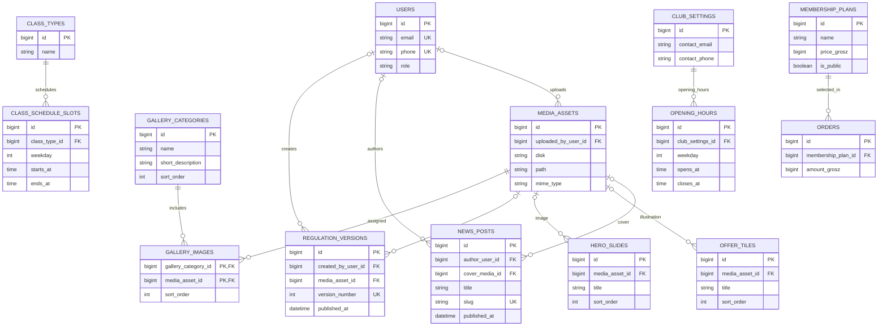
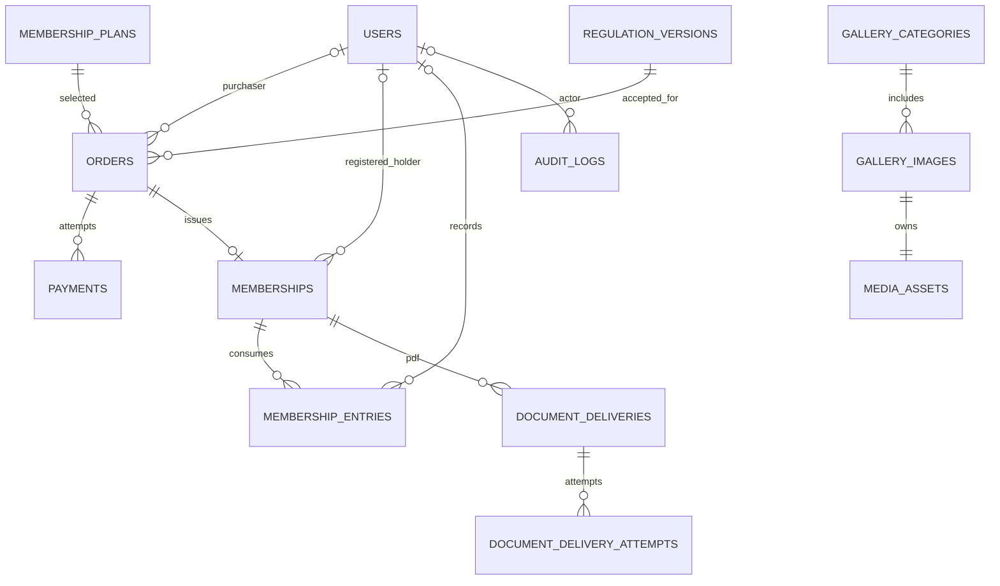

# ActiveFit — Database Design

**Version:** 1.0 (design draft)  
**Date:** 2026-11-04  
**Status:** READY FOR REVIEW — technical proposals are marked `PROPOSED`  
**Target:** MySQL 8+, Laravel, Inertia.js, Vue 3  
**Sources of truth:** `docs/product/requirements.md`, `docs/architecture/overview.md`, `AGENTS.md`.

> This is a logical/physical database specification, **not a set of executed migrations**. Confirmed business rules are separated from proposed technical structure. Where the requirements remain `OPEN`, the schema must not silently decide business behavior.

## 1. Goals and non-negotiable invariants

1. One order purchases **one** pass for **one holder**. Purchaser and holder may differ (`ORD-003`, `ORD-005`).
2. Guest purchase creates **no** `users` row and is never merged into a later account (`OD-05`). `users.email` and normalized `users.phone` are individually unique; guest purchaser/holder contact fields are not unique.
3. A verified payment produces **at most one** membership from an order. Order, payment and membership states are independent.
4. Money is stored as non-negative **integer grosze** (`BIGINT UNSIGNED`); currency is stored explicitly as `PLN`. No `FLOAT`/`DOUBLE` for amounts.
5. Order and membership contain immutable snapshots of the purchased plan terms (`PLN-005`). Price changes do not rewrite historical transactions.
6. `memberships.starts_on` and `memberships.expires_on` are `DATE`; the end date is **inclusive**. Calculate against `Europe/Warsaw`. `paid_at` records payment confirmation, separate from the scheduled start.
7. Limited-entry use is recorded individually with timestamp and the employee who confirmed it (`E2E-04`); concurrent attempts cannot exceed available entries.
8. Memberships and critical activity are preserved after expiry. Audit rows are append-only at the application authorization layer.
9. Every successfully purchased pass must be eligible for PDF delivery, including logged-in purchases. For a future-start renewal, PDF is queued immediately after verified payment; delivery failure does not affect the membership or payment.
10. **OPEN rules remain open**: mixed plan renewals, entry rollover after expiration, cancellations/refunds, minor-holder identity rules, guest document recipient rules and retention periods.

## 2. Conventions

| Aspect | Rule |
|---|---|
| Primary keys | `BIGINT UNSIGNED` auto-increment; foreign keys use `foreignId()` |
| Encoding | `utf8mb4`, InnoDB, consistent collation |
| Audit timestamps | `created_at`, `updated_at` in UTC; business UI timezone `Europe/Warsaw` |
| Effective membership period | `DATE starts_on` nullable until first visit; `DATE expires_on` nullable until first visit (inclusive) |
| External identifiers | Unique where provider contract guarantees uniqueness, otherwise scoped unique pair |
| Status fields | String/`VARCHAR` with PHP enums + application checks; migrations shouldn't obscure transitions |
| Snapshot fields | JSON + selected typed columns for queries and amounts |
| Soft delete | **Not** for orders, payments, memberships, entries or audit history |
| Sensitive data | Limit columns and role-based exposure; redact audit payloads and logs |
| Naming | `snake_case` tables/columns, explicit `*_id` foreign keys |

**Technical note:** store timestamps in UTC using a consistent Laravel DB connection convention. MySQL `DATETIME(6)` is suitable when the application writes UTC values explicitly; DB-local timezone settings must be pinned and tested. Date-only periods are intentionally not timestamps.

## 3. Relationship diagram (Mermaid ERD)

```mermaid
erDiagram
    USERS o|--o{ ORDERS : purchaser_account
    USERS o|--o{ MEMBERSHIPS : holder_account
    USERS o|--o{ MEMBERSHIP_ENTRIES : recorded_by
    USERS o|--o{ AUDIT_LOGS : actor
    USERS o|--o{ MEMBERSHIP_ADJUSTMENTS : performed_by
    MEMBERSHIP_PLANS ||--o{ ORDERS : selected_plan
    ORDERS ||--o{ PAYMENTS : attempts
    ORDERS ||--o| MEMBERSHIPS : issues_one
    MEMBERSHIP_PLANS ||--o{ MEMBERSHIPS : original_plan
    MEMBERSHIPS ||--o{ MEMBERSHIP_ENTRIES : usage
    MEMBERSHIPS o|--o{ MEMBERSHIPS : renewed_from
    MEMBERSHIPS ||--o{ MEMBERSHIP_ADJUSTMENTS : balance_changes
    MEMBERSHIPS ||--o{ DOCUMENT_DELIVERIES : pdf_dispatches
    DOCUMENT_DELIVERIES ||--o{ DOCUMENT_DELIVERY_ATTEMPTS : attempts
    MEMBERSHIP_PLANS {
        bigint id PK
        string name
        bigint price_grosz
        string kind
        int duration_months
        int included_entries
    }
    ORDERS {
        bigint id PK
        bigint purchaser_user_id FK
        bigint membership_plan_id FK
        string purchaser_email
        string purchaser_phone
        string holder_first_name
        string holder_last_name
        string sales_channel
        string payment_method
        bigint amount_grosz
        string status
    }
    PAYMENTS {
        bigint id PK
        bigint order_id FK
        string provider
        string status
        bigint amount_grosz
        datetime confirmed_at
    }
    MEMBERSHIPS {
        bigint id PK
        bigint order_id FK UK
        bigint holder_user_id FK
        bigint renewed_from_id FK
        date starts_on
        date expires_on
        int entries_granted
        int entries_remaining
    }
```

**Interpretation:** optional account FKs do **not** create guest users; purchaser and holder snapshots live on the order. A holder account FK is assigned only when the relationship to the actual holder was established during an authenticated flow — never inferred solely from matching phone/e-mail. The first ERD focuses on transactional tables; the CMS ERD below complements it. Details of CMS entities are in §6 and `cms.md`.


### 3.1. CMS relationship diagram (Mermaid ERD)

The CMS model is separate from sales, except for the shared `membership_plans` catalog. No duplicate price table is introduced.



**Design notes:**
- `gallery_images` links categories and images. Individual gallery photos have no content description; optional `alt_text` in `media_assets` serves accessibility.
- `regulation_versions` retains prior editions; the published version is selected by publication policy, not by overwriting previous text.
- `membership_plans` is the only price source; historical conditions remain snapshotted in orders/memberships.
- `OPENING_HOURS` is a **proposed normalization** of the club schedule. The existing §6 also permits storing validated hours in `club_settings`; select one variant before migrations, do not implement both.
- Relations to media and authors are optional where the content can exist without them; physical nullable FKs must match final validation rules.

## 4. Core identity and sales tables

### 4.1 `users` — registered customers and staff

| Column | Type | Constraints / meaning |
|---|---|---|
| `id` | BIGINT UNSIGNED | PK |
| `first_name`, `last_name` | VARCHAR(120) | NOT NULL |
| `email` | VARCHAR(254) | NOT NULL, UNIQUE; normalized lowercase for comparison |
| `phone` | VARCHAR(20) | NOT NULL, UNIQUE; normalized E.164 |
| `password` | VARCHAR(255) | nullable until invited employee sets password, only if auth flow supports this securely |
| `role` | VARCHAR(20) | `customer`, `employee`, `admin` |
| `suspended_at` | DATETIME(6) | NULL or suspended |
| `email_verified_at` | DATETIME(6) | nullable |
| `created_at`, `updated_at` | DATETIME(6) | standard |

**Rules:** database uniqueness on email and phone, not only Laravel validation. A family may use one phone across *holders* stored in orders, while separate registered accounts cannot duplicate phone. Employee suspension must be enforced on each protected request, including existing sessions. The exact login / invited-password flow will be described in `security.md`.

### 4.2 `membership_plans` — current editable catalog

| Column | Type | Constraints / meaning |
|---|---|---|
| `id` | BIGINT UNSIGNED | PK |
| `name` | VARCHAR(180) | NOT NULL |
| `description` | TEXT | nullable |
| `kind` | VARCHAR(30) | `time`, `entries` (other kinds require requirements change) |
| `price_grosz` | BIGINT UNSIGNED | NOT NULL |
| `currency` | CHAR(3) | `PLN` |
| `duration_months` | SMALLINT UNSIGNED | nullable; e.g. 1 for monthly, exact validity may vary by plan |
| `included_entries` | INT UNSIGNED | nullable for unlimited; NOT NULL for entry-limited plan |
| `terms` | JSON | restrictions (e.g. daytime-only), versioned schema |
| `is_active`, `is_public` | BOOLEAN | manage availability and public listing separately |
| `sort_order` | INT UNSIGNED | default 0 |
| `created_at`, `updated_at` | DATETIME(6) | standard |

**Check in app validation:** a valid plan has a supported, coherent duration/entry configuration. A hidden/inactive plan cannot be purchased from a public form. Do not delete plans referenced by past orders.

### 4.3 `orders` — one purchase = one holder/pass

| Column | Type | Constraints / meaning |
|---|---|---|
| `id` | BIGINT UNSIGNED | PK |
| `public_reference` | CHAR(26) | UNIQUE, opaque ULID for external URLs/support |
| `purchaser_user_id` | BIGINT UNSIGNED | nullable FK `users.id`; NULL for guest |
| `membership_plan_id` | BIGINT UNSIGNED | FK `membership_plans.id` (historical catalog reference) |
| `purchaser_first_name`, `purchaser_last_name` | VARCHAR(120) | NOT NULL, snapshot |
| `purchaser_email` | VARCHAR(254) | NOT NULL, snapshot; **not unique** |
| `purchaser_phone` | VARCHAR(20) | NOT NULL, normalized snapshot; **not unique** |
| `holder_first_name`, `holder_last_name` | VARCHAR(120) | NOT NULL, snapshot |
| `holder_email` | VARCHAR(254) | nullable, not unique (recipient policy still OPEN for gifts) |
| `holder_phone` | VARCHAR(20) | NOT NULL, normalized snapshot; not unique |
| `recipient_email` | VARCHAR(254) | NOT NULL; explicit email intended for PDF delivery; recipient policy for gift/minors OPEN |
| `plan_snapshot` | JSON | NOT NULL, immutable approved terms from purchase |
| `amount_grosz` | BIGINT UNSIGNED | NOT NULL, locked at checkout |
| `currency` | CHAR(3) | NOT NULL, `PLN` |
| `sales_channel` | VARCHAR(20) | `online`, `reception` |
| `payment_method` | VARCHAR(20) | `przelewy24`, `cash`, `card` |
| `status` | VARCHAR(30) | e.g. `pending`, `paid`, `cancelled`, `failed`; transitions versioned |
| `ordered_at` | DATETIME(6) | UTC order creation timestamp |
| `paid_at` | DATETIME(6) | nullable, immutable first verified confirmation timestamp |
| `created_by_user_id` | BIGINT UNSIGNED | nullable FK `users.id`, reception employee/system context |
| `created_at`, `updated_at` | DATETIME(6) | standard |

**Important:** `purchaser_user_id` does not identify the holder. Never attach a guest order to a newly created user automatically. Store a complete `plan_snapshot` such as `{ "name", "kind", "duration_months", "included_entries", "terms", "price_grosz", "currency", "snapshot_version" }`. Persist typed `amount_grosz` as the authoritative order total. Snapshot is immutable after order placement.

**Recipient e-mail:** storing an explicit recipient avoids guessing later from a changing user profile. The rule deciding which email may be entered/used for a gifted pass is still `OPEN` and must be finalized before implementing that checkout branch.

### 4.4 `payments` — online attempts and receipt confirmations

| Column | Type | Constraints / meaning |
|---|---|---|
| `id` | BIGINT UNSIGNED | PK |
| `order_id` | BIGINT UNSIGNED | FK, indexed |
| `provider` | VARCHAR(30) | `przelewy24` or `reception` |
| `method` | VARCHAR(20) | `przelewy24`, `cash`, `card` |
| `status` | VARCHAR(30) | `initiated`, `pending`, `confirmed`, `failed`, `cancelled`, `unknown` |
| `amount_grosz` | BIGINT UNSIGNED | matched against immutable order amount |
| `currency` | CHAR(3) | `PLN` |
| `provider_session_id` | VARCHAR(190) | nullable; unique with provider if guaranteed |
| `provider_transaction_id` | VARCHAR(190) | nullable; unique with provider if guaranteed |
| `confirmed_at` | DATETIME(6) | first successfully verified confirmation UTC |
| `confirmed_by_user_id` | BIGINT UNSIGNED | nullable FK `users.id`, for reception |
| `failure_code` | VARCHAR(100) | nullable; sanitized provider code |
| `created_at`, `updated_at` | DATETIME(6) | standard |

**Payment attempts:** multiple attempts per order are permitted; confirmation and issuance must be serialized by locking the **order**, not only a payment row. Confirm provider-specific uniqueness contracts before adding provider unique keys. Never store PAN/CVV/card secrets in the database. Provider callback payloads should be redacted; store stable identifiers, verification outcome and operational metadata only.

### 4.5 `memberships` — issued individual passes

| Column | Type | Constraints / meaning |
|---|---|---|
| `id` | BIGINT UNSIGNED | PK |
| `order_id` | BIGINT UNSIGNED | NOT NULL FK `orders.id`, **UNIQUE** |
| `membership_plan_id` | BIGINT UNSIGNED | FK for catalog reporting only |
| `holder_user_id` | BIGINT UNSIGNED | nullable FK `users.id`; only if explicitly verified/associated at purchase |
| `renewed_from_id` | BIGINT UNSIGNED | nullable self FK for supported renewal chain |
| `holder_first_name`, `holder_last_name` | VARCHAR(120) | immutable holder snapshot |
| `holder_phone` | VARCHAR(20) | immutable contact snapshot; not unique |
| `holder_email` | VARCHAR(254) | nullable snapshot; not unique |
| `plan_snapshot` | JSON | immutable copy of purchased terms |
| `starts_on`, `expires_on` | DATE NULL | Both NULL until first visit for new passes; both set atomically upon activation; end inclusive, `expires_on >= starts_on` when assigned |
| `activated_at` | DATETIME(6) NULL | UTC instant of first activation; never overwritten |
| `activated_by_user_id` | BIGINT UNSIGNED NULL | FK `users.id` (staff/admin); required when first activated |
| `entries_granted` | INT UNSIGNED | nullable for unlimited; base + rollover on applicable renewals |
| `entries_remaining` | INT UNSIGNED | nullable for unlimited; never negative |
| `status_override` | VARCHAR(20) | nullable `cancelled`/`suspended` **only after business approval** |
| `created_at`, `updated_at` | DATETIME(6) | standard |

**Derived current status:** paid with `starts_on IS NULL` = `pending_activation`; known future start = `scheduled`; within period and allowed by overrides/entry availability = `active`; after period = `expired`; zero entries = `exhausted`. Distinguish `paid` from `active`. `pending_activation` receives the PDF after payment without fabricated dates; `scheduled` advance renewal also receives PDF after payment. Whether an exhausted entry pass renews early is still `OPEN` when not covered by approved rules.

**Why both holder snapshots and `holder_user_id`?** History remains truthful even if an account changes contact data, and a guest holder can exist without creating a login. Display grouped search results per holder/pass; matching phone is a search criterion, never an identity merge key.

## Potwierdzona reguła aktywacji — ACT-01 (2026-11-05)

**CONFIRMED:** opłacenie zakupu wydaje karnet o statusie `pending_activation`, ale **nie uruchamia** jego okresu ważności. Przy **pierwszej wizycie posiadacza** pracownik lub administrator weryfikuje właściwy karnet i uruchamia okres ważności; zapisujemy `activated_at` (UTC), `activated_by_user_id`, `starts_on` (lokalny dzień wizyty według `Europe/Warsaw`) i wyliczone `expires_on` (włącznie) według zakupionego snapshotu planu. Nie można aktywować nieopłaconego karnetu. Powtórzenie aktywacji niczego nie przelicza. Zapis aktywacji i audytu jest atomowy.

**Przedłużenia:** opłacone przedłużenie aktywnego karnetu o tym samym obsługiwanym typie ma przyszły okres od `previous.expires_on + 1 day` — **bez ponownej wizyty aktywacyjnej**. Dla karnetu, który sam jeszcze nie został aktywowany, sposób kolejkowania następnych zakupów pozostaje `OPEN`; nie przypisujemy automatycznie dat bez znanej daty startu źródła.

**PDF po opłacie:** generujemy i wysyłamy także dla `pending_activation`. Zawiera imię i nazwisko posiadacza, dane planu i komunikat „Ważność rozpocznie się przy pierwszej wizycie w klubie”; **nie zawiera fikcyjnych dat**. Dla opłaconego przedłużenia ze znanym przyszłym okresem PDF pokazuje rzeczywiste daty. Nie wymagamy automatycznej drugiej wysyłki PDF po aktywacji; ewentualne późniejsze pobranie aktualnego PDF może uwzględniać ustalone daty. Błąd e-maila nie cofa zakupu ani nie tworzy nowego karnetu.

**Granica stanów:** `orders/payments: paid` ≠ `memberships: active`. Statusy UI obejmują `awaiting_payment`, `pending_activation`, `scheduled` (przedłużenie) i `active`, a także `expired`/`exhausted` w odpowiednim kontekście. Faktyczną aktywację i wejście do klubu zapisujemy jako **różne zdarzenia**; odliczenie wejścia z karnetu limitowanego wymaga osobnej świadomej akcji, nawet jeśli odbywa się podczas tej samej wizyty.

### Database constraints for first-visit activation (PROPOSED implementation)

- `memberships.activated_at` and `activated_by_user_id` are NULL for `pending_activation`, both set exactly once for manual first activation. For a scheduled renewal, membership dates are known at issuance and no separate manual check-in activation is required; model its start from the dates and the link to the preceding pass.
- `CHECK ((starts_on IS NULL AND expires_on IS NULL) OR (starts_on IS NOT NULL AND expires_on IS NOT NULL AND expires_on >= starts_on))` where available, plus application validation.
- The activation action uses a transaction with `SELECT ... FOR UPDATE` on membership and an audit insert in that transaction. It rejects unpaid/cancelled/already activated records and avoids two conflicting dates under concurrent requests.
- Add an index supporting the reception queue, e.g. `(holder_phone, starts_on)` together with a payment/state filter on the joined order; do not assume phone identifies one person.
- Existing payment records retain immutable `paid_at`. `activated_at` is distinct from `paid_at` and `membership_entries.used_at`.


## 5. Entry balances, renewals, documents and audit

### 5.1 `membership_entries` — each actual use

| Column | Type | Constraints / meaning |
|---|---|---|
| `id` | BIGINT UNSIGNED | PK |
| `membership_id` | BIGINT UNSIGNED | FK |
| `recorded_by_user_id` | BIGINT UNSIGNED | FK `users.id`, employee/admin |
| `used_at` | DATETIME(6) | UTC instant entry was recorded |
| `request_id` | CHAR(36) | UUID, **UNIQUE**, deduplicate one submission/retry |
| `created_at` | DATETIME(6) | insert time |

An entry is a historical fact. Do not delete it to increase the balance. If corrections are authorized in the future, record a compensating adjustment and audit record. Enforce business date/time validity and nonnegative balance in the same transaction as inserting this row.

### 5.2 `membership_adjustments` — rollover / approved corrections

| Column | Type | Constraints / meaning |
|---|---|---|
| `id` | BIGINT UNSIGNED | PK |
| `membership_id` | BIGINT UNSIGNED | FK target |
| `source_membership_id` | BIGINT UNSIGNED | nullable FK source of rollover |
| `kind` | VARCHAR(30) | `rollover`, future `correction` after policy approval |
| `delta_entries` | INT SIGNED | positive/negative change; no resulting negative balance |
| `performed_by_user_id` | BIGINT UNSIGNED | nullable FK for worker/system-origin |
| `reason` | VARCHAR(250) | nullable controlled reason |
| `idempotency_key` | VARCHAR(190) | UNIQUE |
| `created_at` | DATETIME(6) | standard |

For a supported entry-pass renewal: compute unspent entries **under locks**, create new membership, add rollover exactly once and debit/mark transferred quantity on source using an approved balance operation. `UNIQUE(idempotency_key)` prevents replay, while locking protects simultaneous usage/renewal. **The policy for transfers after source expiration is still OPEN**; do not implicitly allow indefinite banking.

### 5.3 `document_deliveries` and `document_delivery_attempts`

`document_deliveries`:

| Column | Type | Constraints / meaning |
|---|---|---|
| `id` | BIGINT UNSIGNED | PK |
| `membership_id` | BIGINT UNSIGNED | FK |
| `kind` | VARCHAR(30) | `membership_pdf` |
| `recipient_email` | VARCHAR(254) | snapshot of confirmed destination |
| `scheduled_for` | DATETIME(6) | due time (UTC) at start of valid day or later |
| `status` | VARCHAR(20) | `pending`, `processing`, `sent`, `failed` |
| `sent_at` | DATETIME(6) | nullable |
| `storage_path` | VARCHAR(500) | nullable protected file path; not public URL |
| `idempotency_key` | VARCHAR(190) | UNIQUE for initial automatic delivery |
| `created_at`, `updated_at` | DATETIME(6) | standard |

`document_delivery_attempts`: `id`, `document_delivery_id` FK, `attempt_number`, `status`, `error_code` (redacted), `triggered_by_user_id` nullable, `attempted_at` UTC. Unique `(document_delivery_id, attempt_number)`.

**Rules:** enqueue only **after DB commit**. Scheduler picks due deliveries; queue workers use an atomic claim/lock. Failure retries **only delivery**. Manual resend creates a traceable new attempt (and possibly a new delivery request with its own key), never a new purchase or membership. Keep PDFs outside publicly accessible storage and set a retention policy before production.

### 5.4 `audit_logs` — append-only business event journal

| Column | Type | Constraints / meaning |
|---|---|---|
| `id` | BIGINT UNSIGNED | PK |
| `actor_user_id` | BIGINT UNSIGNED | nullable FK, system actor represented separately |
| `actor_type` | VARCHAR(30) | `admin`, `employee`, `system` |
| `action` | VARCHAR(100) | e.g. `membership.entry_recorded`, `plan.price_updated` |
| `subject_type`, `subject_id` | VARCHAR(100), BIGINT UNSIGNED | polymorphic reference; no FK for polymorphic subject |
| `old_values`, `new_values` | JSON | nullable, **whitelisted** safe fields |
| `metadata` | JSON | nullable, sanitized request/correlation references |
| `occurred_at` | DATETIME(6) | immutable UTC occurrence time |

Critical membership/sales-config changes and their audit rows are saved **in the same transaction**. No update/delete route for audit history. DB permissions and retention/backups should reduce tampering risk. Keep e-mails/phones and provider secrets out of generic before/after captures whenever possible. For account deletion/privacy requests, design a lawful redaction/retention process separately (currently OPEN).

## 6. CMS entities (focused, not a generic page builder)

A compact proposal consistent with approved CMS scope; exact admin form shape follows the HTML reference screens.

| Table | Main columns / responsibility |
|---|---|
| `news_posts` | `id`, `title`, `slug` UNIQUE, `excerpt`, `body`, `cover_media_id`, `published_at`, `is_published`, timestamps |
| `media_assets` | `id`, `disk`, `path`, `mime_type`, `size_bytes`, `alt_text`, `uploaded_by_user_id`, timestamps; protected validation/upload pipeline |
| `gallery_categories` | `id`, `name`, `short_description`, `sort_order`, `is_published`, timestamps |
| `gallery_images` | `gallery_category_id`, `media_asset_id`, `sort_order`; composite UNIQUE membership; **gallery image has no separate caption/description** |
| `offer_tiles` | `id`, `title`, `short_description`, `media_asset_id`, `sort_order`, `is_published`, optional link target, timestamps |
| `hero_slides` | `id`, `media_asset_id`, `title`, `description`, `sort_order`, `is_published`, timestamps |
| `regulation_versions` | `id`, `version_number` UNIQUE, `body`, nullable `media_asset_id`, `published_at`, `created_by_user_id`, timestamps; preserve prior published versions |
| `club_settings` | preferably one row or validated key-value config for address, contact, opening hours, map coordinates and public metadata |
| `class_types` | `id`, `name`, `description`, `is_published` |
| `class_schedule_slots` | `id`, `class_type_id`, `weekday`, `starts_at`, `ends_at`, optional `instructor_name`, `is_published` |

The public **price list** reads from `membership_plans` (one catalog source), not a second price table. CMS text for fixed homepage sections may be stored in a constrained settings/page-content structure **only where HTML requires editable text**. CMS-OD-03 is **CONFIRMED**: online checkout requires acceptance of the currently published regulation version. Persist `orders.accepted_regulation_version_id` (FK to immutable `regulation_versions`) and `orders.regulation_accepted_at`; wording of the legal declaration must be reviewed before production.

## 7. Indexes, constraints, deletion behavior

| Table | Index/constraint | Purpose |
|---|---|---|
| `users` | UNIQUE(`email`), UNIQUE(`phone`) | Registered account identity only |
| `orders` | UNIQUE(`public_reference`), INDEX(`purchaser_user_id`, `created_at`), INDEX(`holder_phone`, `created_at`), INDEX(`status`, `ordered_at`) | Lookup/history |
| `payments` | INDEX(`order_id`, `status`), provider-scoped unique external reference where applicable | Attempts and callback deduplication |
| `memberships` | UNIQUE(`order_id`), INDEX(`holder_user_id`, `starts_on`), INDEX(`holder_phone`, `expires_on`), INDEX(`renewed_from_id`) | Issuance, holder search and renewal |
| `membership_entries` | UNIQUE(`request_id`), INDEX(`membership_id`, `used_at`) | Retry protection, history |
| `membership_adjustments` | UNIQUE(`idempotency_key`), INDEX(`membership_id`, `created_at`) | Rollover idempotency |
| `document_deliveries` | UNIQUE(`idempotency_key`), INDEX(`status`, `scheduled_for`) | Scheduler / queue |
| `audit_logs` | INDEX(`subject_type`, `subject_id`, `occurred_at`), INDEX(`actor_user_id`, `occurred_at`) | Administrator audit queries |

**Deletion policy:** use `RESTRICT` for historical money/pass FKs; do not cascade-delete paid orders, payments, memberships, usage or audit logs when deactivating an account or hiding a plan. Holders and snapshots should remain even if the plan is no longer on sale. Define retention/anonymization obligations before production.

**Additional DB guards (PROPOSED):** CHECK constraints where supported (e.g. `(starts_on IS NULL AND expires_on IS NULL) OR (starts_on IS NOT NULL AND expires_on IS NOT NULL AND expires_on >= starts_on)`, nonnegative balances, valid monetary range), with validation in application code as well. Establish exact nullability and FK delete actions in reviewed migrations. MySQL does not offer partial unique indexes as PostgreSQL does; for “only one confirmed payment” semantics prefer transactional state checks and/or a dedicated unique confirmed-reference design, not a naive uniqueness constraint over nullable status.

## 8. Transaction boundaries and race conditions

### 8.1 Successful payment confirmation → one membership

1. Authenticate/verify provider callback according to **Przelewy24's integration contract**; compare provider identity, order reference, amount and currency. Never trust return URL alone.
2. Start transaction; `SELECT ... FOR UPDATE` the `orders` row.
3. Check whether this order is already paid and a membership already exists. On replay, return success **without changing `paid_at`, dates or balance**.
4. Record confirmed payment and **first** `paid_at` (UTC). Issue one `pending_activation` pass without validity dates; do not derive dates from the payment timestamp.
5. For a supported renewal of an already active pass, determine the new scheduled interval after previous expiry; for a new first-use pass keep both dates NULL until staff/admin first-visit activation. Block unsupported renewal paths.
6. Create exactly one `memberships` row (`UNIQUE(order_id)`), snapshot holder/terms; if eligible for rollover, apply it under source locks once.
7. Insert audit log and pending document delivery in the transaction; commit. Queue dispatch happens after commit.
8. Queue PDF delivery immediately after verified payment regardless of the membership start date. Pending-first-visit documents show no unknown dates.

**Callback time:** keep `paid_at` as the **first verified successful confirmation instant** (not order creation), and never rewrite it on retry. If the payment provider exposes a distinct authoritative settlement timestamp, its use must be validated against the provider protocol and the approved confirmation rule.

### 8.2 Record a limited-entry visit

1. Authorize staff; validate active date, status and membership type.
2. Start transaction; lock `memberships` row; verify `entries_remaining > 0`.
3. Deduplicate `request_id`; decrement balance atomically; insert `membership_entries` with `used_at` and operator ID; insert audit row.
4. Commit; return updated balance. On contention, only one competing last-entry request may succeed.

### 8.3 Apply unused-entry rollover

1. Confirm the *business eligibility* of source/target passes (for types or expired sources not covered by requirements, **do not execute rollover**).
2. Lock source and target consistently (ascending primary key) to avoid deadlocks.
3. Determine transferable balance; apply exactly once with stable idempotency key derived from source/target and operation.
4. Ensure old entries cannot be consumed after transfer; record the transfer adjustment, resulting balance and audit event atomically.

### 8.4 Schedule / retry PDF

1. Scheduler queries `document_deliveries` with `status IN (pending, failed)` and `scheduled_for <= now()`; honor retry policy.
2. Worker claims delivery atomically and verifies membership exists and payment is confirmed; a first-visit activation date is not required for PDF delivery.
3. Generate PDF from stored snapshots (pending first visit: no dates; scheduled: known dates); send only to the confirmed recipient; log a delivery attempt.
4. Set `sent` once successful. On failure save error metadata (no secrets), retry with backoff, and allow controlled administrator resend without touching payment/pass.

## 9. Membership month boundary rule (OD-01 CONFIRMED)

Use calendar-month arithmetic **with clipping if target day doesn't exist**, and distinguish the inclusive expiry from the next-month target:

- If the target next month **contains the same day number**, `expires_on = target_date - 1 day`.
- If the target month **does not contain that day number**, `expires_on = last day of target month` (no extra subtraction).

Examples (approved):

| `starts_on` | `expires_on` inclusive |
|---|---|
| 2026-09-28 | 2026-10-27 |
| 2026-04-30 | 2026-05-29 |
| 2027-01-31 | 2027-02-28 |
| 2028-01-31 | 2028-02-29 |
| 2027-02-28 | 2027-03-27 |
| 2028-02-29 | 2028-03-28 |
| 2026-10-01 | 2026-10-31 |

**Renewal:** `new.starts_on = current.expires_on + 1 day`; compute the new end date using the same rule *from that new start*. Consecutive renewals may shift month-day anchors in short months; do not invent long-term anchor retention behavior without a separate business decision. Implement this in one pure domain calculator and test leap years, 28/29/30/31 and multi-renewal sequences.

## 10. Testing contract (Pest + integration)

| Test | Expected invariant |
|---|---|
| Duplicate verified Przelewy24 callbacks | 1 membership per order, first `paid_at` stable, one initial delivery |
| User email/phone duplicates | DB UNIQUE rejection for registered accounts; guest orders still possible |
| Family shared phone | Separate holder/pass results, no automatic merge |
| Purchase at 23:59, confirmation after midnight | Start date taken from confirmation in Warsaw |
| Payment failed / uncertain | Order retained, membership not issued |
| Early renewal | Future period starts after previous inclusive expiry, PDF sent after payment, including future-start renewals |
| First-visit activation | Paid new pass starts with dates NULL; only staff/admin can set them once with audit and concurrency protection |
| End-of-month rules | All approved dates plus additional leap-year and 31→30 cases |
| Last entry used concurrently | One success, one rejection, no negative balance |
| Rollover callback repeated | Balance credited once, old balance not double-spendable |
| Email delivery fails and retries | Same membership/payment, attempt log updated |
| Employee visits admin-only endpoint | HTTP 403, no record mutation |
| Old pass expires | Still visible in authorized history and audit |
| New price published | Historic order/membership snapshots unchanged |

## 11. Explicit OPEN decisions / implementation boundaries

| Reference | Unresolved detail | Design implication |
|---|---|---|
| OD-02a | Different plan kinds and independent parallel passes | Don't auto-combine all memberships of a phone/holder |
| OD-02 | Rollover after source pass expiry | Eligibility must be decided before finalizing rollover behavior |
| OD-04 | Refunds, cancellations, manual corrections | Reserve structural extension points; do not enable operations without authorization rules |
| OD-07 | Minor holders, identity checking, gift recipient authorization | Do not derive holder account from contact fields; delivery recipient must be confirmed |
| OD-10 | Regulation acceptance/version policy | Versioned rules accepted explicitly at online checkout; persist version FK and acceptance timestamp |
| OD-11 | PDF retention, PII erasure, handling incorrect recipient | Data protection policy before production |
| NFR-010 | SLOs and backup retention | Finalize in deployment/operations design |

## 12. Proposed migration order and implementation checklist

1. `users` and authentication groundwork (unique normalized contact fields).
2. `membership_plans`.
3. `orders` and `payments`.
4. `memberships` (self-reference to renewed pass after table creation if needed).
5. `membership_entries`, `membership_adjustments`.
6. `document_deliveries`, `document_delivery_attempts`.
7. `audit_logs`.
8. CMS media and content tables, gallery_images with unique media FK (no category pivot), regulation versions, settings and class schedule.
9. Factories/seeders for sample plans and roles; no real personal data in fixtures.
10. Pest tests for database uniqueness, locking, idempotency, date calculator, rollover, PDF scheduling and access control before enabling checkout.

**Ready-to-implement gate:** confirm column-level nullable/FK contracts, provider reference semantics and every `OPEN` business rule required by the selected feature. Each migration must be reviewed together with the service/action that writes those records and the matching test suite. Do not auto-generate migrations from this document without that review.

## 13. Confirmed schema amendments — 2026-11-04

These changes supersede any earlier diagram columns or delivery scheduling instructions that disagree:

- **Orders:** `accepted_regulation_version_id` FK nullable during draft creation but NOT NULL for completed online purchase, `regulation_accepted_at` timestamp; immutable snapshot of purchaser and holder, plus plan and amount. `paid_at` is set on confirmed payment; a payment receipt is not an access check-in.
- **Users:** admin bootstrap seeder; unique normalized phone/email; all roles can edit own profile and password. Historical purchaser/holder snapshots do not change.
- **Membership entries:** `used_at` in UTC, `recorded_by_user_id` FK and idempotency `request_id` UNIQUE scoped appropriately.
- **Documents:** enqueue PDF delivery after confirmed payment, including future-start renewals. Do NOT schedule the initial PDF for `starts_on`. Delivery failures never recreate membership or payment.
- **CMS images:** use `gallery_images` (not many-to-many pivot); each `media_assets` record has one sole owner/usage. Physical file deletion after DB commit with retry on storage error.
- **Club hours:** one row per weekday, no holiday overrides in MVP.
- **Audit:** append-only `audit_logs` for critical changes, actor/system, timestamps and redacted diffs.
- **ACT-01 CONFIRMED:** a newly paid pass waits for authorized first-visit activation. Keep dates NULL until activation; PDF is dispatched after purchase with a pending-activation explanation instead of unconfirmed dates.

### Supplemental relation diagram


