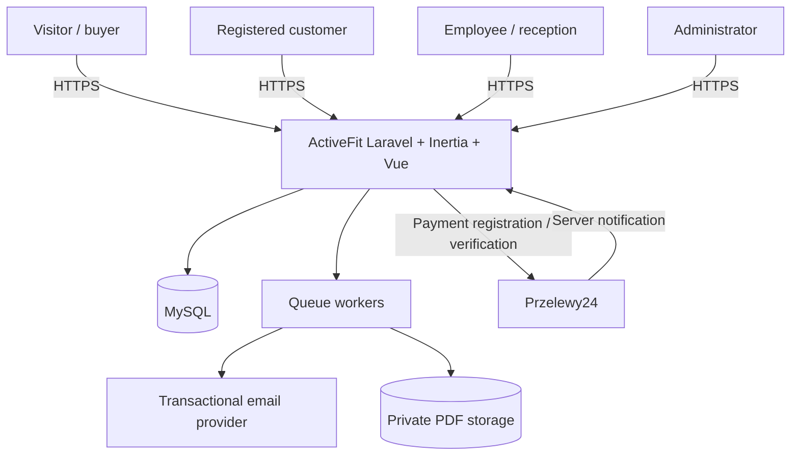
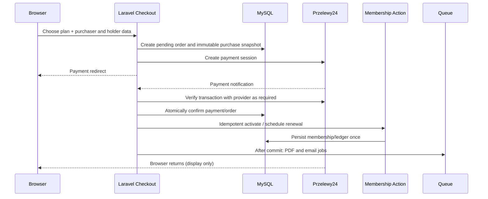

# ActiveFit — Architecture Overview

> **Version:** 1.0-draft  
> **Date:** 2026-10-27  
> **AI SDLC phase:** Solution Design  
> **Path:** `docs/architecture/overview.md`  
> **Status:** PROPOSED architecture based on confirmed product decisions. This document does **not** resolve open business requirements.

## 1. Purpose and references

This document describes the system's overall architecture, responsibility boundaries, main technical flows, and operational assumptions. It is intended for developers and coding agents before database design and implementation.

**Source of truth for business requirements:** `docs/product/requirements.md`. Implementation guardrails: `AGENTS.md`. Project tooling and repository setup: `docs/architecture/repository-setup.md`.

**Decision vocabulary:** **CONFIRMED** = explicitly agreed with the product owner; **RECOMMENDED** = architectural choice proposed here; **OPEN** = not yet decided; implementation must not assume an answer.

## 2. Goals and boundaries

### Product capabilities

- Public website: landing page, offers, prices, schedule, news, photo gallery, contact and regulations.
- Custom CMS: regulations with version history, news, gallery categories, price list, contact information, editable service tiles and image carousel with photo/description.
- Sales: one order purchases **one** membership, online via **Przelewy24** or at reception via **cash/card**.
- Registered and **guest** checkout; purchaser and membership holder may be different people; buying for a family member is supported.
- Memberships: calendar-month validity rules, future-dated renewal after current membership, limited-entry passes and unused-entry carryover on renewal.
- Customer area, reception lookup primarily by phone number, employee accounts and administrator panel.
- PDF delivered by email for guest checkout / membership purchased for another person.

### Explicitly out of scope for MVP

Native mobile app, entry gates/scanners/QR-based attendance, class reservations, automatic recurring charges, multi-location management, large CRM, automatic account merging and Apple/Google Wallet integration. Do not design dependencies on these features.

## 3. Technology and architectural style

| Area | Choice | Status |
|---|---|---|
| Backend and web application | Laravel (single application) | CONFIRMED |
| Server-driven frontend | Inertia.js + Vue 3 | CONFIRMED |
| UI languages and tooling | TypeScript, Tailwind CSS; Polish copy | CONFIRMED |
| Database | MySQL | CONFIRMED |
| Business logic tests | Pest | CONFIRMED |
| Code hosting | GitHub | CONFIRMED |
| Money | Integer, in **grosze**; do not use floating point | CONFIRMED |
| Payments | Przelewy24; cash/card at reception | CONFIRMED |
| Architectural style | **Modular monolith** following Laravel conventions | RECOMMENDED |
| Identity/authentication | Laravel web session, CSRF, Policies, Form Requests | RECOMMENDED |
| Background work | Laravel Queue (initially database-backed) | RECOMMENDED |
| PDF storage | Private Laravel Storage | RECOMMENDED |
| Local timezone | `Europe/Warsaw` for membership dates, UTC for event timestamps | RECOMMENDED |
| Tool versions | Follow repository lockfiles and actual supported releases | REQUIRED IN IMPLEMENTATION |

There is **one Laravel deployment, one codebase and one primary database**. Inertia renders Vue pages through Laravel routes; do not introduce a separate general-purpose REST API, microservices or a generic repository layer around Eloquent.

### Context diagram



**Trust boundary:** the browser, payment redirects and incoming external notifications are never authoritative sources of price, membership eligibility or payment success.

## 4. Logical modules and responsibilities

The modules below are logical boundaries **inside** the Laravel application, not deployable services. Prefer familiar Laravel folders and add namespaces only when complexity justifies them.

| Module | Owns | Does not own |
|---|---|---|
| **Identity & Staff** | User accounts, unique normalized phones/emails in `users`, roles, invitations, suspension, authorization | Historical guest purchases |
| **CMS** | Public content, visibility/order, media metadata, regulations and their versions | Payment transactions |
| **Catalog** | Plan definitions, prices in grosze, published availability, time/entry constraints | Editing past purchased terms |
| **Checkout & Orders** | Buyer/holder snapshots, one-plan-per-order rule, purchase channel, order state | Declaring a payment successful from the browser |
| **Payments** | Przelewy24 adapter, verification, provider identifiers, payment state, callbacks; reception cash/card recording | Membership date arithmetic |
| **Memberships** | Assignment to holder, terms snapshot, activation and renewal, month-end rules, entry balance and usage ledger | External payment calls |
| **Documents & Notifications** | PDF creation, email delivery, retries, delivery metadata | Creating a second membership on retry |
| **Operations & Reporting** | Reception lookup, admin dashboards, transaction views and audit | Cross-user account merging |

### Contracts between modules

- **Catalog → Checkout:** selected plan is loaded from DB server-side, price and terms are snapshotted into the order. Browser-supplied price is ignored.
- **Checkout → Payments:** persisted pending order identified by stable unique reference before redirecting to Przelewy24.
- **Payments → Memberships:** only a **verified** paid transition may issue one `pending_activation` membership; a separate authorized first-visit action starts validity. Both issuance and activation must be idempotent.
- **Memberships → Documents:** after successful database commit, enqueue PDF generation and email. Delivery failures never roll back the successful charge or create another membership.
- **Identity ↔ Orders:** registered `user_id` is optional; guest purchaser and holder snapshots remain independent of later accounts.
- **Operations → Memberships:** entry redemption and manual grants go through server-side Actions with validation, authorization and audit information.

## 5. Suggested Laravel project organization

Use a conventional directory structure rather than introducing a framework within the framework.

```text
app/
  Actions/
    Checkout/
    Memberships/
    Payments/
    Staff/
  Http/
    Controllers/
      Public/
      Customer/
      Staff/
      Admin/
      Payments/
    Requests/
    Middleware/
  Models/
  Policies/
  Jobs/
  Notifications/
  Services/
    Payments/        # provider-specific integration adapters
    Pdf/             # selected PDF renderer behind focused boundary
  Support/
    Money/
    Dates/
resources/js/
  pages/
    public/
    customer/
    staff/
    admin/
  layouts/
  components/
    ui/
    shared/
  composables/
  types/
routes/
  web.php
  # Additional route files only when needed, loaded explicitly
 tests/
  Feature/
  Unit/
  Integration/
docs/
  product/
  architecture/
  development/
```

**Working rules:** controllers orchestrate; Form Requests validate; Policies authorize; focused Actions perform transactional business operations; Eloquent handles persistence; Jobs/Notifications handle slow or retryable side effects. Avoid creating a separate service or interface for every CRUD operation. Names shown here are guidance, not mandatory scaffolding.

## 6. Main request paths

### 6.1 Public pages and CMS

1. Laravel route resolves published content and related media in a controlled query.
2. Controller responds with `Inertia::render(...)` and typed page props.
3. Vue renders the current UX/UI; content changes are managed in the admin panel.
4. Admin writes are authorized, validated and audited when sensitive; rich text is sanitized/limited to approved content formats to prevent stored XSS.
5. Price list and purchasing rules are separate concepts: CMS text does not determine checkout price; Catalog does.

**Regulations:** content is a single editable document with preserved prior versions; active version is identifiable. Historical versions must not be silently overwritten.

### 6.2 Guest / logged-in purchase



**Important:** actual Przelewy24 signature and verification requirements must be implemented against the provider's current official integration specification. Never infer payment success from the browser redirect. Validate provider IDs, order identity, amount in grosze, currency, authentication/signature and replay handling.

**Guest and family purchase:** each order has exactly one membership; purchaser and holder are recorded separately. The purchaser does not become the holder merely by paying. A guest does not get a temporary `users` account. Email delivery target must follow confirmed recipient rules, with unresolved gift/minor cases still **OPEN**.

### 6.3 Reception sale

Employee → authorized staff form → server-side Catalog price → create order with channel `reception` and payment method `cash` or `card` → record authorized employee → activate under agreed business date rules → audit operation → send applicable document/notification.

No automatic payment verification is expected for physical card transactions recorded at reception: this flow represents employee-confirmed offline payment, not a card terminal integration. Whether receipts / fiscal integrations are needed remains outside this overview.

### 6.4 Renewal and entry usage

- Renewals must not discard remaining paid time. New **time-based** coverage follows current coverage rather than the earlier purchase date.
- **OD-01 RESOLVED:** Use the approved rule: matching day next month minus one day; if that day does not exist, expiry is the last day of the target month. Examples: Sep 28 → Oct 27; Apr 30 → May 29; Jan 31, 2027 → Feb 28; Jan 31, 2028 → Feb 29; Feb 28, 2027 → Mar 27. Start/end dates are inclusive and assigned at first visit for new passes.
- A subsequent time-based renewal starts on the day after the existing inclusive `expires_on`; compute its new end from that new start date. Preserve the originally purchased period even if renewal is purchased early.
- Unused entries are added to a renewed **entry-based** package. Record an audit/ledger event and guard against crediting the same remainder twice.
- An entry redemption uses a DB transaction and lock/atomic condition. Concurrent staff actions must not spend the final entry twice.
- **Do not invent:** delayed online confirmation date, entry carryover after expiry, mixing different plan types and cross-plan sequencing. See open decisions below.

## 7. Identity model, authorization and privacy

**Registered accounts:** `users.email` and normalized `users.phone` are unique within registered users. Guest buyer/holder data can repeat. A later account can use contact details previously provided in guest checkout; **no automatic or manual claiming/merging** of old guest orders into that account (OD-05 RESOLVED).

A telephone number supports **lookup**, not unique identification of a holder: family members can share a contact number. Staff results must clearly disambiguate people before an entry is consumed or a membership edited.

**Three roles:** `customer`, `employee`, `admin`. Admin manages employee identity, role and suspension; employee can use operational flows but cannot modify global pricing or staff permissions. Suspended users must be denied even with an already established session. Policies and scoped queries enforce data isolation, including for customer views. Guest PDF/status endpoints must use scoped unpredictable tokens with expiry or equivalent secure access.

Store PDFs privately; do not publish personal details through predictable URLs. Do not place P24 credentials, full personal data or PDFs in logs. Apply rate limits to login, guest checkout, staff search and document retrieval; follow data-minimization and retention decisions once settled.

## 8. Transaction, concurrency and failure strategy

- **Amounts:** `integer` grosze end to end. Assert expected currency and exact amount at payment boundaries; use integer arithmetic only.
- **Persist before payment:** save pending order with plan/price snapshot and unique purchase/payment identifiers.
- **Idempotency:** unique provider event/transaction reference and/or unique membership-per-order constraint as appropriate; treat duplicate callbacks and retried Jobs as normal.
- **Atomicity:** payment state transition and membership creation are coordinated under a DB transaction with a lock or conditional update. Do not hold DB locks while calling Przelewy24 or email services.
- **Side effects:** queue email and PDF after transaction commit. Retries must be safe and observable; failed email cannot cause duplicate membership issuance.
- **Entry balance:** ledger or auditable usage records plus an atomic balance/lock guarantee that remaining entries never become negative.
- **Recovery:** log non-sensitive identifiers and failure reasons; support reconciliation of pending payments and operator investigation. A reconciliation job is recommended but its exact cadence and behavior are implementation design decisions.
- **Time:** use UTC for payment/audit timestamps; calculate membership business dates in `Europe/Warsaw` to avoid date shifts across DST.

## 9. Frontend boundary and UX states

Inertia is the main transport between Laravel and Vue. Frontend receives minimal authorized props, not database rows containing unrelated personal information.

Use Vue 3 `<script setup lang="ts">`, typed props/forms and Tailwind. Keep distinct layouts for public content, customer, staff and admin. Reuse small components where practical without a premature design-system library.

All forms must handle processing, validation failure, server errors, success and retry. Checkout pages must clearly distinguish **pending payment**, **payment unsuccessful**, **paid / awaiting first activation** and **membership active**. Staff lookup should be mobile-friendly; when a phone number matches multiple people, require explicit selection. Public content and any slides with captions should be keyboard accessible and responsive.

## 10. Operations and environments

| Topic | Recommendation |
|---|---|
| Environments | `local`, `testing/CI`, `staging`, `production`, isolated credentials |
| Database | MySQL with migrations and safe factory/seed data |
| Background work | Queue worker supervised in staging/production; failed jobs observable |
| Scheduler | Used for time-based notices/reconciliation if enabled |
| Email | Sandbox locally and on test environments; production SMTP/API secrets in environment |
| Files | Private storage for generated documents; public disk/CDN only for intentionally public CMS media |
| Deploy | Build assets; run migrations with review; deploy queue worker and scheduler configuration |
| Logs and backup | Redacted structured logs, error monitoring, encrypted database/storage backups, restore procedure |
| CI on GitHub | Composer checks, Pest, Pint, JS lint/typecheck/build; E2E once configured |

## 11. Testing expectations

Use Pest for unit, feature and integration tests. In particular, test:

1. Guest purchase, family holder different from purchaser, and strict one-membership-per-order behavior.
2. Correct activation requires authorized first-visit action after verified P24 payment; duplicate/invalid callbacks and repeated activation requests are safe.
3. Reception cash/card sale with employee audit.
4. Inclusive last-day tests: Sep 15 → Oct 14; Oct 1 → Oct 31; Jan 31, 2027 → Feb 28, 2027; Jan 31, 2028 → Feb 29, 2028; Feb 28, 2027 → Mar 27, 2027; Apr 30 → May 29. Test renewal starting the day after the previous expiry.
5. Renewal preserving time and transferring unused entries exactly once; concurrent use of final entry.
6. Unique normalized registered-user phone/email, permitted guest duplicates, and **no guest-to-account linking**.
7. Staff suspension on an existing session, role boundaries and forbidden direct object access.
8. CMS sanitization, regulation revision history, secure PDF access and failed email retries.

Mock external services in automated tests. Run real sandbox Przelewy24 flows only in deliberate integration environments.

## 12. Architecture decision register

| ID | Decision | Status | Note |
|---|---|---|---|
| ARCH-01 | One Laravel modular monolith with Inertia/Vue | RECOMMENDED | Consistent with confirmed stack |
| ARCH-02 | Actions + Form Requests + Policies + Eloquent | RECOMMENDED | No generic repositories |
| ARCH-03 | DB Queue first, after-commit document delivery | RECOMMENDED | Easy to replace worker backend later |
| ARCH-04 | Private PDF storage, controlled access | RECOMMENDED | Personal data protection |
| ARCH-05 | Checkout snapshot of plan and price | RECOMMENDED | Historical consistency |
| ARCH-06 | Payment/membership idempotency with DB constraints | REQUIRED TECHNICAL SAFETY | Exact constraints in `database.md` |
| ARCH-07 | UTC timestamps, Warsaw calendar dates | RECOMMENDED | Requires explicit date tests |

## 13. Open business decisions — do not resolve implicitly

The canonical register is **`docs/product/requirements.md` section 7**. Relevant blockers for architecture and data design:

| ID | Unresolved question | Impact |
|---|---|---|
| OD-01 | **RESOLVED:** inclusive end date, next-month corresponding date minus one day, with month-end anchor | Implement as specified in section 6.4 |
| OD-02a | What happens across **different** membership plan types, unrelated packages and entry packages after expiry | Renewal sequencing and entry ledger |
| OD-03 | RESOLVED: `paid_at` is the verified confirmation time; validity starts at the first visit (ACT-01) | Payment / validity |
| OD-04 | Refunds, cancellation, corrections and who may execute them | Permissions, payment states, audit |
| OD-06 | RESOLVED: all successful purchases receive PDF immediately after payment | Notifications |
| OD-07 | Identity verification, minors, and recipient email for gifted memberships | Checkout + document access |
| OD-08 / OD-09 | Exact dashboard KPIs, reports and export filters | Reporting read models |
| OD-10 / OD-11 | See the current requirements file for regulation versioning / retention and remaining decisions | Storage and compliance |

**Resolved:** OD-05 (registered account uniqueness, guest isolation and no merging). Do not reopen it by introducing customer matching based on email or phone.

## 14. Next design deliverables and entry criteria

1. `docs/architecture/database.md`: entities, keys, snapshots, guest holder representation, constraints, indexes and transaction ownership; ERD.
2. `docs/architecture/business-flows.md`: state transitions and failure paths for purchase, callback, manual payment, renewal and entry redemption.
3. `docs/architecture/security.md`: role/permission matrix, token policies, webhook trust boundaries and audit.
4. `docs/architecture/frontend.md` and `docs/development/testing-strategy.md` only as needed to remove ambiguities before implementation.

**Review checklist:** solution obeys `requirements.md`, uses no hidden account merges, stores monetary values in grosze, handles retries and concurrency, protects personal data, and does not silently settle OPEN decisions.

## Potwierdzona reguła aktywacji — ACT-01 (2026-11-05)

**CONFIRMED:** opłacenie zakupu wydaje karnet o statusie `pending_activation`, ale **nie uruchamia** jego okresu ważności. Przy **pierwszej wizycie posiadacza** pracownik lub administrator weryfikuje właściwy karnet i uruchamia okres ważności; zapisujemy `activated_at` (UTC), `activated_by_user_id`, `starts_on` (lokalny dzień wizyty według `Europe/Warsaw`) i wyliczone `expires_on` (włącznie) według zakupionego snapshotu planu. Nie można aktywować nieopłaconego karnetu. Powtórzenie aktywacji niczego nie przelicza. Zapis aktywacji i audytu jest atomowy.

**Przedłużenia:** opłacone przedłużenie aktywnego karnetu o tym samym obsługiwanym typie ma przyszły okres od `previous.expires_on + 1 day` — **bez ponownej wizyty aktywacyjnej**. Dla karnetu, który sam jeszcze nie został aktywowany, sposób kolejkowania następnych zakupów pozostaje `OPEN`; nie przypisujemy automatycznie dat bez znanej daty startu źródła.

**PDF po opłacie:** generujemy i wysyłamy także dla `pending_activation`. Zawiera imię i nazwisko posiadacza, dane planu i komunikat „Ważność rozpocznie się przy pierwszej wizycie w klubie”; **nie zawiera fikcyjnych dat**. Dla opłaconego przedłużenia ze znanym przyszłym okresem PDF pokazuje rzeczywiste daty. Nie wymagamy automatycznej drugiej wysyłki PDF po aktywacji; ewentualne późniejsze pobranie aktualnego PDF może uwzględniać ustalone daty. Błąd e-maila nie cofa zakupu ani nie tworzy nowego karnetu.

**Granica stanów:** `orders/payments: paid` ≠ `memberships: active`. Statusy UI obejmują `awaiting_payment`, `pending_activation`, `scheduled` (przedłużenie) i `active`, a także `expired`/`exhausted` w odpowiednim kontekście. Faktyczną aktywację i wejście do klubu zapisujemy jako **różne zdarzenia**; odliczenie wejścia z karnetu limitowanego wymaga osobnej świadomej akcji, nawet jeśli odbywa się podczas tej samej wizyty.


## 15. Architecture amendments — 2026-11-04

The later confirmed decisions supersede conflicting earlier text:

1. **PDF issuance:** generated/queued immediately after verified payment, including a renewal whose `starts_on` lies in the future. No scheduled initial PDF delivery on the start date. PDF includes holder first/last name and plan validity/entry terms; no contact fields. Failure triggers delivery retry only, never payment or pass recreation.
2. **CMS assets:** one image belongs to exactly one CMS placement. Deleting a placement removes the file after DB commit and supports retry; no shared media or gallery many-to-many. Weekly opening hours have at most one interval daily; no holiday exceptions in MVP. CMS rich text is sanitized HTML.
3. **Regulations:** published versions immutable; online checkout requires acceptance of a specific regulation version and stores its ID and timestamp on the order.
4. **Identity:** account bootstrap through idempotent admin seeder with secrets outside git; every role may edit own profile and password, never own role or suspension state. Email changes require re-verification.
5. **History:** full membership and audit history retained after expiry; entry usage saves UTC timestamp and employee actor.
6. **Financial snapshots:** order includes purchaser/holder, plan, price (integer grosz), channel, method, and status; snapshot immutable after sale.
7. **ACT-01 CONFIRMED (2026-11-05):** a newly purchased pass begins validity at the holder’s first visit, via authorized staff/admin action; the successful payment issues `pending_activation` and triggers PDF but does not set the start/end dates. Valid advance renewal of an already active pass starts after its previous period.
