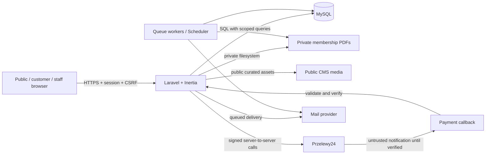

# ActiveFit — Security Architecture

> **Path:** `docs/architecture/security.md`  
> **Version:** 1.0 (2026-11-05)  
> **Status:** DRAFT — ready for review  
> **Stack:** Laravel + Inertia.js + Vue 3 + TypeScript + MySQL  
> **Scope:** public website, CMS, customer panel, staff panel, administration, membership sales, Przelewy24 and PDF delivery.

## 1. Purpose and authority

This document describes security boundaries, concrete implementation rules and testable controls for ActiveFit. It is an **architecture specification**, not a substitute for legal review or operational infrastructure configuration.

**Source of truth (priority):** confirmed decisions in `docs/product/requirements.md` → accepted ADRs in `docs/architecture/decisions/` → `docs/architecture/overview.md`, `database.md`, `cms.md`, `business-flows.md` → this document → implementation details. If documents conflict, stop the affected implementation and record an ADR; do not silently choose a rule.

**Confirmed:** `customer`, `employee`, `admin`; checkout with and without account; purchase for another holder; unlinked guest purchases; unique normalized phone and e-mail within `users`; admin created by idempotent seeder; every role manages its own profile; administrator manages employees, CMS, prices and global settings; staff searches holders and registers reception sales/entries, but cannot manage employees or global settings; audit of critical actions; mandatory PDF after confirmed payment, including advance renewals; acceptance of the published regulation version for online checkout.

**Open and security-relevant:** refund/cancellation permissions (`OD-04`), underage purchasers (`OD-07`), retention periods (`OD-11`), and exporting advanced reports (`OD-09`). Do not grant capabilities or implement destructive workflows for unresolved areas without approval.

## 2. Trust boundaries and threat model

**Protected assets:** account credentials, personal details, purchase/holder records, payment state, membership dates and balances, PDF documents, price catalogue, regulation acceptance, audit records and staff privileges.

**Primary threats:** unauthorized record access (IDOR), privilege escalation, account enumeration/brute force, guest identity confusion, forged/replayed payment callbacks, double activation or double redemption, XSS via rich-text CMS, malicious image uploads, PDF disclosure, secrets exposure and tampering with audit history.

Never trust Vue form state, route IDs, browser prices, query parameters, payment return URLs, uploaded MIME declarations or callback bodies as authority.

## 3. Authentication and account lifecycle

### 3.1 Session-based application

- Use Laravel session authentication for same-origin Inertia pages; do not introduce bearer tokens or a public API without a separately approved use case.
- Enable CSRF protection on state-changing browser routes; do not exempt ordinary checkout, CMS, login, account or staff routes. The provider callback is a separate, explicitly scoped endpoint using provider verification instead of browser CSRF.
- Enforce HTTPS in production, secure session cookies, `HttpOnly`, appropriate `SameSite`, session rotation after login, session invalidation after logout, and session expiry. Configure `SESSION_SECURE_COOKIE=true` in production and review proxy/TLS termination.
- Use Laravel password hashing (current supported hasher), framework password reset flow, strong password validation and account login throttling. Never email plaintext passwords.
- For accounts created by admin, send a single-use, time-limited password-set invitation via email; do not reveal account existence through public endpoints.
- Email is verified when registered and re-verified when changed. An unverified new email must not silently inherit sensitive access; keep sensitive contact/delivery decisions explicit.

### 3.2 Employee provisioning / suspension

- Admin creates and edits staff account data and role and can suspend access; staff cannot do this.
- Authorization middleware must check `is_active` (or equivalent) **on every protected request**; a suspended user's pre-existing session is not sufficient to continue operating. Invalidate relevant sessions when feasible and reject subsequent requests.
- Record who created, changed role or suspended an employee; do not log password hashes or reset tokens.
- Employee invitation links are short-lived, single-use and invalidated on use; rate limit redemption.

### 3.3 Initial administrator seeder

- `AdminUserSeeder` gets initial identity and secret via environment/secret manager; no default passwords or real credentials in git, tests, logs or examples.
- The seeder is idempotent and **never upgrades an existing arbitrary user matched only by email**. On collision, fail clearly and require manual authorized intervention.
- Re-running the seeder must not reset the existing admin password or change privileges unexpectedly. Provide an explicit controlled bootstrap path (e.g. unique bootstrap marker or fail-closed first deployment procedure).
- Do not leave production seed credentials exposed to runtime after provisioning.

**Implementation — TASK-007 (2026-11-13):** `AdminUserSeeder` is explicit opt-in, separate from the default/demo seeders. `config/bootstrap.php` reads `BOOTSTRAP_ADMIN_NAME`, `BOOTSTRAP_ADMIN_EMAIL`, `BOOTSTRAP_ADMIN_PHONE` and `BOOTSTRAP_ADMIN_PASSWORD`; the example environment contains only empty placeholders. Initial passwords require 12 characters with mixed case, a number and a symbol, and use the application's configured hasher. The operator-provided email is trusted/marked verified for initial panel access; no notification is sent. Contact values are normalized using the account conventions. A nullable unique `users.bootstrap_key = initial-admin` distinguishes this account from arbitrary existing admins. Creation is transactional; unique email, phone and marker constraints also protect against competing writes, with bounded transaction retries for deadlocks. Collisions fail without promotion or overwrite. Reruns for the same marked admin/email preserve every field (including password and suspension) and need only the email configuration. Changed identity or revoked admin role fails closed and requires authorized review. The marker is hidden and excluded from mass assignment. Remove bootstrap secrets from deployment/runtime configuration and any configuration cache after provisioning; rebuild caches and restart persistent processes. Tests use synthetic credentials and notification fakes. See `README.md` for local commands.

### 3.4 Personal profile for every role

- `customer`, `employee`, `admin` may update **only their own** first name, last name, normalized phone and email and may change password with verification of existing password.
- `role`, `is_active`, permission lists and historical purchase snapshots must not be mass-assignable from profile forms.
- `users.email` and normalized `users.phone` have database unique indexes. Validate in Laravel and handle race-driven unique-constraint failures with a friendly message.
- E-mail changes require re-verification. Changing profile fields never rewrites `orders`/`memberships` snapshots or previously issued PDFs.

## 4. Authorization model

Use server-side route middleware + Laravel Policies / Gates; query scoping is mandatory. UI hiding is optional UX, **not authorization**. Prefer an explicit small role/ability map over introducing a permission framework without a requirement.

Legend: **R** read, **W** write/use, **OWN** only records strictly linked to the authenticated account, **—** forbidden, **TBD** blocked pending ADR.

| Resource / operation | Guest | Customer | Employee | Admin |
|---|:---:|:---:|:---:|:---:|
| Public pages, public catalogue, published CMS | R | R | R | R |
| Checkout without account (one membership per order) | W | W | W¹ | W¹ |
| Read own profile / edit own profile / password | — | OWN | OWN | OWN |
| Own registered purchases and membership history | — | OWN | —² | —² |
| Access historical guest purchases through account linkage | — | — | — | — |
| Lookup holders by phone, including guest holders | — | — | R | R |
| View holder's membership status / entry history | — | OWN³ | R | R |
| Register one limited-entry usage | — | — | W | W |
| Reception sale (cash/card confirmation) | — | — | W | W |
| Modify plan prices and sale availability | — | — | — | W |
| Create/edit/suspend employees and assign roles | — | — | — | W |
| Edit CMS, regulations, images and settings | — | — | — | W |
| View full audit log | — | — | — | R |
| Retry failed membership PDF email | — | — | — | W |
| First-visit activation of paid membership | — | — | W | W |
| Issue refund / cancel paid membership | TBD | TBD | TBD | TBD |
| Export sensitive customer data | — | — | — | TBD |

¹ Reception purchase is a protected staff action, distinct from public checkout.  
² Staff/admin can review holder records via operational scopes, not by impersonating a customer's account.  
³ Customer access requires an explicit secure relationship to the **holder/purchase** in that account. **Matching a phone number, email address or name is never evidence of ownership.** Purchasing for someone else does not automatically grant access to that person's full account or history.

**Policy examples:** `MembershipPolicy::view`, `MembershipEntryPolicy::create`, `MembershipPlanPolicy::update`, `EmployeePolicy::manage`, `CmsPostPolicy::update`, `AuditLogPolicy::viewAny`. Controllers must authorize before reading/updating records; use scoped Eloquent queries to prevent cross-owner lookup.

## 5. Guest checkout, identity and family purchases

- Guest checkout creates no temporary account and no auto/manual merge into newly registered users (`OD-05`).
- Store a snapshot of **purchaser** and **holder** separately. Do not infer identity solely from matching contact fields. Several holders can share a phone; staff search shows distinct names and membership context.
- Unique email and normalized phone constraints apply to `users`, **not** guest order contacts. Phone normalization is consistent at registration, lookup and checkout.
- Do not expose lookup results, guest order histories or a holder's membership through an unauthenticated `?phone=...` or `?email=...` endpoint. Staff lookup requires role authorization and throttling; avoid bulk enumeration.
- Purchase for another person: contact details for PDF delivery are explicitly provided and validated; the email destination is not treated as proof of holder's account ownership.
- Guest status/document access (if later offered) requires an unpredictable expiring signed/token-based capability, scoped to exactly one order/document, never an order ID alone. Do not implement a generic public search by identity.
- Online purchase must save the accepted **published** regulation version and acceptance timestamp with the order; fail closed if no valid published version exists. Acceptance is separate from optional marketing consent.
- Rules for minors remain OPEN (`OD-07`) and must not be inferred from family purchasing functionality.

## 6. Payments and order integrity (Przelewy24)

**Security invariant:** a browser redirect / “success” URL never marks an order paid. Only a verified server-to-server result, checked against the local order, can finalize online payment.

Required flow:

1. Client submits a selected `membership_plan_id` and purchaser/holder data; the server loads the current plan, approved terms and price in integer **grosz**; ignore client-supplied price, currency, dates and approval flags.
2. Persist a pending order with immutable snapshot, unique merchant/order reference and exactly one intended membership. Registration/initiation with Przelewy24 occurs server-side; store transaction references and attempts.
3. Receive callback at a dedicated public endpoint: validate required fields, amount/currency, merchant identity and transaction references; verify notification using the provider-prescribed signature and server-to-server confirmation/verification flow. Follow **the integration guide matching the selected Przelewy24 API version**; do not implement a guessed signature algorithm.
4. Under a DB transaction and row lock / unique constraint, transition payment and order to confirmed **only once**; create no more than one membership for the order. Reject unexpected status transitions, mismatched amounts and replayed state changes.
5. Commit. Dispatch PDF/email job **after commit**. Failed email delivery changes neither payment nor membership and cannot retrigger payment processing.

Other controls:

- Store secrets in environment/secret storage, never Git or frontend JS. Never log full webhook secrets/signatures, card data or credentials.
- Rate limit checkout/payment creation and prevent duplicate button clicks **server-side**, not just in Vue.
- Distinguish network timeout/unknown payment state from confirmed failure; reconciliation must not duplicate membership issuance.
- Reception cash/card: employee records confirmed receipt of payment; `sales_channel`, `payment_method`, `paid_at` and actor are stored. Browser input cannot set arbitrary `paid_at` or override plan price without a separately authorized action.
- Refunds, cancellation and corrections (`OD-04`) are **not yet authorized flows**; do not add a generic mutation route until approved.
- Persist payment timestamps in UTC; interpret business dates in `Europe/Warsaw`.

## 7. Membership lifecycle, entries and race conditions

- All membership visibility and mutation operations are authorized against current actor and holder. Membership history, entry history and audit survive expiration.
- Monthly expiry follows the **confirmed OD-01 calendar rule** from `requirements.md`; critical date computation is a server-side tested domain operation.
- Advance renewal starts after current membership's expiry; entry-based renewal carries forward unused entries once. Different-type renewals and transfers after expiry are still OPEN; no invented conversion rules.
- One entry redemption must be **atomic**: require a valid usable membership, lock the row or use an equivalent atomic conditional update, decrement once, append a `membership_entries` record with UTC `used_at` and employee actor, and audit the operation. Never permit negative balance, double transfer or redemption against an expired/cancelled membership.
- Treat accidental double clicks and simultaneous actions as concurrency risks; an operation request ID/idempotency key is recommended in addition to DB transactions for entry registration.
- **Activation at first visit is CONFIRMED** (`ADR-001-activation`). Staff/admin may activate only a verified paid pass. Dates and actor are written once, atomically with audit. Frontend controls alone are not authorization.

## Potwierdzona reguła aktywacji — ACT-01 (2026-11-05)

**CONFIRMED:** opłacenie zakupu wydaje karnet o statusie `pending_activation`, ale **nie uruchamia** jego okresu ważności. Przy **pierwszej wizycie posiadacza** pracownik lub administrator weryfikuje właściwy karnet i uruchamia okres ważności; zapisujemy `activated_at` (UTC), `activated_by_user_id`, `starts_on` (lokalny dzień wizyty według `Europe/Warsaw`) i wyliczone `expires_on` (włącznie) według zakupionego snapshotu planu. Nie można aktywować nieopłaconego karnetu. Powtórzenie aktywacji niczego nie przelicza. Zapis aktywacji i audytu jest atomowy.

**Przedłużenia:** opłacone przedłużenie aktywnego karnetu o tym samym obsługiwanym typie ma przyszły okres od `previous.expires_on + 1 day` — **bez ponownej wizyty aktywacyjnej**. Dla karnetu, który sam jeszcze nie został aktywowany, sposób kolejkowania następnych zakupów pozostaje `OPEN`; nie przypisujemy automatycznie dat bez znanej daty startu źródła.

**PDF po opłacie:** generujemy i wysyłamy także dla `pending_activation`. Zawiera imię i nazwisko posiadacza, dane planu i komunikat „Ważność rozpocznie się przy pierwszej wizycie w klubie”; **nie zawiera fikcyjnych dat**. Dla opłaconego przedłużenia ze znanym przyszłym okresem PDF pokazuje rzeczywiste daty. Nie wymagamy automatycznej drugiej wysyłki PDF po aktywacji; ewentualne późniejsze pobranie aktualnego PDF może uwzględniać ustalone daty. Błąd e-maila nie cofa zakupu ani nie tworzy nowego karnetu.

**Granica stanów:** `orders/payments: paid` ≠ `memberships: active`. Statusy UI obejmują `awaiting_payment`, `pending_activation`, `scheduled` (przedłużenie) i `active`, a także `expired`/`exhausted` w odpowiednim kontekście. Faktyczną aktywację i wejście do klubu zapisujemy jako **różne zdarzenia**; odliczenie wejścia z karnetu limitowanego wymaga osobnej świadomej akcji, nawet jeśli odbywa się podczas tej samej wizyty.

## 8. PDF generation, storage and email

- A purchased membership PDF is required for guest and registered purchases, third-party purchases and renewals.
- Generate and queue dispatch **after successful payment confirmation**, including when membership validity starts in the future. For reception sales: after payment has been confirmed by authorized staff.
- PDF contains only the holder's **first name and last name** as personal data, plus club, plan and entry allowance where relevant. For a pending first visit it shows the activation condition instead of unknown dates; for known scheduled renewals it shows real dates. No phone/email in the PDF body; delivery address belongs only to mail transport metadata.
- Generated membership PDFs are **private**, not on the public CMS/media disk. Do not serve using predictable public filenames, direct storage URLs or unauthenticated order IDs.
- For authorized download use a controller with Policy checks, or a short-lived single-document signed URL with explicit scope and expiry. Disable public indexing and apply suitable cache headers (`private, no-store` where necessary).
- Email delivery jobs use a durable delivery record (status/attempts/last error) and bounded retries with backoff. Manual resend is administrator-only and audited. A retry is never an order or payment retry.
- Do not put unnecessary PII in e-mail subjects, application logs or queued exception text. Restrict generated PDF storage and backups; retention/deletion period is OPEN and requires policy/legal confirmation.
- Mail systems can be at-least-once: control duplicate dispatch through idempotent delivery tracking and concurrency locks; do not promise exactly-once external email delivery.

## 9. CMS security

### 9.1 Rich text and HTML

- CMS content may contain formatted HTML. Apply **server-side allowlist HTML sanitization** before storing or before rendering (define one canonical boundary and test it); allow basic formatting and safe links, prohibit scripts, event attributes, dangerous URL schemes, iframes and arbitrary embedded HTML.
- Vue must not render arbitrary content through `v-html` except fields known to have passed the approved sanitizer. Never trust HTML sanitization on the client alone.
- Set appropriate CSP and security headers after testing Inertia/Vite needs; do not weaken CSP with unrestricted `unsafe-inline` in production.

### 9.2 Image upload / removal

- Every image belongs to one CMS placement only. Validate file size, extension **and verified file content**, allowed image type, dimensions and safe processing; generate unpredictable stored names, no user-supplied paths.
- Reject SVG or other active content by default unless a separate sanitization pipeline is explicitly approved. Re-encode raster images when practical and strip metadata when unnecessary.
- Separate public CMS assets from private PDFs and backups. Public media contains no customer documents.
- On remove: authorize delete, delete the DB reference/record transactionally, then delete the physical file after commit; failed disk removal is logged and retried. Avoid deleting file first and leaving broken DB links.
- Prevent path traversal and avoid passing arbitrary filesystem paths from request data.

### 9.3 Published content, regulations and prices

- Public routes show only published/visible records. Drafts, previous regulation versions and hidden records are admin-only.
- Regulation publication records immutable versions; an order references the exact accepted version and acceptance timestamp. Historical versions must not be rewritten in place.
- The price list is sourced from `membership_plans`; plan edits require admin authorization and audit. Checkout always uses server-side plan state and order snapshot, not formatted CMS HTML.
- The max-three featured-plan rule should be validated server-side with concurrency protection where applicable.

## 10. Audit log and observability

**Required for critical actions** (confirmed `ADM-010`): staff manual sales, membership assignments/adjustments, entry redemptions, plan/pricing changes, payment state transitions, regulation publication, employee creation/role/suspension, admin PDF resends and relevant settings changes.

Recommended audit record: `actor_type`, `actor_id` (nullable for system/provider), `action`, `subject_type`, `subject_id`, `old_values`, `new_values`, `created_at`, optional request/correlation ID, channel and relevant device/IP metadata only as justified by retention policy.

- Redact secrets, credentials, passwords, reset tokens, payment secrets and unnecessary personal details from old/new values.
- Persist the audit record together with the critical database operation in the same transaction (or durable outbox where atomicity otherwise cannot be achieved).
- Audit entries are append-only for the application roles; full audit viewer is admin-only. Database administrators may still have operational access: protect at infrastructure level through permissions, backups and monitoring.
- Failed authorization attempts and payment signature failures should be logged with safe context and request identifiers, not raw payloads containing PII.
- Security and operational logs are subject to defined retention, role-restricted access and monitoring. Alert on unusual admin operations, payment verification failures, repeated login failures and delivery errors.

## 11. Privacy, retention and backups

- Data minimization: staff search shows only holder identity and membership context needed at reception; no global unrestricted export.
- Privilege separation for administrative database access, application credentials, backups and operations tooling.
- Encrypt transport via TLS; encrypt backup/media storage where supported. Use restricted filesystem permissions and secret rotation.
- Apply access controls to database backups and secure offsite copies; test restore procedure periodically.
- Decide retention periods, deletion/archival handling, legal bases and incident response with the data controller before production. **Do not claim GDPR compliance solely on the basis of this technical design.** Audit history and purchase records may have different legal retention obligations.
- If an account is disabled/deleted, avoid indiscriminate deletion of immutable order snapshots or audit entries; follow an approved retention/anonymization policy.

## 12. Deployment and operational hardening

- Use production `APP_ENV=production`, `APP_DEBUG=false`, a strong unique `APP_KEY`, strict file permissions and no `.env` in web root or git.
- Separate production and staging keys/accounts for Przelewy24, mail, sessions and databases.
- Protect queue workers and Laravel Scheduler with separate least-privilege runtime credentials; monitor failed jobs and retries.
- Set security headers (HSTS when TLS configured end-to-end, `X-Content-Type-Options: nosniff`, clickjacking prevention, CSP suited to deployed assets) and a conservative CORS policy (same origin by default).
- Dependencies are pinned by lockfiles; enable dependency vulnerability checks and secret scanning in CI. Keep Laravel and frontend dependencies supported and patched.
- Apply rate limits to login, password reset, registration, public checkout, staff searches and any temporary document link endpoints.
- Do not run arbitrary migration/seed commands from browser-accessible operations.

## 13. Required security tests (Pest / integration / E2E)

| ID | Test | Expected result |
|---|---|---|
| SEC-001 | Guest opens customer/admin/staff endpoints | Redirect/401/403; no data disclosure |
| SEC-002 | Customer requests another user's membership/order by changed ID | 403/404; data not loaded |
| SEC-003 | Registered user claims guest purchase using same phone/email | No linking or unauthorized access |
| SEC-004 | Staff calls admin settings, price or employee APIs directly | 403; no DB mutation |
| SEC-005 | Suspended staff sends request using old session | Request rejected |
| SEC-006 | Every role tries to change own role/status via profile payload | Fields ignored/rejected; privilege unchanged |
| SEC-007 | Duplicate normalized phone/email during registration under race | Database constraint blocks duplicate |
| SEC-008 | Seeder run twice; collision with existing non-admin email | No duplicate, takeover or password overwrite |
| SEC-009 | Forged/altered/replayed Przelewy24 notification | No unauthorized payment confirmation or duplicate membership |
| SEC-010 | Two workers process same confirmed payment concurrently | One paid transition, one membership, one logical PDF delivery |
| SEC-011 | Failed email followed by retries/resend | Payment/membership unchanged; audit/attempt recorded |
| SEC-012 | Customer or guest guesses private PDF URL/ID | No access without authorization or scoped token |
| SEC-013 | Malicious CMS HTML with script/event attribute/unsafe href | Sanitized; no executable payload in public view |
| SEC-014 | Malicious upload (wrong MIME, oversized, SVG, path traversal) | Rejected; no executable public file |
| SEC-015 | Two employees redeem last entry concurrently | Exactly one redemption; balance remains zero |
| SEC-016 | Employee changes plan price / regulation / global settings | 403; audit-safe rejection |
| SEC-017 | Admin updates plan or staff role; employee redeems entry | Correct actor/time/change recorded in append-only audit |
| SEC-018 | Online checkout without accepted regulation version | Cannot proceed; specific published version saved when accepted |
| SEC-019 | Search phone shared by multiple holders | Distinct records; no linking by phone; access limited to staff/admin |
| SEC-020 | Attempt to download hidden CMS drafts / old regulation via public route | Not exposed unless explicitly published |
| SEC-021 | Unauthorized or repeated first-visit activation | Customer denied (403); unpaid pass denied; repeated/concurrent activation cannot change dates; staff/admin audit recorded |

Test user-visible validation messages and failed states in Inertia pages. CI should block merge on failing critical tests and static checks.

## 14. Traceability and implementation checklist

| Security concern | Confirmed requirement / decision |
|---|---|
| Unique account identity, no guest merge, profile updates | `ACC-007`–`ACC-013`, `OD-05` |
| Separation of purchaser and holder | `ACC-005`, `BR-001`, order snapshot requirement |
| Staff search and limited permissions | `STF-001`–`STF-006` |
| Employee lifecycle, CMS and audit | `ADM-005`–`ADM-010` |
| Plan snapshot, payment confirmation, delivery | `PLN-005`, `ORD-001`, `OD-03`, `NTF-002`–`NTF-003` |
| Regulation version and protected CMS | `CMS-OD-03`–`CMS-OD-05` |
| Date and entry integrity | `OD-01`, `OD-02`, `E2E-04` |
| First-visit activation | `ADR-001-activation` — **CONFIRMED 2026-11-05** |

**Before implementation:** authorize every action, scope every object lookup, validate server-side, protect critical writes with transactions/unique constraints, record audit and add automated tests. Separate public CMS assets and private PDFs, and do not add business permissions for OPEN decisions.

## 15. Open items before production

1. **ACT-01 ACCEPTED:** implement staff/admin first-visit activation with audit. Pending PDF has no unknown dates; no longer a blocker.
2. **OD-04** — define refunds, corrections and cancellations before implementing privileges and payment transitions.
3. **OD-07** — decide minors/family legal flows and any additional authorizations.
4. **OD-09** — define scope, authorization and controls for sensitive exports.
5. **OD-11** — approve retention and deletion schedules for customer data, PDFs, audit and backups.
6. Confirm production deployment architecture, email provider and operational secret management before go-live.

---

**AI SDLC gate:** `security.md` can guide account/CMS hardening and payment integration design immediately. Treat only the remaining open business policies as implementation blockers for their respective features, not for the whole project.
